# busi.gift.groupbuy 技术图谱

## 一图技术图谱

```mermaid
flowchart LR
  naa1df2ef["Daenerys 框架"]
  n8f718eeb["GORM"]
  na05476e7["GitLab CI"]
  n7c735559["HTTP/外部接口"]
  n51be25b0["Kafka"]
  n8aa21d2e["RPC/IDL 调用"]
  ne1114467["Redis"]
  n4e96cf40["Thrift/RPC"]
  n963396c6["busi.gift.groupbuy"]
  nbfa5311d["git.inke.cn/BackendPlatform/go-tools/cast"]
  n7d7ea8b2["git.inke.cn/BackendPlatform/golang/logging"]
  ne2260199["git.inke.cn/BackendPlatform/golang/trace"]
  nfcf99e4d["git.inke.cn/bpc/server/busi/busi.gift.groupbuy"]
  n7de617ec["git.inke.cn/bpc/server/sdk/commlib"]
  n4bbf5221["git.inke.cn/bpc/server/sdk/ik"]
  n4247e5f2["git.inke.cn/bpc/server/sdk/xt"]
  n0d851172["git.inke.cn/inkelogic/daenerys"]
  n5d53f059["internal/api/code/code.go"]
  naf7887d0["internal/backend/init.go"]
  n9a3416e6["internal/business_schema/schema_groupbuy_do_it.go"]
  n46e6d6c2["internal/business_schema/schema_groupbuy_gold_not_enough.go"]
  n14676067["internal/business_schema/schema_groupbuy_no_charge.go"]
  ne50450c0["internal/dao/dao.go"]
  n057d322a["internal/dao/dao_test.go"]
  n1264fd97["internal/dao/db.go"]
  n647b44a6["internal/dao/redis.go"]
  nd05d08b9["internal/dao/table.go"]
  n09999ead["internal/manager/bill/bill.go"]
  n4421296e["internal/manager/bill/business_log.go"]
  nb2fce39d["internal/manager/billservice/Bill-consts.go"]
  n30dce2a7["internal/manager/billservice/Bill.go"]
  n280a7744["internal/manager/billservice/GoUnusedProtection__.go"]
  n86326b10["internal/model/model.go"]
  n4c552c5c["internal/server/http/handler.go"]
  n7a274952["internal/server/http/http.go"]
  n98fbf7ef["internal/server/http/router.go"]
  n110e8003["internal/service/check.go"]
  nec4ea2b3["internal/service/fsm.go"]
  n5e38f684["internal/service/service.go"]
  n0ed862e8["internal/service/service_create_team.go"]
  ne98bce54["internal/service/service_index.go"]
  nc2b3eb68["internal/service/service_join_team.go"]
  n4a49b1b9["internal/service/service_my_teams.go"]
  n888b7733["业务服务层"]
  n8d81b440["任务/定时处理"]
  n7cc1b88f["公司内部包"]
  nb682654e["外部依赖"]
  nadeed157["工程质量"]
  n8de19b79["接入层 HTTP/API"]
  n9bfbba5f["数据访问层"]
  ne9fe3e59["模型/DTO"]
  n5daeef3f["测试文件 1 个"]
  nfc56e941["领域: 礼物/打赏"]
  n8aa21d2e --> n09999ead
  n8aa21d2e --> n4421296e
  n8aa21d2e --> nb2fce39d
  n8aa21d2e --> n30dce2a7
  n8aa21d2e --> n280a7744
  n963396c6 -- "uses" --> n8aa21d2e
  n963396c6 -- "core" --> n888b7733
  n963396c6 -- "schedules" --> n8d81b440
  n963396c6 -- "imports" --> n7cc1b88f
  n963396c6 -- "depends" --> nb682654e
  n963396c6 -- "quality" --> nadeed157
  n963396c6 -- "exposes" --> n8de19b79
  n963396c6 -- "persists" --> n9bfbba5f
  n963396c6 -- "defines" --> ne9fe3e59
  n963396c6 -- "domain" --> nfc56e941
  n888b7733 --> n110e8003
  n888b7733 --> nec4ea2b3
  n888b7733 --> n5e38f684
  n888b7733 --> n0ed862e8
  n888b7733 --> ne98bce54
  n888b7733 --> nc2b3eb68
  n888b7733 --> n4a49b1b9
  n8d81b440 --> n5d53f059
  n8d81b440 --> naf7887d0
  n8d81b440 --> n9a3416e6
  n8d81b440 --> n46e6d6c2
  n8d81b440 --> n14676067
  n7cc1b88f --> nbfa5311d
  n7cc1b88f --> n7d7ea8b2
  n7cc1b88f --> ne2260199
  n7cc1b88f --> nfcf99e4d
  n7cc1b88f --> n7de617ec
  n7cc1b88f --> n4bbf5221
  n7cc1b88f --> n4247e5f2
  n7cc1b88f --> n0d851172
  nb682654e --> naa1df2ef
  nb682654e --> n8f718eeb
  nb682654e --> n7c735559
  nb682654e --> n51be25b0
  nb682654e --> ne1114467
  nb682654e --> n4e96cf40
  nadeed157 --> na05476e7
  nadeed157 --> n5daeef3f
  n8de19b79 --> n4c552c5c
  n8de19b79 --> n7a274952
  n8de19b79 --> n98fbf7ef
  n9bfbba5f --> ne50450c0
  n9bfbba5f --> n057d322a
  n9bfbba5f --> n1264fd97
  n9bfbba5f --> n647b44a6
  n9bfbba5f --> nd05d08b9
  ne9fe3e59 --> n86326b10
```


## 项目定位
- 源码路径：`/Users/dds/go/src/git.inke.cn/bpc/server/busi/busi.gift.groupbuy`
- 领域判断：礼物/打赏
- README 摘要：busi.gift.groupbuy

```text
# busi.gift.groupbuy
## 项目简介
## 配置说明
## CHANGELOG
```

## 静态结构画像
- 文本/代码文件数：48
- Go 文件数：40
- 文件类型分布：.go(40), .md(2), .json(2), .toml(2), .yml(1), .thrift(1)
- 顶层目录分布：internal(40), app(4)

## 关键目录
- `internal`: 40 个文本/代码文件
- `app`: 4 个文本/代码文件

## 代码分层
- 接入层文件：3 个
- 服务层文件：13 个
- 数据访问文件：5 个
- 模型文件：1 个
- 任务/定时相关文件：20 个
- RPC/IDL 相关文件：7 个

## API/路由线索
- 静态扫描未提取到显式路由字符串，需结合框架注册/网关配置确认

## 核心类型与方法线索
- 导出结构体：Result, Dao, TeamInfo, TeamMember, IdempotencyKey, OfflineActivityReq, TeamDetailReq, TaskDetailReq, TeamListReq, MyTeamsReq, CreateTeamReq, JoinTeamReq, QuickJoinTeamReq, Manager, BillThriftException, BillContent, GiftContent, SilverContent, SeqResult_, BillResult_, BalanceContent, BalanceResult_, BillParam, BillDetailParam, Model, ActivityConfig, TaskConfig, ActConfig, Service, MyTeamVO
- 导出函数/方法：ExportMain, GetShipBizKey, GetRefundBizKey, GroupedMap, FindGroupingTeams, FindGroupingMembers, HasJoinTeam, HasCreateTeam, AvailableTeams, CheckTeamGroupSuccess, CheckTeamRefundSuccess, CheckTeamShipSuccess, FindTeamInfosByTaskID, FindTeamInfoByID, FindTeamInfosByIDs, FindTeamMembersByTeamID, FindMyTeams, TerminateActivity, CreateTeam, LockSeat, UnLockSeat, IdempotencyOrderID, SyncTopMembers, MemberPaid, MemberShipping, MemberRefunding, TeamRefunded, MemberShipped, MemberRefunded, TeamShipped

## 外部依赖线索
- Daenerys 框架: 13 处信号
- HTTP/外部接口: 6 处信号
- GORM: 4 处信号
- Redis: 4 处信号
- Thrift/RPC: 4 处信号
- Kafka: 1 处信号

## 内部依赖线索
- `git.inke.cn/bpc/server/busi/busi.gift.groupbuy`: 78
- `git.inke.cn/bpc/server/sdk/commlib`: 22
- `git.inke.cn/BackendPlatform/golang/logging`: 14
- `git.inke.cn/bpc/server/sdk/ik`: 7
- `git.inke.cn/inkelogic/daenerys`: 6
- `git.inke.cn/BackendPlatform/go-tools/cast`: 5
- `git.inke.cn/bpc/server/sdk/xt`: 3
- `git.inke.cn/BackendPlatform/golang/trace`: 3
- `git.inke.cn/bpc/server/sdk/co`: 3
- `git.inke.cn/inkelogic/daenerys/http/server`: 3
- `git.inke.cn/inkelogic/daenerys/proxy`: 2
- `git.inke.cn/bpc/server/sdk/ka`: 2

## 第三方 import 概览
- github.com(14), os(3), git.apache.org(3), bytes(3), slices(3), log(1), syscall(1), flag(1), testing(1), crypto(1)

## IDL/协议文件
- `internal/manager/billservice/BillService.thrift`

## 工程质量与交付
- GitLab CI：有
- golangci-lint：未发现
- 测试文件：
- `internal/dao/dao_test.go`

## 阅读建议
- 先读 README 和 `server/http`、`handler`、`service` 目录，确认入口 API 与核心业务流程。
- 再沿服务层方法进入 DAO/Repo/Model，确认数据表、缓存 Key、RPC 调用和异步任务。
- 若图中只出现少量节点，通常表示该项目是配置型/胶水型服务，需结合上层共享工程和部署配置继续确认。
