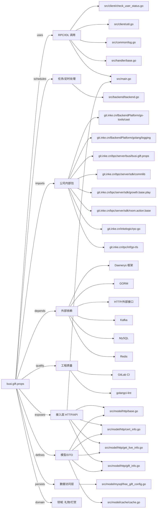

# busi.gift.props 技术图谱

## 一图技术图谱


## 项目定位
- 源码路径：`/Users/dds/go/src/git.inke.cn/bpc/server/busi/busi.gift.props`
- 领域判断：礼物/打赏
- README 摘要：道具服务设计文档：http://wiki.inkept.cn/pages/viewpage.action?pageId=50838328

```text
道具服务设计文档：http://wiki.inkept.cn/pages/viewpage.action?pageId=50838328
```

## 静态结构画像
- 文本/代码文件数：62
- Go 文件数：55
- 文件类型分布：.go(55), .yml(2), .toml(2), .md(1), .json(1), .proto(1)
- 顶层目录分布：src(57), conf(2)

## 关键目录
- `src`: 57 个文本/代码文件
- `conf`: 2 个文本/代码文件

## 代码分层
- 接入层文件：8 个
- 服务层文件：0 个
- 数据访问文件：1 个
- 模型文件：17 个
- 任务/定时相关文件：1 个
- RPC/IDL 相关文件：15 个

## API/路由线索
- 静态扫描未提取到显式路由字符串，需结合框架注册/网关配置确认

## 核心类型与方法线索
- 导出结构体：GetPropByTagsHandler, GetPropByTagsReq, GetPropsListResp, GetRelationBagDetailHandler, GetRelationBagDetailResp, GetPropByTagHandler, GetPropByTagReq, GetPropListResp, GetRelationBagHandler, GiftStockGetHandler, BaseHandler, PropGcmsgReq, PropGcmsgHandler, PropGrowthSendReq, GiftCritRes, PropGrowthSendHandler, UpdateRelationBagHandler, PropNumReq, PropNumHandler, RelationBagPropReduce, ReduceRelationBagReq, RelationBagSendGiftHandler, RelationBagSendGiftResp, GetHornInfoHandler, ContentItem, SendPropsGiftEffectParam, Config, FreeGiftConfig, RelationBagGift, SingleGiftInfo
- 导出函数/方法：Validate, PreProcess, Process, Serve, PreProcess, Process, Serve, Validate, PreProcess, Process, Serve, PreProcess, Process, PostProcess, Validate, PreProcess, Process, PostProcess, New, Serve, RequestDecode, Validate, PreProcess, Process, PostProcess, Validate, PreProcess, Process, PostProcess, PreProcess

## 外部依赖线索
- HTTP/外部接口: 29 处信号
- Redis: 11 处信号
- Kafka: 9 处信号
- GORM: 4 处信号
- MySQL: 2 处信号
- Daenerys 框架: 1 处信号

## 内部依赖线索
- `git.inke.cn/bpc/server/busi/busi.gift.props`: 74
- `git.inke.cn/BackendPlatform/golang/logging`: 46
- `git.inke.cn/inkelogic/rpc-go`: 11
- `git.inke.cn/bpc/server/sdk/commlib`: 4
- `git.inke.cn/BackendPlatform/go-tools/cast`: 3
- `git.inke.cn/bpc/server/sdk/growth.base.play`: 2
- `git.inke.cn/tpc/inf/go-tls`: 2
- `git.inke.cn/bpc/server/sdk/room.action.base`: 2
- `git.inke.cn/BackendPlatform/golang/safego`: 2
- `git.inke.cn/BackendPlatform/golang/trace`: 2
- `git.inke.cn/bpc/server/sdk/busi.privilege.fans_relation`: 2
- `git.inke.cn/bpc/server/sdk/room.msg.base`: 2

## 第三方 import 概览
- golang.org(23), github.com(14), runtime(5), os(3), bytes(3), io(2), unsafe(2), flag(1), go.uber.org(1)

## IDL/协议文件
- `src/client/pb/prop.proto`

## 工程质量与交付
- GitLab CI：有
- golangci-lint：有
- 测试文件：
- 未发现 `_test.go`

## 阅读建议
- 先读 README 和 `server/http`、`handler`、`service` 目录，确认入口 API 与核心业务流程。
- 再沿服务层方法进入 DAO/Repo/Model，确认数据表、缓存 Key、RPC 调用和异步任务。
- 若图中只出现少量节点，通常表示该项目是配置型/胶水型服务，需结合上层共享工程和部署配置继续确认。
