# busi.gift.user-bag-business 技术图谱

## 一图技术图谱

```mermaid
flowchart LR
  naa1df2ef["Daenerys 框架"]
  n8f718eeb["GORM"]
  na05476e7["GitLab CI"]
  n7c735559["HTTP/外部接口"]
  n51be25b0["Kafka"]
  n62a004b9["MySQL"]
  n8aa21d2e["RPC/IDL 调用"]
  ne1114467["Redis"]
  na77466bb["backend/add_bag_source_monitor.go"]
  n0128482d["backend/create_bag_record_table.go"]
  n7a224e78["backend/init.go"]
  n8516eb60["backend/room_enter_leave_monitor.go"]
  n19e382aa["backend/send_gift_monitor.go"]
  nc7f2db34["backend/user_bag_end_notify.go"]
  nf9337dfb["backend/user_bag_end_tips.go"]
  n5c9e467c["busi.gift.user-bag-business"]
  na922d355["client/client_utils.go"]
  n36b1a541["client/pb/push.pb.go"]
  nd334e7f6["dao/consume_normal_bag.go"]
  n32d6889b["dao/db.go"]
  nc12e8a73["dao/db_utils.go"]
  ndb8261f6["dao/db_utils_test.go"]
  nc0b08acd["dao/kafka.go"]
  n62d49182["dao/monitor_util.go"]
  n17aa4db9["dao/redis.go"]
  nbfa5311d["git.inke.cn/BackendPlatform/go-tools/cast"]
  n7d7ea8b2["git.inke.cn/BackendPlatform/golang/logging"]
  n14b7f193["git.inke.cn/BackendPlatform/golang/safego"]
  ne2260199["git.inke.cn/BackendPlatform/golang/trace"]
  n1a046419["git.inke.cn/bpc/server/busi/busi.gift.user-bag-business"]
  nba1d1b77["git.inke.cn/bpc/server/sdk/room.live.base"]
  n961ac33a["git.inke.cn/inkelogic/rpc-go"]
  n86564f77["git.inke.cn/tpc/inf/metrics"]
  ne7b37ee1["golangci-lint"]
  n127fac3e["handler/get_bag_record.go"]
  nbb8ccae4["handler/init.go"]
  n20a313f2["model/const.go"]
  necbb38dc["model/global.go"]
  n167f1e86["model/impl.go"]
  nc31b8654["model/model.go"]
  n3a801941["model/tb/bag_black.go"]
  n8d81b440["任务/定时处理"]
  n7cc1b88f["公司内部包"]
  nb682654e["外部依赖"]
  nadeed157["工程质量"]
  n8de19b79["接入层 HTTP/API"]
  n9bfbba5f["数据访问层"]
  ne9fe3e59["模型/DTO"]
  n61bcdcb7["测试文件 5 个"]
  n60c5380b["领域: 充值/计费支撑"]
  nfc56e941["领域: 礼物/打赏"]
  n8aa21d2e --> na77466bb
  n8aa21d2e --> n8516eb60
  n8aa21d2e --> n19e382aa
  n8aa21d2e --> na922d355
  n8aa21d2e --> n36b1a541
  n5c9e467c -- "uses" --> n8aa21d2e
  n5c9e467c -- "schedules" --> n8d81b440
  n5c9e467c -- "imports" --> n7cc1b88f
  n5c9e467c -- "depends" --> nb682654e
  n5c9e467c -- "quality" --> nadeed157
  n5c9e467c -- "exposes" --> n8de19b79
  n5c9e467c -- "persists" --> n9bfbba5f
  n5c9e467c -- "defines" --> ne9fe3e59
  n5c9e467c -- "domain" --> n60c5380b
  n5c9e467c -- "domain" --> nfc56e941
  n8d81b440 --> na77466bb
  n8d81b440 --> n0128482d
  n8d81b440 --> n7a224e78
  n8d81b440 --> nc7f2db34
  n8d81b440 --> nf9337dfb
  n7cc1b88f --> nbfa5311d
  n7cc1b88f --> n7d7ea8b2
  n7cc1b88f --> n14b7f193
  n7cc1b88f --> ne2260199
  n7cc1b88f --> n1a046419
  n7cc1b88f --> nba1d1b77
  n7cc1b88f --> n961ac33a
  n7cc1b88f --> n86564f77
  nb682654e --> naa1df2ef
  nb682654e --> n8f718eeb
  nb682654e --> n7c735559
  nb682654e --> n51be25b0
  nb682654e --> n62a004b9
  nb682654e --> ne1114467
  nadeed157 --> na05476e7
  nadeed157 --> ne7b37ee1
  nadeed157 --> n61bcdcb7
  n8de19b79 --> n127fac3e
  n8de19b79 --> nbb8ccae4
  n9bfbba5f --> nd334e7f6
  n9bfbba5f --> n32d6889b
  n9bfbba5f --> nc12e8a73
  n9bfbba5f --> ndb8261f6
  n9bfbba5f --> nc0b08acd
  n9bfbba5f --> n62d49182
  n9bfbba5f --> n17aa4db9
  ne9fe3e59 --> n20a313f2
  ne9fe3e59 --> necbb38dc
  ne9fe3e59 --> n167f1e86
  ne9fe3e59 --> nc31b8654
  ne9fe3e59 --> n3a801941
```


## 项目定位
- 源码路径：`/Users/dds/go/src/git.inke.cn/bpc/server/busi/busi.gift.user-bag-business`
- 领域判断：礼物/打赏, 充值/计费支撑
- README 摘要：用户背包服务

```text
# 用户背包服务
## 目录
- [开始](#开始)
- [服务信息](#服务信息)
- [关键结构](#关键结构)
- [api列表](#接口列表)
- [下游依赖](#下游依赖)
- [数据存储](#数据存储)
- [mysql](#mysql)
- [redis](#redis)
- [kafka](#kafka)
- [风控](#风控)
```

## 静态结构画像
- 文本/代码文件数：79
- Go 文件数：69
- 文件类型分布：.go(69), .toml(4), .yml(2), .md(1), .json(1), .proto(1), .sql(1)
- 顶层目录分布：handler(24), backend(11), dao(9), model(9), utils(8), client(7), conf(4), datalog(1), Godeps(1), sql(1)

## 关键目录
- `handler`: 24 个文本/代码文件
- `backend`: 11 个文本/代码文件
- `dao`: 9 个文本/代码文件
- `model`: 9 个文本/代码文件
- `utils`: 8 个文本/代码文件
- `client`: 7 个文本/代码文件
- `conf`: 4 个文本/代码文件
- `datalog`: 1 个文本/代码文件
- `Godeps`: 1 个文本/代码文件
- `sql`: 1 个文本/代码文件

## 代码分层
- 接入层文件：2 个
- 服务层文件：0 个
- 数据访问文件：9 个
- 模型文件：9 个
- 任务/定时相关文件：9 个
- RPC/IDL 相关文件：12 个

## API/路由线索
- 静态扫描未提取到显式路由字符串，需结合框架注册/网关配置确认

## 核心类型与方法线索
- 导出结构体：EggbeaterShowBagReq, EggbeaterShowBagResp, EggbeaterShowBagHandler, AppHandler, Route, GetGiftStockReq, GetGiftStockResp, GiftStock, GetGiftStockHandler, AddBagItemTmpReq, AddBagItemTmpResp, AddBagItemTmpHandler, CheckAggregationShowHandler, CheckAggregationShowReq, CheckAggregationShowResp, ConsumeBatchHandler, QueryAllRelationBagInfoHandler, QueryAllRelationBagReq, QueryAllRelationBagResp, RelationBagInfo, GiftSimpleInfo, NewPlayRoomInfoResponse, NewRoomDataType, RoomInfo, PlayRoomInfoRequest, NormalBatchConsumer, GetBagInfosReq, GetBagInfosResp, GetBagInfosHandler, AddBagItemSecureReq
- 导出函数/方法：Validate, HandlerName, ReqParam, Serve, Serve, Get, Post, PostOnly, Handler, Validate, HandlerName, ReqParam, Serve, Validate, HandlerName, ReqParam, Serve, Validate, HandlerName, ReqParam, Serve, Validate, HandlerName, ReqParam, Serve, GetBagInfo, PostConsumeBatch, GenerateOrderID, QueryUserBagInfo, QueryRoomRelationBagInfo

## 外部依赖线索
- HTTP/外部接口: 23 处信号
- Kafka: 11 处信号
- GORM: 9 处信号
- Redis: 7 处信号
- Daenerys 框架: 4 处信号
- MySQL: 2 处信号

## 内部依赖线索
- `git.inke.cn/bpc/server/busi/busi.gift.user-bag-business`: 107
- `git.inke.cn/BackendPlatform/golang/logging`: 44
- `git.inke.cn/inkelogic/rpc-go`: 12
- `git.inke.cn/BackendPlatform/go-tools/cast`: 7
- `git.inke.cn/BackendPlatform/golang/trace`: 7
- `git.inke.cn/tpc/inf/metrics`: 5
- `git.inke.cn/bpc/server/sdk/room.live.base`: 4
- `git.inke.cn/BackendPlatform/golang/safego`: 3
- `git.inke.cn/bpc/server/sdk/shanyin.server.serviceinfo`: 2
- `git.inke.cn/bpc/server/sdk/room.action.base`: 2
- `git.inke.cn/bpc/server/sdk/separate`: 2
- `git.inke.cn/BackendPlatform/golang/sql`: 2

## 第三方 import 概览
- github.com(16), bytes(5), testing(5), go.uber.org(5), golang.org(4), runtime(4), os(2), crypto(2), database(2), io(2)

## IDL/协议文件
- `client/pb/push.proto`

## 工程质量与交付
- GitLab CI：有
- golangci-lint：有
- 测试文件：
- `dao/redis_utils_test.go`
- `dao/db_utils_test.go`
- `utils/errors_test.go`
- `utils/robot_test.go`
- `backend/add_bag_source_monitor_test.go`

## 阅读建议
- 先读 README 和 `server/http`、`handler`、`service` 目录，确认入口 API 与核心业务流程。
- 再沿服务层方法进入 DAO/Repo/Model，确认数据表、缓存 Key、RPC 调用和异步任务。
- 若图中只出现少量节点，通常表示该项目是配置型/胶水型服务，需结合上层共享工程和部署配置继续确认。
