# busi.gift.user_growth 技术图谱

## 一图技术图谱

```mermaid
flowchart LR
  n8f718eeb["GORM"]
  n7c735559["HTTP/外部接口"]
  n51be25b0["Kafka"]
  n62a004b9["MySQL"]
  n8aa21d2e["RPC/IDL 调用"]
  ne1114467["Redis"]
  n4e96cf40["Thrift/RPC"]
  n963499f8["busi.gift.user_growth"]
  ne6f54790["git.inke.cn/BackendPlatform/golang/kafka"]
  n7d7ea8b2["git.inke.cn/BackendPlatform/golang/logging"]
  na283f7b0["git.inke.cn/BackendPlatform/golang/redis"]
  nec5c5812["git.inke.cn/BackendPlatform/golang/sql"]
  na2bf8a4f["git.inke.cn/BackendPlatform/thrift_go/v2"]
  na4dd1430["git.inke.cn/bpc/server/busi/busi.gift.user_growth"]
  n58d5ea77["git.inke.cn/bpc/server/sdk/shanyin.server.serviceinfo"]
  n961ac33a["git.inke.cn/inkelogic/rpc-go"]
  n6c824a12["src/backend/first_login_kafka.go"]
  nb6f7a171["src/backend/first_login_kafka_test.go"]
  nd440d6c6["src/backend/init.go"]
  n9fe1f888["src/backend/nova_push.go"]
  ne0e61aa0["src/billservice/Bill-consts.go"]
  nc03120c8["src/billservice/Bill.go"]
  n2fffb814["src/billservice/GoUnusedProtection__.go"]
  nc9d0e9dc["src/common/const.go"]
  na88d1d7c["src/dao/init.go"]
  n63d88ca0["src/dao/lucky_gift.go"]
  n441a2466["src/dao/nick_portrait_prompt.go"]
  n58c38120["src/dao/nova_info.go"]
  n197ea02b["src/dao/nova_popup_times.go"]
  n677c5248["src/dao/one_key_follow.go"]
  n84a2397a["src/dao/paopao_reveal.go"]
  nfbf83367["src/dao/whitelist.go"]
  ne2faa0bd["src/handler/init.go"]
  nc99d8456["src/model/db.go"]
  n47a82c2a["src/model/table/luck_gift_draw_conf.go"]
  n01b216bf["src/model/table/lucky_gift_award_fail.go"]
  n2bfba062["src/model/table/lucky_gift_award_record.go"]
  nbc84f209["src/model/table/nova_act_proxy.go"]
  n668f7e0b["src/service/get_nova_info.go"]
  n746f8648["src/service/get_nova_popup_info.go"]
  nfdf1221c["src/service/gift_pack_pop.go"]
  na17338df["src/service/gift_wall_float_window.go"]
  n47fe0d55["src/service/lucky_gift.go"]
  n072c01c9["src/service/nova_coupon.go"]
  nc6b24c4d["src/service/one_key_follow.go"]
  n888b7733["业务服务层"]
  n8d81b440["任务/定时处理"]
  n7cc1b88f["公司内部包"]
  nb682654e["外部依赖"]
  nadeed157["工程质量"]
  n8de19b79["接入层 HTTP/API"]
  n9bfbba5f["数据访问层"]
  ne9fe3e59["模型/DTO"]
  n0f632d9e["测试文件 3 个"]
  n015f7fd2["领域: 增长/玩法"]
  nfc56e941["领域: 礼物/打赏"]
  n8aa21d2e --> nb6f7a171
  n8aa21d2e --> nd440d6c6
  n8aa21d2e --> ne0e61aa0
  n8aa21d2e --> nc03120c8
  n8aa21d2e --> n2fffb814
  n963499f8 -- "uses" --> n8aa21d2e
  n963499f8 -- "core" --> n888b7733
  n963499f8 -- "schedules" --> n8d81b440
  n963499f8 -- "imports" --> n7cc1b88f
  n963499f8 -- "depends" --> nb682654e
  n963499f8 -- "quality" --> nadeed157
  n963499f8 -- "exposes" --> n8de19b79
  n963499f8 -- "persists" --> n9bfbba5f
  n963499f8 -- "defines" --> ne9fe3e59
  n963499f8 -- "domain" --> n015f7fd2
  n963499f8 -- "domain" --> nfc56e941
  n888b7733 --> n668f7e0b
  n888b7733 --> n746f8648
  n888b7733 --> nfdf1221c
  n888b7733 --> na17338df
  n888b7733 --> n47fe0d55
  n888b7733 --> n072c01c9
  n888b7733 --> nc6b24c4d
  n8d81b440 --> n6c824a12
  n8d81b440 --> n9fe1f888
  n8d81b440 --> nc9d0e9dc
  n8d81b440 --> n84a2397a
  n8d81b440 --> nfbf83367
  n7cc1b88f --> ne6f54790
  n7cc1b88f --> n7d7ea8b2
  n7cc1b88f --> na283f7b0
  n7cc1b88f --> nec5c5812
  n7cc1b88f --> na2bf8a4f
  n7cc1b88f --> na4dd1430
  n7cc1b88f --> n58d5ea77
  n7cc1b88f --> n961ac33a
  nb682654e --> n8f718eeb
  nb682654e --> n7c735559
  nb682654e --> n51be25b0
  nb682654e --> n62a004b9
  nb682654e --> ne1114467
  nb682654e --> n4e96cf40
  nadeed157 --> n0f632d9e
  n8de19b79 --> nc9d0e9dc
  n8de19b79 --> ne2faa0bd
  n9bfbba5f --> na88d1d7c
  n9bfbba5f --> n63d88ca0
  n9bfbba5f --> n441a2466
  n9bfbba5f --> n58c38120
  n9bfbba5f --> n197ea02b
  n9bfbba5f --> n677c5248
  n9bfbba5f --> n84a2397a
  ne9fe3e59 --> nc99d8456
  ne9fe3e59 --> n47a82c2a
  ne9fe3e59 --> n01b216bf
  ne9fe3e59 --> n2bfba062
  ne9fe3e59 --> nbc84f209
```


## 项目定位
- 源码路径：`/Users/dds/go/src/git.inke.cn/bpc/server/busi/busi.gift.user_growth`
- 领域判断：礼物/打赏, 增长/玩法
- README 摘要：需求汇总

```text
# 需求汇总
## 新用户主路径on boarding
* 需求文档：http://wiki.inkept.cn/pages/viewpage.action?pageId=41770535
* 接口文档：http://wiki.inkept.cn/pages/viewpage.action?pageId=44831728
## 默认昵称&默认头像用户私信通知
* 需求文档：http://wiki.inkept.cn/pages/viewpage.action?pageId=41772576
## 新用户欢迎语
* 需求信息：
> 目前希望给新注册用户触发私信消息，详情如下：
>
>  ​1. 触发消息类型：私信
>  2. 接收方：新注册用户
```

## 静态结构画像
- 文本/代码文件数：95
- Go 文件数：85
- 文件类型分布：.go(85), .json(5), .toml(2), .md(1), .thrift(1), .proto(1)
- 顶层目录分布：src(88), conf(6)

## 关键目录
- `src`: 88 个文本/代码文件
- `conf`: 6 个文本/代码文件

## 代码分层
- 接入层文件：2 个
- 服务层文件：8 个
- 数据访问文件：11 个
- 模型文件：8 个
- 任务/定时相关文件：9 个
- RPC/IDL 相关文件：20 个

## API/路由线索
- 静态扫描未提取到显式路由字符串，需结合框架注册/网关配置确认

## 核心类型与方法线索
- 导出结构体：GetNovaInfoHandler, UserEnterAppHandler, AppHandler, GetDrawNoticeHandler, GetDrawRecordHandler, GiftWallFloatWindowHandler, GetNovaPopupInfoHandler, FirstChargeGiftPackPopHandler, OneKeyFollowHandler, GetCouponInfoHandler, ConsumeCouponHandler, IssueCouponHandler, DrawConfRedisModel, Whitelist, RedisLockClient, OneKeyFollowRedisModel, NovaInfoRedisModel, ApiProxyRdsModel, Request, WowHttp, GiftThrift, UserLoginKafkaModel, FeedPublishKafkaModel, JoinRoomKafkaModel, SendGiftKafkaModel, SendGiftKafka, UserChargeKafkaModel, RoomPublishKafkaModel, KafkaHandler, Ios_
- 导出函数/方法：Serve, Serve, Serve, Wrapper, Get, Post, Validate, Handler, Serve, Serve, Serve, Serve, Serve, Serve, InitServer, Serve, Serve, Serve, SetNovaPopupTimes, GetNovaPopupTimes, AddMaiMengMessageTask, CheckMaiMengMessageTask, DelMaiMengMessageTask, GetDrawPoolKey, GetDrawDataKey, GetDrawReleaseKey, GetLockSendPrizeKey, GetLockInitPoolKey, GetAllDrawConf, IncrDrawPoolAccount

## 外部依赖线索
- HTTP/外部接口: 28 处信号
- Redis: 18 处信号
- Kafka: 10 处信号
- GORM: 8 处信号
- Thrift/RPC: 7 处信号
- MySQL: 1 处信号

## 内部依赖线索
- `git.inke.cn/bpc/server/busi/busi.gift.user_growth`: 150
- `git.inke.cn/BackendPlatform/golang/logging`: 22
- `git.inke.cn/inkelogic/rpc-go`: 16
- `git.inke.cn/BackendPlatform/golang/kafka`: 7
- `git.inke.cn/BackendPlatform/golang/redis`: 3
- `git.inke.cn/bpc/server/sdk/shanyin.server.serviceinfo`: 2
- `git.inke.cn/BackendPlatform/thrift_go/v2`: 1
- `git.inke.cn/BackendPlatform/golang/sql`: 1
- `git.inke.cn/inkelogic/rpc-go/desc`: 1

## 第三方 import 概览
- github.com(13), golang.org(11), io(6), os(5), bytes(5), flag(4), testing(3), git.apache.org(2), crypto(1), runtime(1)

## IDL/协议文件
- `src/billservice/BillService.thrift`
- `src/client/linkroommsg/linkroommsg.proto`

## 工程质量与交付
- GitLab CI：未发现
- golangci-lint：未发现
- 测试文件：
- `src/dao/redis_lock_test.go`
- `src/backend/first_login_kafka_test.go`
- `src/manager/nova_test.go`

## 阅读建议
- 先读 README 和 `server/http`、`handler`、`service` 目录，确认入口 API 与核心业务流程。
- 再沿服务层方法进入 DAO/Repo/Model，确认数据表、缓存 Key、RPC 调用和异步任务。
- 若图中只出现少量节点，通常表示该项目是配置型/胶水型服务，需结合上层共享工程和部署配置继续确认。
