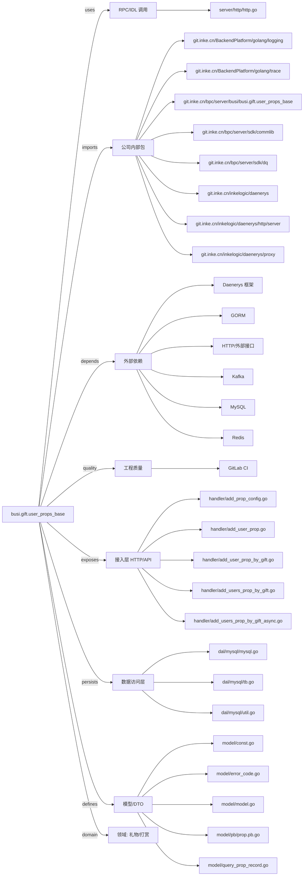

# busi.gift.user_props_base 技术图谱

## 一图技术图谱


## 项目定位
- 源码路径：`/Users/dds/go/src/git.inke.cn/bpc/server/busi/busi.gift.user_props_base`
- 领域判断：礼物/打赏
- README 摘要：busi.gift.user_props_base

```text
# busi.gift.user_props_base
相关wiki：https://wiki.inkept.cn/pages/viewpage.action?pageId=71914166
道具库存服务
```

## 静态结构画像
- 文本/代码文件数：45
- Go 文件数：39
- 文件类型分布：.go(39), .toml(2), .md(1), .yml(1), .json(1), .proto(1)
- 顶层目录分布：handler(22), dal(7), model(6), app(4), server(2), backend(1), conf(1)

## 关键目录
- `handler`: 22 个文本/代码文件
- `dal`: 7 个文本/代码文件
- `model`: 6 个文本/代码文件
- `app`: 4 个文本/代码文件
- `server`: 2 个文本/代码文件
- `backend`: 1 个文本/代码文件
- `conf`: 1 个文本/代码文件

## 代码分层
- 接入层文件：20 个
- 服务层文件：0 个
- 数据访问文件：3 个
- 模型文件：5 个
- 任务/定时相关文件：0 个
- RPC/IDL 相关文件：1 个

## API/路由线索
- 静态扫描未提取到显式路由字符串，需结合框架注册/网关配置确认

## 核心类型与方法线索
- 导出结构体：AddUsersPropByGiftAsyncReq, BaseResp, StockItem, AddUsersPropByGiftReq, AddUsersPropByGiftResp, UserProp, KafkaMsg, GiftPropInfo, Stock, StockList, RdsDao, KafkaDao, PropConfig, PropRecord, PropRecordV2, UserProp, MysqlDao, Config
- 导出函数/方法：StartAddUsersPropAsync, AddUsersPropByGiftAsync, AdminQueryDetail, ConsumeUserPropByGift, GetPropRecords, QueryUserProp, UpdateUserPropsByReceivers, UpdateUserProps, RenewUserPropEndTime, SafeGiftID, CalStock, AddPropConfig, Error, Code, Message, Equal, QueryUserPropByGift, AddUserProp, AdminDelUserProp, ConsumeUserProp, GetPropTotalNum, GetPropConfig, RenewUserProp, GetConsumeSummary, AdminQueryUserProp, Init, SyncPropConfigTags, AddUserPropByGift, AddUsersPropByGift, Init

## 外部依赖线索
- Daenerys 框架: 26 处信号
- HTTP/外部接口: 21 处信号
- Kafka: 12 处信号
- MySQL: 11 处信号
- Redis: 4 处信号
- GORM: 2 处信号

## 内部依赖线索
- `git.inke.cn/bpc/server/busi/busi.gift.user_props_base`: 51
- `git.inke.cn/BackendPlatform/golang/logging`: 27
- `git.inke.cn/inkelogic/daenerys/http/server`: 20
- `git.inke.cn/bpc/server/sdk/commlib`: 6
- `git.inke.cn/BackendPlatform/golang/trace`: 4
- `git.inke.cn/bpc/server/sdk/dq`: 3
- `git.inke.cn/inkelogic/daenerys`: 3
- `git.inke.cn/inkelogic/daenerys/proxy`: 3
- `git.inke.cn/BackendPlatform/golang/safego`: 2
- `git.inke.cn/BackendPlatform/go-tools/cast`: 2
- `git.inke.cn/bpc/server/sdk/busi.gift.wall`: 1
- `git.inke.cn/bpc/server/sdk/room.action.base`: 1

## 第三方 import 概览
- github.com(18), go.uber.org(2), golang.org(2), os(2), unsafe(2), flag(1), log(1), syscall(1), io(1)

## IDL/协议文件
- `model/pb/prop.proto`

## 工程质量与交付
- GitLab CI：有
- golangci-lint：未发现
- 测试文件：
- 未发现 `_test.go`

## 阅读建议
- 先读 README 和 `server/http`、`handler`、`service` 目录，确认入口 API 与核心业务流程。
- 再沿服务层方法进入 DAO/Repo/Model，确认数据表、缓存 Key、RPC 调用和异步任务。
- 若图中只出现少量节点，通常表示该项目是配置型/胶水型服务，需结合上层共享工程和部署配置继续确认。
