# busi.gift.wall 技术图谱

## 一图技术图谱

```mermaid
flowchart LR
  naa1df2ef["Daenerys 框架"]
  n8f718eeb["GORM"]
  na05476e7["GitLab CI"]
  n7c735559["HTTP/外部接口"]
  n51be25b0["Kafka"]
  n62a004b9["MySQL"]
  n8aa21d2e["RPC/IDL 调用"]
  ne1114467["Redis"]
  n1ea47879["busi.gift.wall"]
  nbfa5311d["git.inke.cn/BackendPlatform/go-tools/cast"]
  n7d7ea8b2["git.inke.cn/BackendPlatform/golang/logging"]
  n14b7f193["git.inke.cn/BackendPlatform/golang/safego"]
  ne2260199["git.inke.cn/BackendPlatform/golang/trace"]
  n79b188ad["git.inke.cn/bpc/server/busi/busi.gift.wall"]
  n780a94b0["git.inke.cn/bpc/server/sdk/commconst"]
  n7de617ec["git.inke.cn/bpc/server/sdk/commlib"]
  n58d5ea77["git.inke.cn/bpc/server/sdk/shanyin.server.serviceinfo"]
  ne7b37ee1["golangci-lint"]
  na016128d["src/backend/backend.go"]
  n0e388778["src/backend/update_app_exp.go"]
  na27145f6["src/backend/update_gift_wall_dynamic_info.go"]
  n2cbc52f2["src/globals/globals.go"]
  n67e6a8d7["src/handler/base.go"]
  n13c7eed9["src/handler/gift_filter.go"]
  n67d67e1e["src/handler/gift_wall_dynamic_infos.go"]
  n79ee049c["src/main.go"]
  na34acbce["src/utils/http/appendage.go"]
  n307281e5["src/utils/http/base.go"]
  nd26b4df2["src/utils/http/black_user.go"]
  ncec44fd1["src/utils/http/busi.sendgift.play.go"]
  n1e53fa3a["src/utils/mysql/base.go"]
  n380a6927["src/utils/mysql/define_gift.go"]
  n262bf557["src/utils/mysql/discount.go"]
  n99da0548["src/utils/mysql/gift.go"]
  n7a23c317["src/utils/mysql/gift_bonus.go"]
  na9123b18["src/utils/mysql/gift_log.go"]
  n3567c764["src/utils/mysql/gift_package.go"]
  n8d81b440["任务/定时处理"]
  n7cc1b88f["公司内部包"]
  nb682654e["外部依赖"]
  nadeed157["工程质量"]
  n8de19b79["接入层 HTTP/API"]
  n9bfbba5f["数据访问层"]
  n0f632d9e["测试文件 3 个"]
  nfb754e86["领域: 权益/特权"]
  nfc56e941["领域: 礼物/打赏"]
  n8aa21d2e --> na016128d
  n8aa21d2e --> n0e388778
  n8aa21d2e --> n2cbc52f2
  n8aa21d2e --> n79ee049c
  n8aa21d2e --> n307281e5
  n1ea47879 -- "uses" --> n8aa21d2e
  n1ea47879 -- "schedules" --> n8d81b440
  n1ea47879 -- "imports" --> n7cc1b88f
  n1ea47879 -- "depends" --> nb682654e
  n1ea47879 -- "quality" --> nadeed157
  n1ea47879 -- "exposes" --> n8de19b79
  n1ea47879 -- "persists" --> n9bfbba5f
  n1ea47879 -- "domain" --> nfb754e86
  n1ea47879 -- "domain" --> nfc56e941
  n8d81b440 --> na016128d
  n8d81b440 --> na27145f6
  n8d81b440 --> n67e6a8d7
  n8d81b440 --> n13c7eed9
  n8d81b440 --> n67d67e1e
  n7cc1b88f --> nbfa5311d
  n7cc1b88f --> n7d7ea8b2
  n7cc1b88f --> n14b7f193
  n7cc1b88f --> ne2260199
  n7cc1b88f --> n79b188ad
  n7cc1b88f --> n780a94b0
  n7cc1b88f --> n7de617ec
  n7cc1b88f --> n58d5ea77
  nb682654e --> naa1df2ef
  nb682654e --> n8f718eeb
  nb682654e --> n7c735559
  nb682654e --> n51be25b0
  nb682654e --> n62a004b9
  nb682654e --> ne1114467
  nadeed157 --> na05476e7
  nadeed157 --> ne7b37ee1
  nadeed157 --> n0f632d9e
  n8de19b79 --> n79ee049c
  n8de19b79 --> na34acbce
  n8de19b79 --> n307281e5
  n8de19b79 --> nd26b4df2
  n8de19b79 --> ncec44fd1
  n9bfbba5f --> n1e53fa3a
  n9bfbba5f --> n380a6927
  n9bfbba5f --> n262bf557
  n9bfbba5f --> n99da0548
  n9bfbba5f --> n7a23c317
  n9bfbba5f --> na9123b18
  n9bfbba5f --> n3567c764
```


## 项目定位
- 源码路径：`/Users/dds/go/src/git.inke.cn/bpc/server/busi/busi.gift.wall`
- 领域判断：礼物/打赏, 权益/特权
- README 摘要：礼物墙服务

```text
# 礼物墙服务
## 目录
- [开始](#开始)
- [服务信息](#服务信息)
- [接口列表](#接口列表)
- [下游依赖](#下游依赖)
- [数据存储](#数据存储)
- [*todo*](#todo)
- [版本迭代](#版本迭代)
- [相关文档](#相关文档)
## 开始
### 获取项目
```

## 静态结构画像
- 文本/代码文件数：183
- Go 文件数：176
- 文件类型分布：.go(176), .yml(2), .json(2), .toml(2), .md(1)
- 顶层目录分布：src(177), conf(2)

## 关键目录
- `src`: 177 个文本/代码文件
- `conf`: 2 个文本/代码文件

## 代码分层
- 接入层文件：20 个
- 服务层文件：0 个
- 数据访问文件：19 个
- 模型文件：0 个
- 任务/定时相关文件：17 个
- RPC/IDL 相关文件：10 个

## API/路由线索
- 静态扫描未提取到显式路由字符串，需结合框架注册/网关配置确认

## 核心类型与方法线索
- 导出结构体：GetGiftWallThemeGiftListByGiftIdHandler, GetGiftWallRelateGiftListByGiftIdHandler, GetGiftWallDynamicInfosHandler, WhitelistOne, WhitelistTwo, GetGiftWallRelateGiftConfigByGiftIdAndTypeHandler, GetGiftWallThemeGiftConfigByGiftIdHandler, BaseHandler, MoveDataHandler, AddGiftPackageHandler, DeleteGiftPackageHandler, SelectGiftPackageHandler, AddDiscountHandler, DeleteDiscountHandler, AddGiftWallTabHandler, DeleteGiftWallTabReq, DeleteGiftWallTabHandler, UpdateGiftWallTabReq, UpdateGiftWallTabHandler, DeleteGiftHandler, GetGiftInfoHandler, MGetGiftInfoV4Handler, SelectGiftHandler, SelectGiftResponse, SelectGift, GiftOnWallCheckHandlerV2, AddGiftHandler, AddGiftReq, MGetGiftInfoHandler, UpdateGiftExtHandler
- 导出函数/方法：PreProcess, Process, PostProcess, PreProcess, Process, PostProcess, DataMerge, SmokeBombFilter, PreProcess, Process, PostProcess, TestFilterDoudizhuGift, TestFilterKanwoxinqingGift, TestFilterLotteryCardGift, Filter, Filter, PKGrayReleaseFilter, CheckLimitInfo, PreProcess, Process, PostProcess, GiftFilter, PreProcess, Process, PostProcess, Serve, CheckRequest, GetRequest, CheckFieldNotEmpty, CheckResourceID

## 外部依赖线索
- HTTP/外部接口: 99 处信号
- Redis: 79 处信号
- MySQL: 68 处信号
- Kafka: 12 处信号
- GORM: 6 处信号
- Daenerys 框架: 5 处信号

## 内部依赖线索
- `git.inke.cn/bpc/server/busi/busi.gift.wall`: 360
- `git.inke.cn/BackendPlatform/golang/logging`: 126
- `git.inke.cn/bpc/server/sdk/commlib`: 30
- `git.inke.cn/BackendPlatform/go-tools/cast`: 23
- `git.inke.cn/BackendPlatform/golang/trace`: 20
- `git.inke.cn/bpc/server/sdk/commconst`: 16
- `git.inke.cn/bpc/server/sdk/shanyin.server.serviceinfo`: 12
- `git.inke.cn/BackendPlatform/golang/safego`: 10
- `git.inke.cn/bpc/server/sdk/busi.sendgift.play`: 8
- `git.inke.cn/inkelogic/rpc-go`: 7
- `git.inke.cn/bpc/server/sdk/busi.privilege.guard`: 6
- `git.inke.cn/bpc/server/sdk/cvlimit`: 5

## 第三方 import 概览
- github.com(43), go.uber.org(18), golang.org(11), runtime(3), testing(3), unsafe(3), bytes(2), flag(1), os(1), reflect(1)

## IDL/协议文件
- 未发现 proto/thrift 文件

## 工程质量与交付
- GitLab CI：有
- golangci-lint：有
- 测试文件：
- `src/handler/gift_filter_test.go`
- `src/handler/pk_gift_wall_tab/pk_gift_wall_tab_test.go`
- `src/utils/util_test.go`

## 阅读建议
- 先读 README 和 `server/http`、`handler`、`service` 目录，确认入口 API 与核心业务流程。
- 再沿服务层方法进入 DAO/Repo/Model，确认数据表、缓存 Key、RPC 调用和异步任务。
- 若图中只出现少量节点，通常表示该项目是配置型/胶水型服务，需结合上层共享工程和部署配置继续确认。
