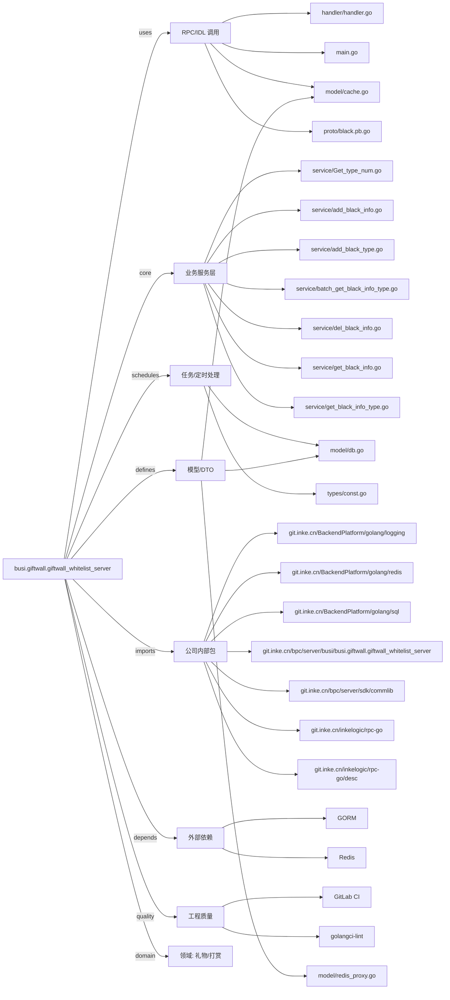

# busi.giftwall.giftwall_whitelist_server 技术图谱

## 一图技术图谱


## 项目定位
- 源码路径：`/Users/dds/go/src/git.inke.cn/bpc/server/busi/busi.giftwall.giftwall_whitelist_server`
- 领域判断：礼物/打赏
- README 摘要：礼物墙白名单服务

```text
# 礼物墙白名单服务
## 相关文档
https://wiki.inkept.cn/pages/viewpage.action?pageId=84472176
```

## 静态结构画像
- 文本/代码文件数：29
- Go 文件数：21
- 文件类型分布：.go(21), .toml(3), .yml(2), .md(1), .proto(1), .json(1)
- 顶层目录分布：service(12), model(3), conf(3), types(2), proto(2), handler(1), define(1), Godeps(1)

## 关键目录
- `service`: 12 个文本/代码文件
- `model`: 3 个文本/代码文件
- `conf`: 3 个文本/代码文件
- `types`: 2 个文本/代码文件
- `proto`: 2 个文本/代码文件
- `handler`: 1 个文本/代码文件
- `define`: 1 个文本/代码文件
- `Godeps`: 1 个文本/代码文件

## 代码分层
- 接入层文件：0 个
- 服务层文件：12 个
- 数据访问文件：0 个
- 模型文件：3 个
- 任务/定时相关文件：2 个
- RPC/IDL 相关文件：4 个

## API/路由线索
- 静态扫描未提取到显式路由字符串，需结合框架注册/网关配置确认

## 核心类型与方法线索
- 导出结构体：BlackService, Response, BlackMsg, BlackType, BlackType2, BlackSubType, BlackActionDb, BlackTokenDb, BlackInfoDb, BlackInfoDb, BlackTypeDb, BlackLogDb, BlackInfoCache, PushInfo, BlackMsg, AddBlackInfoRequest, AddBlackInfoResponse, BlackNamesRequest, BlackMessage, BlackNamesResponse, BlackTypeRequest, BlackTypesRequest, BlackTypeResponse, BlackLogMessage, BlackLogRequest, BlackLogResponse, DelBlackMsgRequest, DelBlackMsgResponse, UpdateBlackMsgRequest, UpdateBlackMsgResponse
- 导出函数/方法：InitServer, AddBlackMsg, AddBlackType2, AddBlackTypeV2, AddBlackSubType, AddBlackNameType, GetBlackTypeV2, GetBlackTypeV3, GetBlackSubType, GetBlackNameType, GetBlackMsgByNames, IsBlack, GetBlackMsgByType, GetBlackLog, GetBlackLogByName, DelBlackMsg, UpdateBlackMsg, GetTypeNum, GetBlackRecord, RenewalBlackMsg, GetBlackMsgByTypes, Reset, String, ProtoMessage, Descriptor, XXX_Unmarshal, XXX_Marshal, XXX_Merge, XXX_Size, XXX_DiscardUnknown

## 外部依赖线索
- Redis: 8 处信号
- GORM: 2 处信号

## 内部依赖线索
- `git.inke.cn/bpc/server/busi/busi.giftwall.giftwall_whitelist_server`: 47
- `git.inke.cn/BackendPlatform/golang/logging`: 16
- `git.inke.cn/inkelogic/rpc-go`: 4
- `git.inke.cn/bpc/server/sdk/commlib`: 2
- `git.inke.cn/inkelogic/rpc-go/desc`: 1
- `git.inke.cn/BackendPlatform/golang/sql`: 1
- `git.inke.cn/BackendPlatform/golang/redis`: 1

## 第三方 import 概览
- github.com(6), golang.org(6), os(2), go.uber.org(1)

## IDL/协议文件
- `proto/black.proto`

## 工程质量与交付
- GitLab CI：有
- golangci-lint：有
- 测试文件：
- 未发现 `_test.go`

## 阅读建议
- 先读 README 和 `server/http`、`handler`、`service` 目录，确认入口 API 与核心业务流程。
- 再沿服务层方法进入 DAO/Repo/Model，确认数据表、缓存 Key、RPC 调用和异步任务。
- 若图中只出现少量节点，通常表示该项目是配置型/胶水型服务，需结合上层共享工程和部署配置继续确认。
