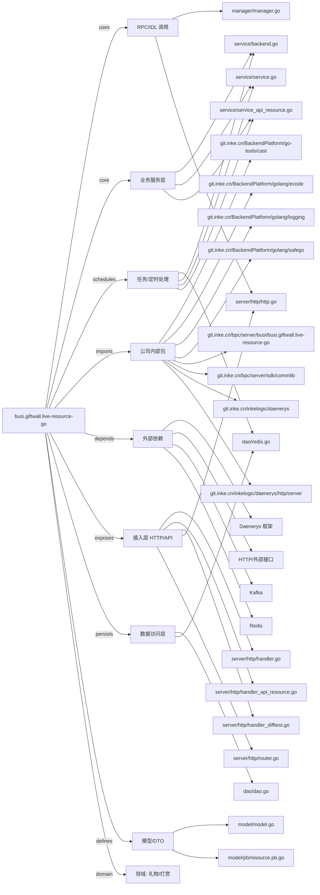

# busi.giftwall.live-resource-go 技术图谱

## 一图技术图谱


## 项目定位
- 源码路径：`/Users/dds/go/src/git.inke.cn/bpc/server/busi/busi.giftwall.live-resource-go`
- 领域判断：礼物/打赏
- README 摘要：busi.giftwall.live-resource-go

```text
# busi.giftwall.live-resource-go
旧礼物墙资源服务, go重写
```

## 静态结构画像
- 文本/代码文件数：23
- Go 文件数：17
- 文件类型分布：.go(17), .md(2), .toml(2), .json(1), .proto(1)
- 顶层目录分布：server(5), app(4), model(3), service(3), dao(2), api(2), backend(1), manager(1), conf(1)

## 关键目录
- `server`: 5 个文本/代码文件
- `app`: 4 个文本/代码文件
- `model`: 3 个文本/代码文件
- `service`: 3 个文本/代码文件
- `dao`: 2 个文本/代码文件
- `api`: 2 个文本/代码文件
- `backend`: 1 个文本/代码文件
- `manager`: 1 个文本/代码文件
- `conf`: 1 个文本/代码文件

## 代码分层
- 接入层文件：5 个
- 服务层文件：3 个
- 数据访问文件：2 个
- 模型文件：2 个
- 任务/定时相关文件：4 个
- RPC/IDL 相关文件：2 个

## API/路由线索
- 静态扫描未提取到显式路由字符串，需结合框架注册/网关配置确认

## 核心类型与方法线索
- 导出结构体：Dao, Manager, Gift, GiftResource, GiftIcon, RankResource, VerifiedResource, Service, Config
- 导出函数/方法：GetNessGiftResourceList, GetInUseGiftResourceIds, GetGiftResourceVersion, GetGiftResource, GetBundleResource, GetGiftBundleInfo, GetFeedsGiftInfo, GetGiftInfo, GetMultiPlayerGiftInfo, GetMultiEffectGiftInfo, GetVideoRewardGiftInfo, GetGiftDftSelect, GetGameGiftDftSelect, GetVideoClipsGiftDftSelect, GetGiftUpgradeInfo, GetGameGiftInfo, GetUserGiftInfo, GetRankResourceVersion, GetRankResource, GetVerifiedResourceVersion, GetVerifiedResource, GetVirtualResourceVersion, GetVirtualResource, GetCorrespondResource, GetLikeResource, GetGiftIconInfoVersion, GetGiftIconInfo, GetCommonPicResource, New, Ping

## 外部依赖线索
- Daenerys 框架: 8 处信号
- HTTP/外部接口: 7 处信号
- Redis: 2 处信号
- Kafka: 1 处信号

## 内部依赖线索
- `git.inke.cn/bpc/server/busi/busi.giftwall.live-resource-go`: 18
- `git.inke.cn/BackendPlatform/golang/logging`: 8
- `git.inke.cn/inkelogic/daenerys/http/server`: 5
- `git.inke.cn/inkelogic/daenerys`: 4
- `git.inke.cn/BackendPlatform/go-tools/cast`: 3
- `git.inke.cn/bpc/server/sdk/commlib`: 2
- `git.inke.cn/BackendPlatform/golang/safego`: 2
- `git.inke.cn/BackendPlatform/golang/ecode`: 2
- `git.inke.cn/BackendPlatform/golang/trace`: 2
- `git.inke.cn/BackendPlatform/golang/redis`: 1
- `git.inke.cn/inkelogic/daenerys/proxy`: 1
- `git.inke.cn/inkelogic/daenerys/plugins/http`: 1

## 第三方 import 概览
- github.com(4), os(2), go.uber.org(2), flag(1), log(1), syscall(1), bytes(1), crypto(1), io(1), reflect(1)

## IDL/协议文件
- `model/pb/resource.proto`

## 工程质量与交付
- GitLab CI：未发现
- golangci-lint：未发现
- 测试文件：
- 未发现 `_test.go`

## 阅读建议
- 先读 README 和 `server/http`、`handler`、`service` 目录，确认入口 API 与核心业务流程。
- 再沿服务层方法进入 DAO/Repo/Model，确认数据表、缓存 Key、RPC 调用和异步任务。
- 若图中只出现少量节点，通常表示该项目是配置型/胶水型服务，需结合上层共享工程和部署配置继续确认。
