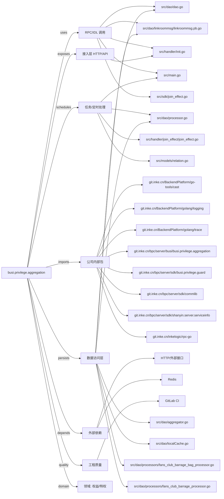

# busi.privilege.aggregation 技术图谱

## 一图技术图谱


## 项目定位
- 源码路径：`/Users/dds/go/src/git.inke.cn/bpc/server/busi/busi.privilege.aggregation`
- 领域判断：权益/特权
- README 摘要：特权聚合服务

```text
# 特权聚合服务
* [服务发布树](https://deploy.inkept.cn/templates/deploy.html?job_name=cop.inke_owt.bpc_pdl.busi_servicegroup.privilege_service.aggregation_job.aggregation_cluster.ali-bj)
* [线上机器列表](https://deploy.inkept.cn/templates/deploy.html?job_name=cop.inke_owt.bpc_pdl.busi_servicegroup.privilege_service.aggregation_job.aggregation_cluster.ali-bj)
## 服务描述
|     服务名     |               git 仓库              |       简介       | 任务链接 | falcon监控图 |
| -------------- | ----------------------------------- | ---------------- | -------- | ------------ |
| busi.privilege.aggregation | [Git地址](https://code.inke.cn/boc/server/privilege/busi.privilege.aggregation) | 特权聚合服务 |          |   * [特权聚合](https://monitorvpc.inkept.cn/screen/1302) <br> * [特权聚合页](https://monitorvpc.inkept.cn/screen/1366)         |
## 主要接口&流量
| 接口     | API               | 流程                                 | 重要程度 | 流量 |
| -------- | ----------------- | ------------------------------------ | -------- | ---- |
| 特权信息展示     | /api/buz_privilege_server/resource/show_batch     | [见wiki](https://wiki.inkept.cn/pages/viewpage.action?pageId=73782972) | 高 | [见falcon监控](https://monitorvpc.inkept.cn/screen/1302) |
| 特权进房特效 | /api/buz_privilege_server/resource/privilege_join_effect | [见wiki](https://wiki.inkept.cn/pages/viewpage.action?pageId=73782972) | 高 | [见falcon监控](https://monitorvpc.inkept.cn/screen/1302)  |
```

## 静态结构画像
- 文本/代码文件数：114
- Go 文件数：63
- 文件类型分布：.go(63), .json(46), .toml(2), .md(1), .yml(1), .proto(1)
- 顶层目录分布：src(65), conf(47)

## 关键目录
- `src`: 65 个文本/代码文件
- `conf`: 47 个文本/代码文件

## 代码分层
- 接入层文件：1 个
- 服务层文件：0 个
- 数据访问文件：7 个
- 模型文件：0 个
- 任务/定时相关文件：4 个
- RPC/IDL 相关文件：6 个

## API/路由线索
- 静态扫描未提取到显式路由字符串，需结合框架注册/网关配置确认

## 核心类型与方法线索
- 导出结构体：JoinEffectAggregator, PrivilegeAggregator, PrivilegeUserInfoHandler, HandlerManager, BadgeListFamily, DecorationHeadPortrait, LiveUsers, RuleBarrageGoods, AntiForbidden, PrivateMessage, BoardStyle, AuthPrivilege, PersonalTablePrivilege, Barrage, PublicChat, JoinEffect, PrivateChat, BadgeList, UserInfoCard, TopList, VipInfo, GuardRelation, NobilityPrivilege, UserProfile, GuardProcessor, LevelProcessor, AnchorInfoProcessor, ExBarrageProcessor, BadgeListBillboardProcessor, PotentialityProcessor
- 导出函数/方法：NewJoinEffectAggregator, Serve, NewPrivilegeAggregator, Serve, Serve, NewHandlerManager, AddHandler, GetHandler, InitServer, InitConfig, Init, ProcessType, PreProcess, Process, PostProcess, GetFansClubName, Init, ProcessType, PreProcess, Process, PostProcess, Init, ProcessType, PreProcess, Process, PostProcess, Init, ProcessType, PreProcess, Process

## 外部依赖线索
- HTTP/外部接口: 31 处信号
- Redis: 3 处信号

## 内部依赖线索
- `git.inke.cn/bpc/server/busi/busi.privilege.aggregation`: 94
- `git.inke.cn/BackendPlatform/golang/logging`: 28
- `git.inke.cn/bpc/server/sdk/commlib`: 8
- `git.inke.cn/inkelogic/rpc-go`: 5
- `git.inke.cn/BackendPlatform/go-tools/cast`: 5
- `git.inke.cn/BackendPlatform/golang/trace`: 4
- `git.inke.cn/bpc/server/sdk/shanyin.server.serviceinfo`: 3
- `git.inke.cn/bpc/server/sdk/busi.privilege.guard`: 3
- `git.inke.cn/bpc/server/sdk/user.resource.logic`: 2
- `git.inke.cn/BackendPlatform/golang/utils`: 2
- `git.inke.cn/bpc/server/sdk/user.profile.gateway`: 2
- `git.inke.cn/bpc/server/sdk/room.action.base`: 2

## 第三方 import 概览
- github.com(11), os(3), runtime(3), golang.org(3), go.uber.org(2), bytes(2), io(2), flag(1), log(1), reflect(1)

## IDL/协议文件
- `src/dao/linkroommsg/linkroommsg.proto`

## 工程质量与交付
- GitLab CI：有
- golangci-lint：未发现
- 测试文件：
- 未发现 `_test.go`

## 阅读建议
- 先读 README 和 `server/http`、`handler`、`service` 目录，确认入口 API 与核心业务流程。
- 再沿服务层方法进入 DAO/Repo/Model，确认数据表、缓存 Key、RPC 调用和异步任务。
- 若图中只出现少量节点，通常表示该项目是配置型/胶水型服务，需结合上层共享工程和部署配置继续确认。
