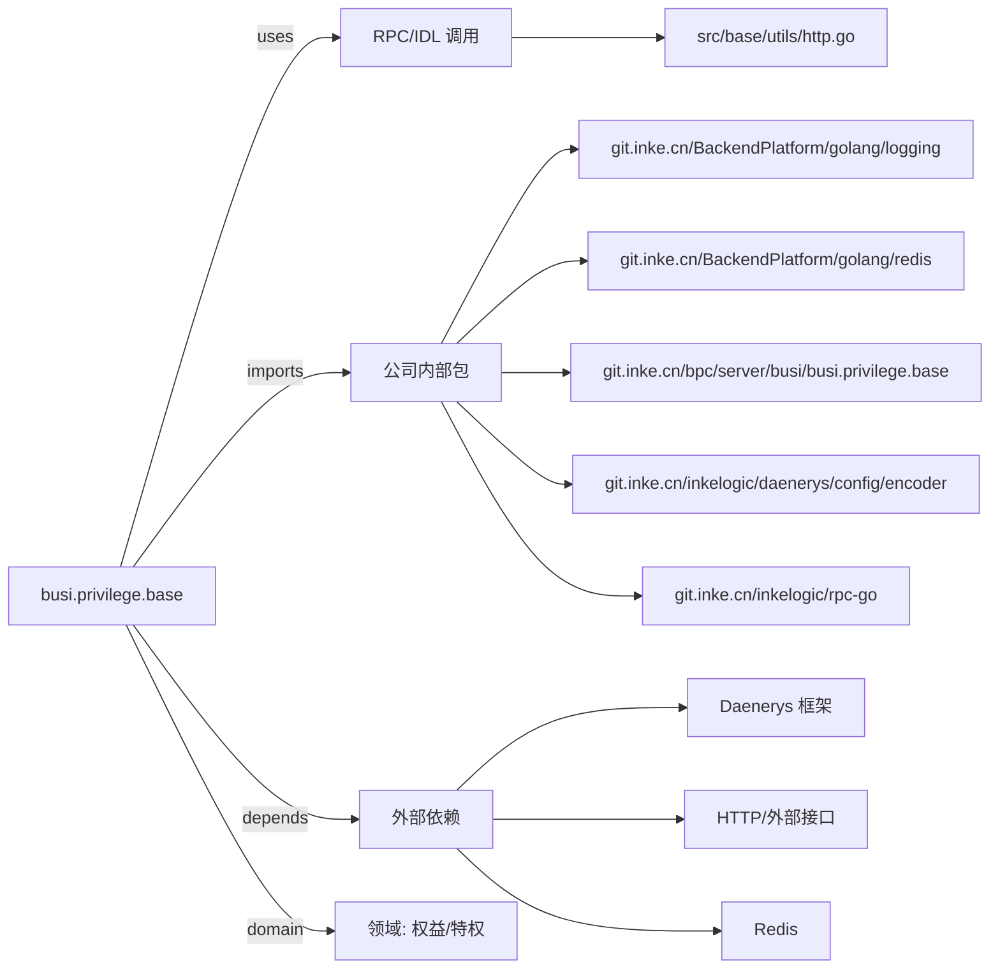

# busi.privilege.base 技术图谱

## 一图技术图谱


## 项目定位
- 源码路径：`/Users/dds/go/src/git.inke.cn/bpc/server/busi/busi.privilege.base`
- 领域判断：权益/特权
- README 摘要：busi.privilege.base

```text
# busi.privilege.base
```

## 静态结构画像
- 文本/代码文件数：6
- Go 文件数：5
- 文件类型分布：.go(5), .md(1)
- 顶层目录分布：src(5)

## 关键目录
- `src`: 5 个文本/代码文件

## 代码分层
- 接入层文件：0 个
- 服务层文件：0 个
- 数据访问文件：0 个
- 模型文件：0 个
- 任务/定时相关文件：0 个
- RPC/IDL 相关文件：1 个

## API/路由线索
- 静态扫描未提取到显式路由字符串，需结合框架注册/网关配置确认

## 核心类型与方法线索
- 导出结构体：未提取到导出结构体
- 导出函数/方法：JointInt, JointInt64, UUID, SplitArray, BuildHttpResp, Bind, DoHttpGet, DoHttpPost, GetDataFromCache

## 外部依赖线索
- Redis: 2 处信号
- HTTP/外部接口: 1 处信号
- Daenerys 框架: 1 处信号

## 内部依赖线索
- `git.inke.cn/bpc/server/busi/busi.privilege.base`: 2
- `git.inke.cn/BackendPlatform/golang/logging`: 1
- `git.inke.cn/inkelogic/daenerys/config/encoder`: 1
- `git.inke.cn/inkelogic/rpc-go`: 1
- `git.inke.cn/BackendPlatform/golang/redis`: 1

## 第三方 import 概览
- github.com(3), io(2), crypto(1), bytes(1)

## IDL/协议文件
- 未发现 proto/thrift 文件

## 工程质量与交付
- GitLab CI：未发现
- golangci-lint：未发现
- 测试文件：
- 未发现 `_test.go`

## 阅读建议
- 先读 README 和 `server/http`、`handler`、`service` 目录，确认入口 API 与核心业务流程。
- 再沿服务层方法进入 DAO/Repo/Model，确认数据表、缓存 Key、RPC 调用和异步任务。
- 若图中只出现少量节点，通常表示该项目是配置型/胶水型服务，需结合上层共享工程和部署配置继续确认。
