# busi.privilege.common 技术图谱

## 一图技术图谱

```mermaid
flowchart LR
  naa1df2ef["Daenerys 框架"]
  n8f718eeb["GORM"]
  na05476e7["GitLab CI"]
  n7c735559["HTTP/外部接口"]
  n51be25b0["Kafka"]
  n62a004b9["MySQL"]
  n8aa21d2e["RPC/IDL 调用"]
  ne1114467["Redis"]
  n1190f94a["backend/backend.go"]
  n7a224e78["backend/init.go"]
  n9d2790f9["busi.privilege.common"]
  n1f85f50a["common/model.go"]
  n697dcb32["dao/gift_log_mysql.go"]
  nc2a37b5e["dao/grace_privilege_account_mysql.go"]
  n33f8b90b["dao/grace_privilege_record_mysql.go"]
  nbb548c4f["dao/grace_privilege_use_log_mysql.go"]
  n14d1615e["dao/notify_user_redis.go"]
  n1fe5a9d8["dao/recommend_mysql.go"]
  n16fc4f1d["dao/recommend_redis.go"]
  n17aa4db9["dao/redis.go"]
  n7d7ea8b2["git.inke.cn/BackendPlatform/golang/logging"]
  n14b7f193["git.inke.cn/BackendPlatform/golang/safego"]
  nec5c5812["git.inke.cn/BackendPlatform/golang/sql"]
  ne2260199["git.inke.cn/BackendPlatform/golang/trace"]
  n266f68fa["git.inke.cn/bpc/server/busi/busi.privilege.common"]
  n7de617ec["git.inke.cn/bpc/server/sdk/commlib"]
  n44a757c3["git.inke.cn/bpc/server/sdk/ka"]
  n961ac33a["git.inke.cn/inkelogic/rpc-go"]
  nbb8ccae4["handler/init.go"]
  ne60df4bc["logic/logic.go"]
  n11e54b46["logic/recommend_index.go"]
  n88d65f1e["model/color_nick_chat.go"]
  n7f893b07["model/common.go"]
  nd7d46fa6["model/db.go"]
  n755532c8["model/db_cs_log.go"]
  n4a25ad1f["model/emperor_ally.go"]
  n8d81b440["任务/定时处理"]
  n7cc1b88f["公司内部包"]
  nb682654e["外部依赖"]
  nadeed157["工程质量"]
  n8de19b79["接入层 HTTP/API"]
  n9bfbba5f["数据访问层"]
  ne9fe3e59["模型/DTO"]
  n61bcdcb7["测试文件 5 个"]
  nfb754e86["领域: 权益/特权"]
  n8aa21d2e --> n7a224e78
  n8aa21d2e --> n17aa4db9
  n8aa21d2e --> nbb8ccae4
  n8aa21d2e --> ne60df4bc
  n8aa21d2e --> n11e54b46
  n9d2790f9 -- "uses" --> n8aa21d2e
  n9d2790f9 -- "schedules" --> n8d81b440
  n9d2790f9 -- "imports" --> n7cc1b88f
  n9d2790f9 -- "depends" --> nb682654e
  n9d2790f9 -- "quality" --> nadeed157
  n9d2790f9 -- "exposes" --> n8de19b79
  n9d2790f9 -- "persists" --> n9bfbba5f
  n9d2790f9 -- "defines" --> ne9fe3e59
  n9d2790f9 -- "domain" --> nfb754e86
  n8d81b440 --> n1190f94a
  n8d81b440 --> n7a224e78
  n8d81b440 --> n1f85f50a
  n7cc1b88f --> n7d7ea8b2
  n7cc1b88f --> n14b7f193
  n7cc1b88f --> nec5c5812
  n7cc1b88f --> ne2260199
  n7cc1b88f --> n266f68fa
  n7cc1b88f --> n7de617ec
  n7cc1b88f --> n44a757c3
  n7cc1b88f --> n961ac33a
  nb682654e --> naa1df2ef
  nb682654e --> n8f718eeb
  nb682654e --> n7c735559
  nb682654e --> n51be25b0
  nb682654e --> n62a004b9
  nb682654e --> ne1114467
  nadeed157 --> na05476e7
  nadeed157 --> n61bcdcb7
  n8de19b79 --> nbb8ccae4
  n9bfbba5f --> n697dcb32
  n9bfbba5f --> nc2a37b5e
  n9bfbba5f --> n33f8b90b
  n9bfbba5f --> nbb548c4f
  n9bfbba5f --> n14d1615e
  n9bfbba5f --> n1fe5a9d8
  n9bfbba5f --> n16fc4f1d
  ne9fe3e59 --> n88d65f1e
  ne9fe3e59 --> n7f893b07
  ne9fe3e59 --> nd7d46fa6
  ne9fe3e59 --> n755532c8
  ne9fe3e59 --> n4a25ad1f
```


## 项目定位
- 源码路径：`/Users/dds/go/src/git.inke.cn/bpc/server/busi/busi.privilege.common`
- 领域判断：权益/特权
- README 摘要：贵族体系需求地址：

```text
贵族体系需求地址：
http://wiki.inkept.cn/pages/viewpage.action?pageId=36806327
贵族设计文档地址:
http://wiki.inkept.cn/pages/viewpage.action?pageId=46106070
```

## 静态结构画像
- 文本/代码文件数：105
- Go 文件数：98
- 文件类型分布：.go(98), .md(3), .toml(2), .yml(1), .json(1)
- 顶层目录分布：handler(27), sdk(21), model(15), logic(11), dao(10), backend(6), common(4), util(3), conf(2), Godeps(1)

## 关键目录
- `handler`: 27 个文本/代码文件
- `sdk`: 21 个文本/代码文件
- `model`: 15 个文本/代码文件
- `logic`: 11 个文本/代码文件
- `dao`: 10 个文本/代码文件
- `backend`: 6 个文本/代码文件
- `common`: 4 个文本/代码文件
- `util`: 3 个文本/代码文件
- `conf`: 2 个文本/代码文件
- `Godeps`: 1 个文本/代码文件
- `docs`: 1 个文本/代码文件

## 代码分层
- 接入层文件：1 个
- 服务层文件：0 个
- 数据访问文件：10 个
- 模型文件：15 个
- 任务/定时相关文件：3 个
- RPC/IDL 相关文件：10 个

## API/路由线索
- 静态扫描未提取到显式路由字符串，需结合框架注册/网关配置确认

## 核心类型与方法线索
- 导出结构体：PageNobilityReq, PageNobilityResp, PageNobilityItemResp, PageNobilityHandler, SkinReissueHandler, GetGracePrivilegeResp, GetGracePrivilegeHandler, GetGracePrivilegeAllianceHandler, LiveNobilityNumberReq, LiveNobilityNumberResp, LiveNobilityNumber, NobilityScanHandler, GetNobilityListByCodeResp, GetNobilityListByCodeHandler, LiveNobilityListReq, LiveNobilityListResp, LiveNobilityListHandler, ColorStatusSetHandler, ColorStatusGetHandler, AddGiftNobilityHandler, CanNobilityUserHandler, CanNobilityUseReq, CanNobilityUseResp, AddGracePrivilegeHandler, NobilityActionHandler, AddNobilityHandler, UseGracePrivilegeHandler, LowPrivilegeStatusChangeToUsingHandler, QueryNobilityReq, QueryNobilityResp
- 导出函数/方法：Validate, Serve, Validate, Serve, Serve, Serve, Validate, Serve, Validate, Serve, Validate, Serve, Validate, Serve, Serve, Serve, Validate, Serve, Validate, Serve, TestAddNobilityHandler_Serve, Serve, Validate, Serve, Serve, Serve, Serve, Validate, Serve, Validate

## 外部依赖线索
- HTTP/外部接口: 51 处信号
- Redis: 18 处信号
- GORM: 12 处信号
- MySQL: 5 处信号
- Kafka: 4 处信号
- Daenerys 框架: 1 处信号

## 内部依赖线索
- `git.inke.cn/bpc/server/busi/busi.privilege.common`: 170
- `git.inke.cn/BackendPlatform/golang/logging`: 31
- `git.inke.cn/inkelogic/rpc-go`: 10
- `git.inke.cn/BackendPlatform/golang/trace`: 7
- `git.inke.cn/BackendPlatform/golang/sql`: 7
- `git.inke.cn/bpc/server/sdk/commlib`: 6
- `git.inke.cn/bpc/server/sdk/ka`: 4
- `git.inke.cn/BackendPlatform/golang/safego`: 4
- `git.inke.cn/BackendPlatform/golang/redis`: 4
- `git.inke.cn/bpc/server/sdk/busi.gift.user_props_base`: 3
- `git.inke.cn/bpc/server/sdk/user.account.common_config`: 3
- `git.inke.cn/BackendPlatform/go-tools/cast`: 2

## 第三方 import 概览
- github.com(13), testing(5), io(5), bytes(4), os(2), crypto(2), reflect(2), flag(1), bufio(1), golang.org(1)

## IDL/协议文件
- 未发现 proto/thrift 文件

## 工程质量与交付
- GitLab CI：有
- golangci-lint：未发现
- 测试文件：
- `handler/add_nobility_test.go`
- `backend/nobility_status_update_test.go`
- `backend/backend_test.go`
- `sdk/client_privilege_whitelist_test.go`
- `sdk/client_giftwall_whitelist_test.go`

## 阅读建议
- 先读 README 和 `server/http`、`handler`、`service` 目录，确认入口 API 与核心业务流程。
- 再沿服务层方法进入 DAO/Repo/Model，确认数据表、缓存 Key、RPC 调用和异步任务。
- 若图中只出现少量节点，通常表示该项目是配置型/胶水型服务，需结合上层共享工程和部署配置继续确认。
