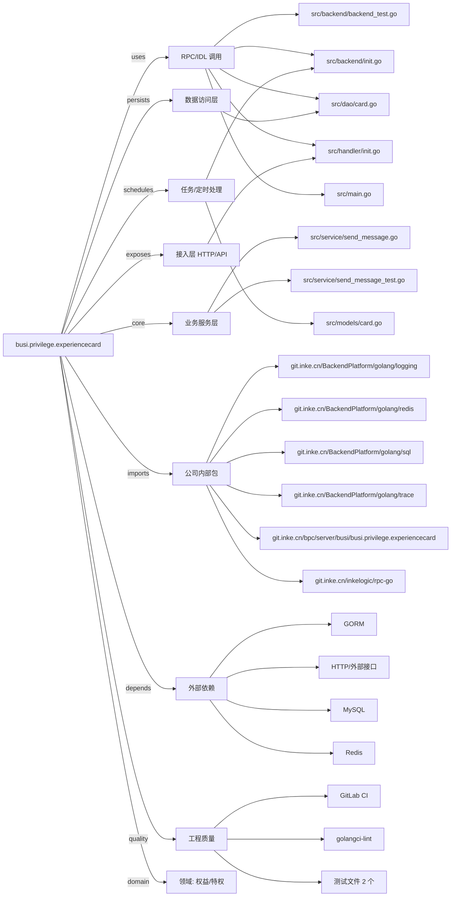

# busi.privilege.experiencecard 技术图谱

## 一图技术图谱


## 项目定位
- 源码路径：`/Users/dds/go/src/git.inke.cn/bpc/server/busi/busi.privilege.experiencecard`
- 领域判断：权益/特权
- README 摘要：特权翻倍卡

```text
#### 特权翻倍卡
设计文档: http://wiki.inkept.cn/pages/viewpage.action?pageId=27599516
需求文档: http://wiki.inkept.cn/pages/viewpage.action?pageId=27596969
```

## 静态结构画像
- 文本/代码文件数：25
- Go 文件数：18
- 文件类型分布：.go(18), .yml(2), .md(2), .toml(2), .json(1)
- 顶层目录分布：src(19), conf(2)

## 关键目录
- `src`: 19 个文本/代码文件
- `conf`: 2 个文本/代码文件

## 代码分层
- 接入层文件：1 个
- 服务层文件：2 个
- 数据访问文件：1 个
- 模型文件：0 个
- 任务/定时相关文件：2 个
- RPC/IDL 相关文件：6 个

## API/路由线索
- 静态扫描未提取到显式路由字符串，需结合框架注册/网关配置确认

## 核心类型与方法线索
- 导出结构体：BaseHandler, UserGetHandler, UserSourceHandler, AddUserHandler, DeadLineHandler, HttpClient, Source, CardDealLineReq, CardDeadLineRes, CardAddUserReq, CardUserGetReq, UserCardRecord, ExpCardRecord, CardUserGetResponse, UserSourceRes, UserSourceData, RedisExpCardValue, MysqlExpCardDbModel, BaseRes, Config, TextContent, Content, CardContent, SendMessageIn, SendMessageOut
- 导出函数/方法：Serve, InitServer, PreProcess, Process, PostProcess, PreProcess, Process, PostProcess, PreProcess, Process, PostProcess, PreProcess, Process, PostProcess, DoHttpPost, DoHttpGet, NewHttpClient, HttpPost, HttpGet, GetCtxLogger, SetCtxLogger, PrettySerialize, RequestDecode, ParseIdStringToArrInt64, UniqueArrayString, ChunkArrInt64, QueryDeadLine, AddUser, UserGet, GetUserResource

## 外部依赖线索
- HTTP/外部接口: 9 处信号
- Redis: 5 处信号
- MySQL: 3 处信号
- GORM: 2 处信号

## 内部依赖线索
- `git.inke.cn/bpc/server/busi/busi.privilege.experiencecard`: 25
- `git.inke.cn/BackendPlatform/golang/logging`: 15
- `git.inke.cn/inkelogic/rpc-go`: 6
- `git.inke.cn/BackendPlatform/golang/trace`: 1
- `git.inke.cn/BackendPlatform/golang/sql`: 1
- `git.inke.cn/BackendPlatform/golang/redis`: 1

## 第三方 import 概览
- golang.org(7), github.com(4), flag(2), testing(2), os(1), runtime(1), bytes(1), io(1)

## IDL/协议文件
- 未发现 proto/thrift 文件

## 工程质量与交付
- GitLab CI：有
- golangci-lint：有
- 测试文件：
- `src/backend/backend_test.go`
- `src/service/send_message_test.go`

## 阅读建议
- 先读 README 和 `server/http`、`handler`、`service` 目录，确认入口 API 与核心业务流程。
- 再沿服务层方法进入 DAO/Repo/Model，确认数据表、缓存 Key、RPC 调用和异步任务。
- 若图中只出现少量节点，通常表示该项目是配置型/胶水型服务，需结合上层共享工程和部署配置继续确认。
