# busi.privilege.family 技术图谱

## 一图技术图谱

```mermaid
flowchart LR
  naa1df2ef["Daenerys 框架"]
  na05476e7["GitLab CI"]
  n7c735559["HTTP/外部接口"]
  n51be25b0["Kafka"]
  n62a004b9["MySQL"]
  n8aa21d2e["RPC/IDL 调用"]
  ne1114467["Redis"]
  nd3cffdee["app/main.go"]
  n1a2d03f9["backend/timer.go"]
  n5c08f02d["busi.privilege.family"]
  nbc0c8eb0["conf/config.go"]
  nb9b1545a["dao/dao.go"]
  n7d7ea8b2["git.inke.cn/BackendPlatform/golang/logging"]
  n7634613f["git.inke.cn/bpc/server/busi/busi.privilege.family"]
  n7c3c34ce["git.inke.cn/bpc/server/sdk/busi.privilege.aggregation"]
  n7c4d2cc9["git.inke.cn/bpc/server/sdk/busi.privilege.family_base"]
  n56f964c3["git.inke.cn/bpc/server/sdk/user.profile.gateway"]
  na7b2875b["git.inke.cn/bpc/server/sdk/user.profile.logic"]
  n0d851172["git.inke.cn/inkelogic/daenerys"]
  n0cea5f4d["git.inke.cn/inkelogic/daenerys/http/client"]
  n8077df92["manager/manager.go"]
  n1a0a40b2["model/cache.go"]
  nea95385a["model/chat_room_entry.go"]
  nd255c1ee["model/convene.go"]
  ne87531ea["model/explain.go"]
  nae508eba["model/family_homepage.go"]
  n37617513["model/task_page.go"]
  nfa1b8922["server/http/handler.go"]
  nf03d9c77["server/http/http.go"]
  n6dfa5257["server/http/router.go"]
  neeade751["service/service.go"]
  n8776e036["service/service_chat_room_entry.go"]
  nc384e7e7["service/service_chat_room_entry_test.go"]
  n4127c187["service/service_explain.go"]
  n60f72b84["service/service_family_convene_rank.go"]
  nf666b814["service/service_family_guards_test.go"]
  ndf0efbe0["service/service_family_homepage_contribution.go"]
  n888b7733["业务服务层"]
  n8d81b440["任务/定时处理"]
  n7cc1b88f["公司内部包"]
  nb682654e["外部依赖"]
  nadeed157["工程质量"]
  n8de19b79["接入层 HTTP/API"]
  n9bfbba5f["数据访问层"]
  ne9fe3e59["模型/DTO"]
  n59368ba0["测试文件 17 个"]
  nfb754e86["领域: 权益/特权"]
  n8aa21d2e --> n8077df92
  n8aa21d2e --> nf03d9c77
  n8aa21d2e --> n8776e036
  n5c08f02d -- "uses" --> n8aa21d2e
  n5c08f02d -- "core" --> n888b7733
  n5c08f02d -- "schedules" --> n8d81b440
  n5c08f02d -- "imports" --> n7cc1b88f
  n5c08f02d -- "depends" --> nb682654e
  n5c08f02d -- "quality" --> nadeed157
  n5c08f02d -- "exposes" --> n8de19b79
  n5c08f02d -- "persists" --> n9bfbba5f
  n5c08f02d -- "defines" --> ne9fe3e59
  n5c08f02d -- "domain" --> nfb754e86
  n888b7733 --> neeade751
  n888b7733 --> n8776e036
  n888b7733 --> nc384e7e7
  n888b7733 --> n4127c187
  n888b7733 --> n60f72b84
  n888b7733 --> nf666b814
  n888b7733 --> ndf0efbe0
  n8d81b440 --> nd3cffdee
  n8d81b440 --> n1a2d03f9
  n8d81b440 --> nbc0c8eb0
  n8d81b440 --> n37617513
  n8d81b440 --> nfa1b8922
  n7cc1b88f --> n7d7ea8b2
  n7cc1b88f --> n7634613f
  n7cc1b88f --> n7c3c34ce
  n7cc1b88f --> n7c4d2cc9
  n7cc1b88f --> n56f964c3
  n7cc1b88f --> na7b2875b
  n7cc1b88f --> n0d851172
  n7cc1b88f --> n0cea5f4d
  nb682654e --> naa1df2ef
  nb682654e --> n7c735559
  nb682654e --> n51be25b0
  nb682654e --> n62a004b9
  nb682654e --> ne1114467
  nadeed157 --> na05476e7
  nadeed157 --> n59368ba0
  n8de19b79 --> nfa1b8922
  n8de19b79 --> nf03d9c77
  n8de19b79 --> n6dfa5257
  n9bfbba5f --> nb9b1545a
  ne9fe3e59 --> n1a0a40b2
  ne9fe3e59 --> nea95385a
  ne9fe3e59 --> nd255c1ee
  ne9fe3e59 --> ne87531ea
  ne9fe3e59 --> nae508eba
```


## 项目定位
- 源码路径：`/Users/dds/go/src/git.inke.cn/bpc/server/busi/busi.privilege.family`
- 领域判断：权益/特权
- README 摘要：busi.privilege.family

```text
# busi.privilege.family
## 项目简介
## 配置说明
## CHANGELOG
```

## 静态结构画像
- 文本/代码文件数：85
- Go 文件数：78
- 文件类型分布：.go(78), .toml(3), .md(2), .yml(1), .json(1)
- 顶层目录分布：service(36), model(22), manager(8), app(5), utils(4), server(3), api(2), dao(1), backend(1), conf(1)

## 关键目录
- `service`: 36 个文本/代码文件
- `model`: 22 个文本/代码文件
- `manager`: 8 个文本/代码文件
- `app`: 5 个文本/代码文件
- `utils`: 4 个文本/代码文件
- `server`: 3 个文本/代码文件
- `api`: 2 个文本/代码文件
- `dao`: 1 个文本/代码文件
- `backend`: 1 个文本/代码文件
- `conf`: 1 个文本/代码文件

## 代码分层
- 接入层文件：3 个
- 服务层文件：20 个
- 数据访问文件：1 个
- 模型文件：20 个
- 任务/定时相关文件：11 个
- RPC/IDL 相关文件：3 个

## API/路由线索
- 静态扫描未提取到显式路由字符串，需结合框架注册/网关配置确认

## 核心类型与方法线索
- 导出结构体：Dao, Response, SearchResult, ResultPair, SearchUserResp, SearchUserData, StarUserData, SearchUser, SearchUserInfo, Manager, BaseResponse, UserPublishBatchReq, UserPublishBatchResp, UserPublishBatchItem, UserPublisherInfoItem, GuardsReq, GuardsResp, GuardsItem, ConveneRankReq, ConveneRankResp, NewStarRankReq, NewStarRankResp, NewStarRankItem, OnlineMemberListReq, OnlineMemberListResp, OnlineMemberListItem, FamilyHomepageContributionReq, FamilyHomepageContributionResp, MyContributionItem, FamilyRank
- 导出函数/方法：New, Ping, Close, Init, Shutdown, TestNewCv, TestCheckPlatform, TestGt, TestHarmonyPlatformSupport, TestBackwardCompatibility, GetNewCreateTime, Timastamp2YearMonthDay, Timastamp2HourMinSec, Timestamp2Date, NewCv, CheckPlatform, Struct2Map, InitTimer, TestMain, TestManagerSearchUser, Search, SearchUser, TestManagerGetUserPublishBatch, TestManagerGetUserPublishBatchMap, New, Ping, Close, GetUserPublishBatch, GetUserPublishBatchMap, TestManagerSearch

## 外部依赖线索
- HTTP/外部接口: 13 处信号
- Daenerys 框架: 12 处信号
- Kafka: 3 处信号
- Redis: 2 处信号
- MySQL: 2 处信号

## 内部依赖线索
- `git.inke.cn/bpc/server/busi/busi.privilege.family`: 76
- `git.inke.cn/bpc/server/sdk/busi.privilege.family_base`: 29
- `git.inke.cn/BackendPlatform/golang/logging`: 26
- `git.inke.cn/bpc/server/sdk/user.profile.gateway`: 15
- `git.inke.cn/bpc/server/sdk/user.profile.logic`: 8
- `git.inke.cn/inkelogic/daenerys`: 6
- `git.inke.cn/inkelogic/daenerys/http/client`: 6
- `git.inke.cn/bpc/server/sdk/busi.privilege.aggregation`: 6
- `git.inke.cn/inkelogic/daenerys/http/server`: 3
- `git.inke.cn/bpc/server/sdk/busi.privilege.family_bonus`: 3
- `git.inke.cn/bpc/server/sdk/room.link.social`: 3
- `git.inke.cn/bpc/server/sdk/commlib`: 3

## 第三方 import 概览
- github.com(20), testing(17), os(2), golang.org(2), flag(1), log(1), syscall(1), regexp(1), go.uber.org(1)

## IDL/协议文件
- 未发现 proto/thrift 文件

## 工程质量与交付
- GitLab CI：有
- golangci-lint：未发现
- 测试文件：
- `utils/cv_test.go`
- `manager/manager_test.go`
- `manager/manager_search_user_test.go`
- `manager/manager_live_test.go`
- `manager/manager_search_test.go`
- `service/service_interactive_test.go`
- `service/service_family_members_test.go`
- `service/service_like_search_test.go`
- `service/service_test.go`
- `service/service_online_list_test.go`
- `service/service_family_homepage_contribution_test.go`
- `service/service_family_profile_test.go`
- `service/service_chat_room_entry_test.go`
- `service/service_family_guards_test.go`
- `service/service_homepage_test.go`
- `service/service_family_person_profile_test.go`
- `service/service_search_test.go`

## 阅读建议
- 先读 README 和 `server/http`、`handler`、`service` 目录，确认入口 API 与核心业务流程。
- 再沿服务层方法进入 DAO/Repo/Model，确认数据表、缓存 Key、RPC 调用和异步任务。
- 若图中只出现少量节点，通常表示该项目是配置型/胶水型服务，需结合上层共享工程和部署配置继续确认。
