# busi.privilege.family_base 技术图谱

## 一图技术图谱

```mermaid
flowchart LR
  naa1df2ef["Daenerys 框架"]
  n8f718eeb["GORM"]
  na05476e7["GitLab CI"]
  n7c735559["HTTP/外部接口"]
  n51be25b0["Kafka"]
  n62a004b9["MySQL"]
  n8aa21d2e["RPC/IDL 调用"]
  ne1114467["Redis"]
  n4e96cf40["Thrift/RPC"]
  ncaab6d6d["api/code/code.go"]
  nd3cffdee["app/main.go"]
  n359f8114["backend/billboard/billboard.go"]
  n38288e09["backend/billgold/bill_gold.go"]
  n4669cf9e["backend/capsule_award/capsule_award_test.go"]
  nbaa4ee11["busi.privilege.family_base"]
  nbc0c8eb0["conf/config.go"]
  n4cd7abaf["dao/cache.go"]
  nb939a7e3["dao/cache_test.go"]
  nb9b1545a["dao/dao.go"]
  ne4a094f6["dao/dao_apply_auto.go"]
  n19f6a311["dao/dao_bill.go"]
  n155999b2["dao/dao_bonus.go"]
  n77dc0280["dao/dao_capsule.go"]
  ne6f54790["git.inke.cn/BackendPlatform/golang/kafka"]
  n7d7ea8b2["git.inke.cn/BackendPlatform/golang/logging"]
  na283f7b0["git.inke.cn/BackendPlatform/golang/redis"]
  ne2260199["git.inke.cn/BackendPlatform/golang/trace"]
  n63448fda["git.inke.cn/bpc/server/busi/busi.privilege.family_base"]
  nd9759b91["git.inke.cn/bpc/server/sdk/room.play.chatroom"]
  n56f964c3["git.inke.cn/bpc/server/sdk/user.profile.gateway"]
  n0d851172["git.inke.cn/inkelogic/daenerys"]
  n8077df92["manager/manager.go"]
  nb1700aea["model/battle.go"]
  n396b8509["model/bill.go"]
  nec968709["model/bill_bill_gold.go"]
  n1a0a40b2["model/cache.go"]
  n39ee580c["model/can_create.go"]
  nfa1b8922["server/http/handler.go"]
  nf03d9c77["server/http/http.go"]
  n6dfa5257["server/http/router.go"]
  neeade751["service/service.go"]
  nf10e80ab["service/service_apply_auto_set.go"]
  n74fbef82["service/service_apply_available.go"]
  n01022fe4["service/service_apply_cancel.go"]
  n8fe4182f["service/service_apply_handle.go"]
  n5d1323b6["service/service_apply_handle_all.go"]
  na52bcb01["service/service_apply_handle_test.go"]
  n888b7733["业务服务层"]
  n8d81b440["任务/定时处理"]
  n7cc1b88f["公司内部包"]
  nb682654e["外部依赖"]
  nadeed157["工程质量"]
  n8de19b79["接入层 HTTP/API"]
  n9bfbba5f["数据访问层"]
  ne9fe3e59["模型/DTO"]
  n9f1b93ee["测试文件 20 个"]
  nfb754e86["领域: 权益/特权"]
  n8aa21d2e --> nd3cffdee
  n8aa21d2e --> nbc0c8eb0
  n8aa21d2e --> n8077df92
  n8aa21d2e --> n396b8509
  n8aa21d2e --> nf03d9c77
  nbaa4ee11 -- "uses" --> n8aa21d2e
  nbaa4ee11 -- "core" --> n888b7733
  nbaa4ee11 -- "schedules" --> n8d81b440
  nbaa4ee11 -- "imports" --> n7cc1b88f
  nbaa4ee11 -- "depends" --> nb682654e
  nbaa4ee11 -- "quality" --> nadeed157
  nbaa4ee11 -- "exposes" --> n8de19b79
  nbaa4ee11 -- "persists" --> n9bfbba5f
  nbaa4ee11 -- "defines" --> ne9fe3e59
  nbaa4ee11 -- "domain" --> nfb754e86
  n888b7733 --> neeade751
  n888b7733 --> nf10e80ab
  n888b7733 --> n74fbef82
  n888b7733 --> n01022fe4
  n888b7733 --> n8fe4182f
  n888b7733 --> n5d1323b6
  n888b7733 --> na52bcb01
  n8d81b440 --> ncaab6d6d
  n8d81b440 --> nd3cffdee
  n8d81b440 --> n359f8114
  n8d81b440 --> n38288e09
  n8d81b440 --> n4669cf9e
  n7cc1b88f --> ne6f54790
  n7cc1b88f --> n7d7ea8b2
  n7cc1b88f --> na283f7b0
  n7cc1b88f --> ne2260199
  n7cc1b88f --> n63448fda
  n7cc1b88f --> nd9759b91
  n7cc1b88f --> n56f964c3
  n7cc1b88f --> n0d851172
  nb682654e --> naa1df2ef
  nb682654e --> n8f718eeb
  nb682654e --> n7c735559
  nb682654e --> n51be25b0
  nb682654e --> n62a004b9
  nb682654e --> ne1114467
  nb682654e --> n4e96cf40
  nadeed157 --> na05476e7
  nadeed157 --> n9f1b93ee
  n8de19b79 --> nfa1b8922
  n8de19b79 --> nf03d9c77
  n8de19b79 --> n6dfa5257
  n9bfbba5f --> n4cd7abaf
  n9bfbba5f --> nb939a7e3
  n9bfbba5f --> nb9b1545a
  n9bfbba5f --> ne4a094f6
  n9bfbba5f --> n19f6a311
  n9bfbba5f --> n155999b2
  n9bfbba5f --> n77dc0280
  ne9fe3e59 --> nb1700aea
  ne9fe3e59 --> n396b8509
  ne9fe3e59 --> nec968709
  ne9fe3e59 --> n1a0a40b2
  ne9fe3e59 --> n39ee580c
```


## 项目定位
- 源码路径：`/Users/dds/go/src/git.inke.cn/bpc/server/busi/busi.privilege.family_base`
- 领域判断：权益/特权
- README 摘要：busi.privilege.family_base

```text
# busi.privilege.family_base
## 项目简介
## 配置说明
## CHANGELOG
bj:
mysql:
mysql -h rm-2zezcpy6y583x84u7.mysql.rds.aliyuncs.com -u inke_db_user -p"***REDACTED***" --default-character-set=utf8 family
redis-cli -h r-2ze6c6b5ebcabd94.redis.rds.aliyuncs.com -a ***REDACTED***
addr="r-2ze6c6b5ebcabd94.redis.rds.aliyuncs.com:6379"
password="***REDACTED***"
qa:
mysql -h rm-2ze50kd216300528q.mysql.rds.aliyuncs.com -u inke_db_user -p"***REDACTED***" family
```

## 静态结构画像
- 文本/代码文件数：308
- Go 文件数：294
- 文件类型分布：.go(294), .md(6), .sql(4), .toml(2), .yml(1), .json(1)
- 顶层目录分布：service(147), model(73), dao(41), util(9), backend(8), manager(8), server(7), app(4), sqlscript(4), api(2)

## 关键目录
- `service`: 147 个文本/代码文件
- `model`: 73 个文本/代码文件
- `dao`: 41 个文本/代码文件
- `util`: 9 个文本/代码文件
- `backend`: 8 个文本/代码文件
- `manager`: 8 个文本/代码文件
- `server`: 7 个文本/代码文件
- `app`: 4 个文本/代码文件
- `sqlscript`: 4 个文本/代码文件
- `api`: 2 个文本/代码文件
- `conf`: 2 个文本/代码文件
- `cache`: 1 个文本/代码文件

## 代码分层
- 接入层文件：3 个
- 服务层文件：20 个
- 数据访问文件：20 个
- 模型文件：20 个
- 任务/定时相关文件：20 个
- RPC/IDL 相关文件：20 个

## API/路由线索
- 静态扫描未提取到显式路由字符串，需结合框架注册/网关配置确认

## 核心类型与方法线索
- 导出结构体：GiftThrift, Ret, RoomBill, FamilyMembersCache, Dao, BillGoldKafka, CapsuleAward, Live, Task, Contribution, BillBoardKafka, SendFeedReq, SendFeedContent, SendFeedResp, SendPrivateMessageReq, SendPrivateMessageContent, SendPrivateMessageCardContent, SendPrivateMessageTextContent, Manager, BaseResponse, BillGoldEvent, SendWeekReportReq, RoomSwitchInfoReq, RoomSwitchInfoResp, DeleteReq, TransferCheckReq, TransferCheckResp, TransferInnerReq, TransferInfoReq, TransferInfoResp
- 导出函数/方法：TestNewCv, TestCheckPlatform, TestGt, TestGte, TestHarmonyPlatformSupport, TestBackwardCompatibility, GetFirstTimeOfNowDay, GetEndTimeOfNowDay, TodayMinusInputDate, Today, NewCv, CheckPlatform, Gte, DoHttpGet, DoHttpPost, Struct2Map, IsInWhiteList, GenMessageID, InitThriftDeal, GetBillSeq, SendGift, SendFreeGift, Donate, IsBillSuccess, GetUserGoldBalance, MaxInt64, MaxInt, MinInt, DiffAbsInt, NewRet

## 外部依赖线索
- GORM: 47 处信号
- HTTP/外部接口: 23 处信号
- Daenerys 框架: 20 处信号
- Kafka: 18 处信号
- Redis: 18 处信号
- Thrift/RPC: 8 处信号
- MySQL: 5 处信号

## 内部依赖线索
- `git.inke.cn/bpc/server/busi/busi.privilege.family_base`: 392
- `git.inke.cn/BackendPlatform/golang/logging`: 129
- `git.inke.cn/inkelogic/daenerys`: 14
- `git.inke.cn/bpc/server/sdk/user.profile.gateway`: 14
- `git.inke.cn/BackendPlatform/golang/redis`: 11
- `git.inke.cn/BackendPlatform/golang/trace`: 11
- `git.inke.cn/BackendPlatform/golang/kafka`: 10
- `git.inke.cn/bpc/server/sdk/room.play.chatroom`: 10
- `git.inke.cn/bpc/server/sdk/commlib`: 7
- `git.inke.cn/inkelogic/daenerys/http/client`: 6
- `git.inke.cn/BackendPlatform/golang/sql`: 5
- `git.inke.cn/bpc/server/sdk/busi.privilege.family_bonus`: 5

## 第三方 import 概览
- github.com(102), testing(43), os(6), bytes(4), go.uber.org(4), image(4), unicode(3), reflect(2), busi.privilege.guard(2), io(2)

## IDL/协议文件
- 未发现 proto/thrift 文件

## 工程质量与交付
- GitLab CI：有
- golangci-lint：未发现
- 测试文件：
- `util/cv_test.go`
- `dao/cache_test.go`
- `dao/dao_family_review_test.go`
- `dao/dao_family_apply_test.go`
- `dao/dao_test.go`
- `dao/dao_family_finance_test.go`
- `dao/dao_family_test.go`
- `dao/dao_family_economic_test.go`
- `dao/dao_family_likes_test.go`
- `dao/dao_family_share_test.go`
- `dao/dao_contribution_test.go`
- `dao/dao_family_members_test.go`
- `backend/capsule_award/capsule_award_test.go`
- `manager/manager_test.go`
- `manager/message_test.go`
- `manager/search_test.go`
- `manager/feed_test.go`
- `model/capsule_test.go`
- `service/service_finance_test.go`
- `service/service_family_review_test.go`

## 阅读建议
- 先读 README 和 `server/http`、`handler`、`service` 目录，确认入口 API 与核心业务流程。
- 再沿服务层方法进入 DAO/Repo/Model，确认数据表、缓存 Key、RPC 调用和异步任务。
- 若图中只出现少量节点，通常表示该项目是配置型/胶水型服务，需结合上层共享工程和部署配置继续确认。
