# busi.privilege.family_bonus 技术图谱

## 一图技术图谱

```mermaid
flowchart LR
  n8f718eeb["GORM"]
  n7c735559["HTTP/外部接口"]
  n51be25b0["Kafka"]
  n62a004b9["MySQL"]
  n8aa21d2e["RPC/IDL 调用"]
  ne1114467["Redis"]
  n4e96cf40["Thrift/RPC"]
  n14bfd3eb["busi.privilege.family_bonus"]
  n6c015c1d["common/config.go"]
  n6145aa59["dao/answer_stay.go"]
  n0f58c068["dao/base.go"]
  n5c5f40c1["dao/bonus.go"]
  nd69baf94["dao/convene.go"]
  n36a03684["dao/dao_lock.go"]
  nd1203636["dao/idol.go"]
  nde2a3fbd["dao/showroom.go"]
  n7d7ea8b2["git.inke.cn/BackendPlatform/golang/logging"]
  na283f7b0["git.inke.cn/BackendPlatform/golang/redis"]
  ne2260199["git.inke.cn/BackendPlatform/golang/trace"]
  ne438a74f["git.inke.cn/bpc/server/busi/busi.privilege.family_bonus"]
  n7c4d2cc9["git.inke.cn/bpc/server/sdk/busi.privilege.family_base"]
  n780a94b0["git.inke.cn/bpc/server/sdk/commconst"]
  n7de617ec["git.inke.cn/bpc/server/sdk/commlib"]
  n961ac33a["git.inke.cn/inkelogic/rpc-go"]
  n47f77afc["handler/bonus/bonus_list.go"]
  nbd8df21c["handler/bonus/grab_bonus.go"]
  nfd7b180e["handler/convene_token/bonus_convene_list.go"]
  n090deb85["handler/convene_token/charge_list.go"]
  nbb8ccae4["handler/init.go"]
  n73ca88f8["library/convene_event.go"]
  n7ddfb3e0["main.go"]
  n46088d30["service/bill/bill.go"]
  nc1728f9f["service/bill/thrift_pool.go"]
  n70e27a67["service/bill/update.go"]
  n0beef907["service/bonus_info.go"]
  necbe698a["service/bonus_mq.go"]
  n0f1aeb14["service/code/error.go"]
  n0d190ef1["service/common_bonus.go"]
  n88f6bb64["service/cron/init.go"]
  n4e057818["service/lucky_bag_pendant.go"]
  n888b7733["业务服务层"]
  n8d81b440["任务/定时处理"]
  n7cc1b88f["公司内部包"]
  nb682654e["外部依赖"]
  n8de19b79["接入层 HTTP/API"]
  n9bfbba5f["数据访问层"]
  nfb754e86["领域: 权益/特权"]
  n8aa21d2e --> n6c015c1d
  n8aa21d2e --> n0f58c068
  n8aa21d2e --> n47f77afc
  n8aa21d2e --> nbd8df21c
  n8aa21d2e --> nfd7b180e
  n14bfd3eb -- "uses" --> n8aa21d2e
  n14bfd3eb -- "core" --> n888b7733
  n14bfd3eb -- "schedules" --> n8d81b440
  n14bfd3eb -- "imports" --> n7cc1b88f
  n14bfd3eb -- "depends" --> nb682654e
  n14bfd3eb -- "exposes" --> n8de19b79
  n14bfd3eb -- "persists" --> n9bfbba5f
  n14bfd3eb -- "domain" --> nfb754e86
  n888b7733 --> n46088d30
  n888b7733 --> nc1728f9f
  n888b7733 --> n70e27a67
  n888b7733 --> n0beef907
  n888b7733 --> necbe698a
  n888b7733 --> n0f1aeb14
  n888b7733 --> n0d190ef1
  n8d81b440 --> n090deb85
  n8d81b440 --> n73ca88f8
  n8d81b440 --> n7ddfb3e0
  n8d81b440 --> n88f6bb64
  n8d81b440 --> n4e057818
  n7cc1b88f --> n7d7ea8b2
  n7cc1b88f --> na283f7b0
  n7cc1b88f --> ne2260199
  n7cc1b88f --> ne438a74f
  n7cc1b88f --> n7c4d2cc9
  n7cc1b88f --> n780a94b0
  n7cc1b88f --> n7de617ec
  n7cc1b88f --> n961ac33a
  nb682654e --> n8f718eeb
  nb682654e --> n7c735559
  nb682654e --> n51be25b0
  nb682654e --> n62a004b9
  nb682654e --> ne1114467
  nb682654e --> n4e96cf40
  n8de19b79 --> nbb8ccae4
  n9bfbba5f --> n6145aa59
  n9bfbba5f --> n0f58c068
  n9bfbba5f --> n5c5f40c1
  n9bfbba5f --> nd69baf94
  n9bfbba5f --> n36a03684
  n9bfbba5f --> nd1203636
  n9bfbba5f --> nde2a3fbd
```


## 项目定位
- 源码路径：`/Users/dds/go/src/git.inke.cn/bpc/server/busi/busi.privilege.family_bonus`
- 领域判断：权益/特权
- README 摘要：master = "inke_db_user:inke_db_user_pass@tcp(rm-2ze33axfyk51v6703979.mysql.rds.a

```text
master = "inke_db_user:inke_db_user_pass@tcp(rm-2ze33axfyk51v6703979.mysql.rds.aliyuncs.com:3306)/db_base_product?charset=utf8mb4"
redis-cli -h "r-2ze4d83c1a718ce4.redis.rds.aliyuncs.com" -a ***REDACTED***
mysql -h rm-2ze33axfyk51v6703979.mysql.rds.aliyuncs.com -u inke_db_user -p"***REDACTED***" --default-character-set=utf8 db_base_product
create index idx_effect_expire_answer on family_convene_token_list (effect_time, expire_time, answer_number);
查询用户发红包后的资金去向：
select uid, sum(gold) as gold from family_chat_common_bonus_get_log where bonusid in (select bonusid from family_chat_common_bonus_send_log where uid = 750349437 and date(create_time) = '2020-10-18') group by uid;
create index idx_effect_expire_answer on family_convene_token_list (effect_time, expire_time, answer_number);
alter table family_convene_token_list add delete_status int default 0 not null comment '状态：0-默认，1-删除';
红包资金流水详情：
select s.uid as sender, g.uid as recevier, s.create_time, g.gold from family_chat_common_bonus_get_log as g left join family_chat_common_bonus_send_log as s on g.bonusid = s.bonusid where s.uid = 750349437 and s.create_time >= '2020-01-01';
```

## 静态结构画像
- 文本/代码文件数：96
- Go 文件数：92
- 文件类型分布：.go(92), .toml(2), .md(1), .json(1)
- 顶层目录分布：handler(24), service(22), library(16), models(15), dao(8), util(5), conf(2), Godeps(1), common(1)

## 关键目录
- `handler`: 24 个文本/代码文件
- `service`: 22 个文本/代码文件
- `library`: 16 个文本/代码文件
- `models`: 15 个文本/代码文件
- `dao`: 8 个文本/代码文件
- `util`: 5 个文本/代码文件
- `conf`: 2 个文本/代码文件
- `Godeps`: 1 个文本/代码文件
- `common`: 1 个文本/代码文件

## 代码分层
- 接入层文件：1 个
- 服务层文件：20 个
- 数据访问文件：8 个
- 模型文件：0 个
- 任务/定时相关文件：5 个
- RPC/IDL 相关文件：20 个

## API/路由线索
- 静态扫描未提取到显式路由字符串，需结合框架注册/网关配置确认

## 核心类型与方法线索
- 导出结构体：GuideInfo, BonusPreSendHandler, BonusRankHandler, GrabBonusHandler, ChatBonusMsgInfoHandler, CommonBonusPreGrabHandler, BonusContentHandler, ChatBonusListHandler, ChatBonusStatisticsHandler, CommonBonusCreateHandler, OutData, BonusConveneTokenCreateHandler, ConveneTokenBonusResponseParams, ConveneTokenBonusAnswerHandler, ConveneTokenBonusAnswerReqParams, BonusConveneChatRoom, BonusInfoParams, BonusConveneListHandler, DayConveneList, ConveneTokenList, DayConveneListHandler, ConveneTokenDeleteHandler, ConveneTokenDeleteReq, ConveneTokenStayListHandler, ConveneTokenStayListReq, ConveneTokenIconDataParamsRes, ConveneTokenIconDataReqParams, ConveneTokenIconDataHandler, LiveRoomConveneListReq, Convene
- 导出函数/方法：Serve, InitServer, Serve, Serve, Serve, Serve, Serve, Serve, Serve, Serve, Serve, GetFamilyRoomIdOwner, Serve, Serve, Serve, GetFirstDateOfWeek, Serve, ParseRequest, Serve, ParsePostRequestParams, Serve, ParseReq, Serve, GetFamilyConveneCount, Serve, GetFirstDateOfMonth, GetLastDateOfMonth, Serve, Serve, ParseRequest

## 外部依赖线索
- HTTP/外部接口: 51 处信号
- Redis: 24 处信号
- GORM: 15 处信号
- Kafka: 8 处信号
- Thrift/RPC: 5 处信号
- MySQL: 2 处信号

## 内部依赖线索
- `git.inke.cn/bpc/server/busi/busi.privilege.family_bonus`: 184
- `git.inke.cn/BackendPlatform/golang/logging`: 65
- `git.inke.cn/inkelogic/rpc-go`: 35
- `git.inke.cn/bpc/server/sdk/commlib`: 12
- `git.inke.cn/bpc/server/sdk/busi.privilege.family_base`: 11
- `git.inke.cn/BackendPlatform/golang/redis`: 9
- `git.inke.cn/bpc/server/sdk/commconst`: 6
- `git.inke.cn/BackendPlatform/golang/trace`: 5
- `git.inke.cn/bpc/server/sdk/user.base.risk-core`: 4
- `git.inke.cn/bpc/server/sdk/room.merge.server`: 4
- `git.inke.cn/bpc/server/sdk/room.action.base`: 3
- `git.inke.cn/tpc/inf/metrics`: 2

## 第三方 import 概览
- github.com(18), bytes(10), golang.org(9), io(4), git.apache.org(2), flag(1), os(1), regexp(1), runtime(1), crypto(1)

## IDL/协议文件
- 未发现 proto/thrift 文件

## 工程质量与交付
- GitLab CI：未发现
- golangci-lint：未发现
- 测试文件：
- 未发现 `_test.go`

## 阅读建议
- 先读 README 和 `server/http`、`handler`、`service` 目录，确认入口 API 与核心业务流程。
- 再沿服务层方法进入 DAO/Repo/Model，确认数据表、缓存 Key、RPC 调用和异步任务。
- 若图中只出现少量节点，通常表示该项目是配置型/胶水型服务，需结合上层共享工程和部署配置继续确认。
