# busi.privilege.fans_club 技术图谱

## 一图技术图谱

```mermaid
flowchart LR
  naa1df2ef["Daenerys 框架"]
  n8f718eeb["GORM"]
  na05476e7["GitLab CI"]
  n7c735559["HTTP/外部接口"]
  n51be25b0["Kafka"]
  n62a004b9["MySQL"]
  n8aa21d2e["RPC/IDL 调用"]
  ne1114467["Redis"]
  n4e96cf40["Thrift/RPC"]
  na389dffc["busi.privilege.fans_club"]
  n7d7ea8b2["git.inke.cn/BackendPlatform/golang/logging"]
  n14b7f193["git.inke.cn/BackendPlatform/golang/safego"]
  n696fa69a["git.inke.cn/bpc/server/busi/busi.privilege.fans_club"]
  n9651b2ad["git.inke.cn/bpc/server/busi/busi.privilege.rpc"]
  n7b29fa88["git.inke.cn/bpc/server/sdk/busi.privilege.fans_relation"]
  n7de617ec["git.inke.cn/bpc/server/sdk/commlib"]
  nc4721187["git.inke.cn/bpc/server/sdk/room.action.base"]
  n961ac33a["git.inke.cn/inkelogic/rpc-go"]
  nd440d6c6["src/backend/init.go"]
  ne0a5b9fd["src/backend/ticket.go"]
  ne0e61aa0["src/billservice/Bill-consts.go"]
  nc03120c8["src/billservice/Bill.go"]
  n2fffb814["src/billservice/GoUnusedProtection__.go"]
  n70c19c9f["src/client/bonus.go"]
  n6145f0d1["src/client/cert_info.go"]
  n628ae18d["src/common/config.go"]
  ne2faa0bd["src/handler/init.go"]
  nd4a713c7["src/logic/anchor_task.go"]
  n298ea500["src/model/cache.go"]
  ne8007401["src/model/common.go"]
  nc99d8456["src/model/db.go"]
  n04f4fe4e["src/model/defines.go"]
  nec783fe7["src/model/fans_buy.go"]
  nb7fe9195["src/service/accompany_rank_list.go"]
  ne6c75c36["src/service/accompany_rank_list1v1.go"]
  nd1fccbd9["src/service/achievement.go"]
  n6a91b09d["src/service/active_rank_list.go"]
  nf8e297af["src/service/add_accompany.go"]
  n62c63911["src/service/add_anchor_love_gift.go"]
  nf76cee06["src/service/anchor_fans_club.go"]
  n888b7733["业务服务层"]
  n8d81b440["任务/定时处理"]
  n7cc1b88f["公司内部包"]
  nb682654e["外部依赖"]
  nadeed157["工程质量"]
  n8de19b79["接入层 HTTP/API"]
  ne9fe3e59["模型/DTO"]
  n0d63e995["测试文件 2 个"]
  n015f7fd2["领域: 增长/玩法"]
  nfb754e86["领域: 权益/特权"]
  n8aa21d2e --> ne0e61aa0
  n8aa21d2e --> nc03120c8
  n8aa21d2e --> n2fffb814
  n8aa21d2e --> n70c19c9f
  n8aa21d2e --> n6145f0d1
  na389dffc -- "uses" --> n8aa21d2e
  na389dffc -- "core" --> n888b7733
  na389dffc -- "schedules" --> n8d81b440
  na389dffc -- "imports" --> n7cc1b88f
  na389dffc -- "depends" --> nb682654e
  na389dffc -- "quality" --> nadeed157
  na389dffc -- "exposes" --> n8de19b79
  na389dffc -- "defines" --> ne9fe3e59
  na389dffc -- "domain" --> n015f7fd2
  na389dffc -- "domain" --> nfb754e86
  n888b7733 --> nb7fe9195
  n888b7733 --> ne6c75c36
  n888b7733 --> nd1fccbd9
  n888b7733 --> n6a91b09d
  n888b7733 --> nf8e297af
  n888b7733 --> n62c63911
  n888b7733 --> nf76cee06
  n8d81b440 --> nd440d6c6
  n8d81b440 --> ne0a5b9fd
  n8d81b440 --> n628ae18d
  n8d81b440 --> ne2faa0bd
  n8d81b440 --> nd4a713c7
  n7cc1b88f --> n7d7ea8b2
  n7cc1b88f --> n14b7f193
  n7cc1b88f --> n696fa69a
  n7cc1b88f --> n9651b2ad
  n7cc1b88f --> n7b29fa88
  n7cc1b88f --> n7de617ec
  n7cc1b88f --> nc4721187
  n7cc1b88f --> n961ac33a
  nb682654e --> naa1df2ef
  nb682654e --> n8f718eeb
  nb682654e --> n7c735559
  nb682654e --> n51be25b0
  nb682654e --> n62a004b9
  nb682654e --> ne1114467
  nb682654e --> n4e96cf40
  nadeed157 --> na05476e7
  nadeed157 --> n0d63e995
  n8de19b79 --> ne2faa0bd
  ne9fe3e59 --> n298ea500
  ne9fe3e59 --> ne8007401
  ne9fe3e59 --> nc99d8456
  ne9fe3e59 --> n04f4fe4e
  ne9fe3e59 --> nec783fe7
```


## 项目定位
- 源码路径：`/Users/dds/go/src/git.inke.cn/bpc/server/busi/busi.privilege.fans_club`
- 领域判断：权益/特权, 增长/玩法
- README 摘要：需求文档：http://wiki.inkept.cn/pages/viewpage.action?pageId=49063709

```text
需求文档：http://wiki.inkept.cn/pages/viewpage.action?pageId=49063709
接口协议：
粉丝团相关协议：
http://wiki.inkept.cn/pages/viewpage.action?pageId=50832965
公聊区、个人主页、个人资料卡特权相关协议
http://wiki.inkept.cn/pages/viewpage.action?pageId=49067120
worktile：
https://worktile.inke.cn/tasks/projects/5ab08786cde55e75b50dd0fb/5c663a6d1b386700294f3270
```

## 静态结构画像
- 文本/代码文件数：212
- Go 文件数：203
- 文件类型分布：.go(203), .md(3), .toml(2), .yml(1), .json(1), .proto(1), .thrift(1)
- 顶层目录分布：src(206), conf(2)

## 关键目录
- `src`: 206 个文本/代码文件
- `conf`: 2 个文本/代码文件

## 代码分层
- 接入层文件：1 个
- 服务层文件：20 个
- 数据访问文件：0 个
- 模型文件：20 个
- 任务/定时相关文件：20 个
- RPC/IDL 相关文件：20 个

## API/路由线索
- 静态扫描未提取到显式路由字符串，需结合框架注册/网关配置确认

## 核心类型与方法线索
- 导出结构体：AppHandler, Route, Resource, MysteryManInfo, FansMedalResource, FansRelationInfo, FansMedal, Ios_, IosAps, AlertJson, AndrAps, Android_, Link_, TaskStatusMsg, PayLoadJson, PushUsersResp, Row_os, AnchorContributionAvg, AnchorContribution, Request, WowHttp, GiftThrift, BaseRes, PushRequest, PushResponse, PushRequest, PushResponse, Config, VictoryLimit, FansClubPride
- 导出函数/方法：Serve, Wrapper, Get, Post, PostOnly, Handler, InitServer, IncrRecruit, GetGiftRecipientNum, GetFansLevelIcon, GetFansBgUrl, GetFansLevelIconUrl, GetFansBgHttpUrl, GetFansMedalUrlIconAndBg, GetFansMedalUrlIconAndBgGray, CalcLevelByAccompany, CalcNextLevel, CalcLevelRange, GetUserNick, CalcFooterTextAndButtonText, CalcGuardNameByGuardId, CalcBuyPageFooterText, CalcMemberStatusByEndTime, GetFansLevelToGiftNum, GetClubInfo, BatchGetClubInfo, ClubInfoSync, GetFansNum, SetFansNum, FansNumSync

## 外部依赖线索
- HTTP/外部接口: 43 处信号
- GORM: 27 处信号
- Redis: 14 处信号
- Thrift/RPC: 13 处信号
- Kafka: 7 处信号
- MySQL: 5 处信号
- Daenerys 框架: 3 处信号

## 内部依赖线索
- `git.inke.cn/bpc/server/busi/busi.privilege.fans_club`: 430
- `git.inke.cn/BackendPlatform/golang/logging`: 138
- `git.inke.cn/inkelogic/rpc-go`: 26
- `git.inke.cn/bpc/server/sdk/commlib`: 17
- `git.inke.cn/BackendPlatform/golang/safego`: 14
- `git.inke.cn/bpc/server/sdk/room.action.base`: 13
- `git.inke.cn/bpc/server/sdk/busi.privilege.fans_relation`: 12
- `git.inke.cn/bpc/server/busi/busi.privilege.rpc`: 12
- `git.inke.cn/BackendPlatform/go-tools/cast`: 11
- `git.inke.cn/bpc/server/sdk/user.profile.gateway`: 10
- `git.inke.cn/bpc/server/sdk/room.link.common`: 7
- `git.inke.cn/bpc/server/sdk/busi.gift.props`: 5

## 第三方 import 概览
- github.com(53), golang.org(23), go.uber.org(21), bytes(18), io(4), crypto(3), unicode(3), reflect(2), database(2), git.apache.org(2)

## IDL/协议文件
- `src/protocol/push.proto`
- `src/billservice/BillService.thrift`

## 工程质量与交付
- GitLab CI：有
- golangci-lint：未发现
- 测试文件：
- `src/service/confirm_club_name_test.go`
- `src/service/fans_num_test.go`

## 阅读建议
- 先读 README 和 `server/http`、`handler`、`service` 目录，确认入口 API 与核心业务流程。
- 再沿服务层方法进入 DAO/Repo/Model，确认数据表、缓存 Key、RPC 调用和异步任务。
- 若图中只出现少量节点，通常表示该项目是配置型/胶水型服务，需结合上层共享工程和部署配置继续确认。
