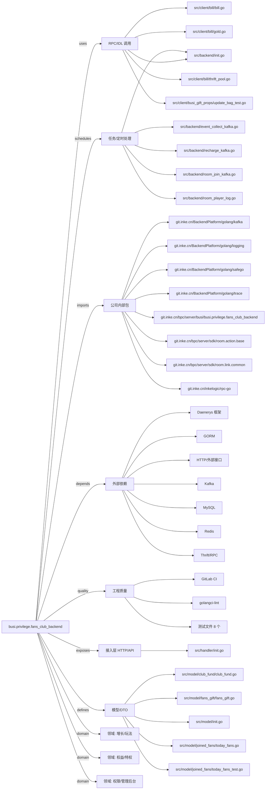

# busi.privilege.fans_club_backend 技术图谱

## 一图技术图谱


## 项目定位
- 源码路径：`/Users/dds/go/src/git.inke.cn/bpc/server/busi/busi.privilege.fans_club_backend`
- 领域判断：权益/特权, 增长/玩法, 权限/管理后台
- README 摘要：研发人员： 王子杰

```text
研发人员： 王子杰
计划：3-6提测，3-11提审
需求文档：http://wiki.inkept.cn/pages/viewpage.action?pageId=49063709
UI资源：
https://lanhuapp.com/url/Pbpnt
账号：guanyx331@163.com
密码：123456
接口协议：
粉丝团相关协议：
http://wiki.inkept.cn/pages/viewpage.action?pageId=50832965
公聊区、个人主页、个人资料卡特权相关协议
http://wiki.inkept.cn/pages/viewpage.action?pageId=49067120
```

## 静态结构画像
- 文本/代码文件数：96
- Go 文件数：86
- 文件类型分布：.go(86), .md(3), .yml(2), .json(2), .toml(2), .proto(1)
- 顶层目录分布：src(90), conf(2), Godeps(1)

## 关键目录
- `src`: 90 个文本/代码文件
- `conf`: 2 个文本/代码文件
- `Godeps`: 1 个文本/代码文件

## 代码分层
- 接入层文件：1 个
- 服务层文件：0 个
- 数据访问文件：0 个
- 模型文件：15 个
- 任务/定时相关文件：20 个
- RPC/IDL 相关文件：20 个

## API/路由线索
- 静态扫描未提取到显式路由字符串，需结合框架注册/网关配置确认

## 核心类型与方法线索
- 导出结构体：AppHandler, Event_love_rank_score_record_info, Bdlove_rank_score_record, PendantPosParams, Resource, Request, WowHttp, SendPropsKafkaModel, JoinRoomKafkaModel, ViewTask, ChorusLifecycleKafkaModel, SendGiftKafkaModel, Resource, StrategyEventKafka, AtomMsg, StayDurationKafka, Resource, RoomPlayerLogKafkaModel, Resource, UserAttendModel, LinkData, LinkInfo, UserRechargeKafkaModel, RoomPublishKafkaModel, Info, KafkaHandler, Config, Thrift, ViewTask, FansClubAnchorPublish
- 导出函数/方法：Serve, Wrapper, Get, Post, Validate, Handler, InitServer, IncrClubFund, MonitorLiveDaysProcess, CheckClubFundActivityCv, SendTicketEffect, IsAnchorLivingOrOnMic, Reward, Reward, Reward, Reward, TicketRewardWorker, WatchTaskReward, GetTicketByLevel, UpdateTicket, SendGiftReward, RefreshLightGiftWorker, PRRewardWorker, SpecialRewardTop1, SpecialTest, SendTicketFloatMsg, RecruitRewardWorker, TestLogicIsFans, CreateTableProcess, AutoLight

## 外部依赖线索
- HTTP/外部接口: 25 处信号
- Redis: 18 处信号
- Kafka: 12 处信号
- GORM: 5 处信号
- Daenerys 框架: 4 处信号
- Thrift/RPC: 4 处信号
- MySQL: 2 处信号

## 内部依赖线索
- `git.inke.cn/bpc/server/busi/busi.privilege.fans_club_backend`: 177
- `git.inke.cn/BackendPlatform/golang/logging`: 57
- `git.inke.cn/inkelogic/rpc-go`: 20
- `git.inke.cn/BackendPlatform/golang/trace`: 11
- `git.inke.cn/BackendPlatform/golang/kafka`: 11
- `git.inke.cn/BackendPlatform/golang/safego`: 9
- `git.inke.cn/bpc/server/sdk/room.action.base`: 6
- `git.inke.cn/bpc/server/sdk/room.link.common`: 6
- `git.inke.cn/bpc/server/sdk/user.profile.gateway`: 6
- `git.inke.cn/bpc/server/sdk/commlib`: 6
- `git.inke.cn/BackendPlatform/go-tools/cast`: 5
- `git.inke.cn/bpc/server/sdk/room.live.base`: 5

## 第三方 import 概览
- github.com(16), go.uber.org(14), golang.org(11), os(10), testing(8), flag(7), bytes(5), io(4), git.apache.org(2), syscall(1)

## IDL/协议文件
- `src/client/linkroommsg/linkroommsg.proto`

## 工程质量与交付
- GitLab CI：有
- golangci-lint：有
- 测试文件：
- `src/logic/fans_relation_test.go`
- `src/model/joined_fans/today_fans_test.go`
- `src/model/joined_fans/today_jr_pbc_times_test.go`
- `src/client/fans_club/query_fans_info_test.go`
- `src/client/busi_gift_props/update_bag_test.go`
- `src/client/room_live_base/get_live_anchor_id_test.go`
- `src/client/room_action_base/get_user_extra_info_test.go`
- `src/client/linkroommsg/send_pbc_bottom_tips_test.go`

## 阅读建议
- 先读 README 和 `server/http`、`handler`、`service` 目录，确认入口 API 与核心业务流程。
- 再沿服务层方法进入 DAO/Repo/Model，确认数据表、缓存 Key、RPC 调用和异步任务。
- 若图中只出现少量节点，通常表示该项目是配置型/胶水型服务，需结合上层共享工程和部署配置继续确认。
