# busi.privilege.goods 技术图谱

## 一图技术图谱

```mermaid
flowchart LR
  naa1df2ef["Daenerys 框架"]
  na05476e7["GitLab CI"]
  n7c735559["HTTP/外部接口"]
  n51be25b0["Kafka"]
  n62a004b9["MySQL"]
  n8aa21d2e["RPC/IDL 调用"]
  ne1114467["Redis"]
  n89b763d5["busi.privilege.goods"]
  nb9b1545a["dao/dao.go"]
  ne1e4bf68["dao/dao_test.go"]
  nc5c36ea3["dao/mysql_goods_category.go"]
  ndd76874b["dao/mysql_goods_category_test.go"]
  n20e55533["dao/mysql_goods_limit.go"]
  n01aa7ca1["dao/mysql_goods_limit_test.go"]
  n94f60c47["dao/mysql_goods_template.go"]
  ne6f54790["git.inke.cn/BackendPlatform/golang/kafka"]
  n7d7ea8b2["git.inke.cn/BackendPlatform/golang/logging"]
  na283f7b0["git.inke.cn/BackendPlatform/golang/redis"]
  nec5c5812["git.inke.cn/BackendPlatform/golang/sql"]
  n66a736ac["git.inke.cn/bpc/server/busi/busi.privilege.goods"]
  n0d851172["git.inke.cn/inkelogic/daenerys"]
  n0cea5f4d["git.inke.cn/inkelogic/daenerys/http/client"]
  n7bacf918["git.inke.cn/inkelogic/daenerys/http/server"]
  n8077df92["manager/manager.go"]
  n2912182e["model/constants.go"]
  nd711983d["model/goods_category.go"]
  nfdbaca24["model/goods_limit.go"]
  n3534923b["model/goods_template.go"]
  nc31b8654["model/model.go"]
  nfa1b8922["server/http/handler.go"]
  nf03d9c77["server/http/http.go"]
  n6dfa5257["server/http/router.go"]
  n9b96c301["service/goods_category.go"]
  nfb049571["service/goods_category_test.go"]
  n770c11f6["service/goods_limit.go"]
  n81c01ad3["service/goods_limit_test.go"]
  n13059ce0["service/goods_template.go"]
  n30da3ae5["service/goods_template_test.go"]
  neeade751["service/service.go"]
  n888b7733["业务服务层"]
  n7cc1b88f["公司内部包"]
  nb682654e["外部依赖"]
  nadeed157["工程质量"]
  n8de19b79["接入层 HTTP/API"]
  n9bfbba5f["数据访问层"]
  ne9fe3e59["模型/DTO"]
  ndba12569["测试文件 11 个"]
  nfb754e86["领域: 权益/特权"]
  n8aa21d2e --> nb9b1545a
  n8aa21d2e --> n8077df92
  n8aa21d2e --> nf03d9c77
  n89b763d5 -- "uses" --> n8aa21d2e
  n89b763d5 -- "core" --> n888b7733
  n89b763d5 -- "imports" --> n7cc1b88f
  n89b763d5 -- "depends" --> nb682654e
  n89b763d5 -- "quality" --> nadeed157
  n89b763d5 -- "exposes" --> n8de19b79
  n89b763d5 -- "persists" --> n9bfbba5f
  n89b763d5 -- "defines" --> ne9fe3e59
  n89b763d5 -- "domain" --> nfb754e86
  n888b7733 --> n9b96c301
  n888b7733 --> nfb049571
  n888b7733 --> n770c11f6
  n888b7733 --> n81c01ad3
  n888b7733 --> n13059ce0
  n888b7733 --> n30da3ae5
  n888b7733 --> neeade751
  n7cc1b88f --> ne6f54790
  n7cc1b88f --> n7d7ea8b2
  n7cc1b88f --> na283f7b0
  n7cc1b88f --> nec5c5812
  n7cc1b88f --> n66a736ac
  n7cc1b88f --> n0d851172
  n7cc1b88f --> n0cea5f4d
  n7cc1b88f --> n7bacf918
  nb682654e --> naa1df2ef
  nb682654e --> n7c735559
  nb682654e --> n51be25b0
  nb682654e --> n62a004b9
  nb682654e --> ne1114467
  nadeed157 --> na05476e7
  nadeed157 --> ndba12569
  n8de19b79 --> nfa1b8922
  n8de19b79 --> nf03d9c77
  n8de19b79 --> n6dfa5257
  n9bfbba5f --> nb9b1545a
  n9bfbba5f --> ne1e4bf68
  n9bfbba5f --> nc5c36ea3
  n9bfbba5f --> ndd76874b
  n9bfbba5f --> n20e55533
  n9bfbba5f --> n01aa7ca1
  n9bfbba5f --> n94f60c47
  ne9fe3e59 --> n2912182e
  ne9fe3e59 --> nd711983d
  ne9fe3e59 --> nfdbaca24
  ne9fe3e59 --> n3534923b
  ne9fe3e59 --> nc31b8654
```


## 项目定位
- 源码路径：`/Users/dds/go/src/git.inke.cn/bpc/server/busi/busi.privilege.goods`
- 领域判断：权益/特权
- README 摘要：busi.privilege.goods

```text
# busi.privilege.goods
## 项目简介
## 配置说明
## CHANGELOG
```

## 静态结构画像
- 文本/代码文件数：44
- Go 文件数：38
- 文件类型分布：.go(38), .md(2), .toml(2), .yml(1), .json(1)
- 顶层目录分布：dao(13), model(8), service(8), app(4), server(3), manager(2), api(2), utils(1), conf(1)

## 关键目录
- `dao`: 13 个文本/代码文件
- `model`: 8 个文本/代码文件
- `service`: 8 个文本/代码文件
- `app`: 4 个文本/代码文件
- `server`: 3 个文本/代码文件
- `manager`: 2 个文本/代码文件
- `api`: 2 个文本/代码文件
- `utils`: 1 个文本/代码文件
- `conf`: 1 个文本/代码文件

## 代码分层
- 接入层文件：3 个
- 服务层文件：8 个
- 数据访问文件：13 个
- 模型文件：8 个
- 任务/定时相关文件：0 个
- RPC/IDL 相关文件：3 个

## API/路由线索
- 静态扫描未提取到显式路由字符串，需结合框架注册/网关配置确认

## 核心类型与方法线索
- 导出结构体：Dao, RedisPrefixProxy, PipelineProxy, Manager, ListStandard, GoodsLimit, GoodsLimitItem, GoodsCategory, GoodsCategoryItem, GoodsTemplate, GoodsTemplateItem, Service, Config
- 导出函数/方法：TestDaoGetGoodsIdsByBuzId, TestDaoDelGoodsIdsByBuzIdCache, TestDaoSaveGoodsTemplate, TestDaoDelGoodsTemplate, TestDaoSearchGoodsTemplateList, TestDaoSearchGoodsTemplateListLike, TestDaoSearchGoodsTemplateInfo, TestDaoSearchGoodsTemplateListCount, TestDaoSearchGoodsIds, TestDaoGetGoodsTemplateInfo, TestDaoSetGoodsTemplateInfo, TestDaoGoodsTemplateListItem, SaveGoodsTemplate, DelGoodsTemplate, SearchGoodsTemplateList, SearchGoodsTemplateListLike, SearchGoodsTemplateInfo, SearchGoodsTemplateListCount, SearchGoodsIds, GetGoodsTemplateInfo, SetGoodsTemplateInfo, GoodsTemplateListItem, SaveGoodsCategory, DelGoodsCategory, SearchAllGoodsCategoryList, SearchGoodsCategoryList, SearchGoodsCategoryListCount, GetGoodsCategoryType, GetGoodsCategorySubType, SearchGoodsCategoryById

## 外部依赖线索
- Daenerys 框架: 10 处信号
- Redis: 10 处信号
- MySQL: 9 处信号
- HTTP/外部接口: 8 处信号
- Kafka: 4 处信号

## 内部依赖线索
- `git.inke.cn/bpc/server/busi/busi.privilege.goods`: 44
- `git.inke.cn/BackendPlatform/golang/logging`: 9
- `git.inke.cn/BackendPlatform/golang/redis`: 7
- `git.inke.cn/BackendPlatform/golang/sql`: 7
- `git.inke.cn/inkelogic/daenerys`: 6
- `git.inke.cn/BackendPlatform/golang/kafka`: 3
- `git.inke.cn/inkelogic/daenerys/http/client`: 3
- `git.inke.cn/inkelogic/daenerys/http/server`: 3
- `git.inke.cn/bpc/server/sdk/commlib`: 2
- `git.inke.cn/inkelogic/rpc-go`: 1
- `git.inke.cn/inkelogic/daenerys/proxy`: 1
- `git.inke.cn/BackendPlatform/golang/ecode`: 1

## 第三方 import 概览
- testing(11), github.com(8), os(2), flag(1), log(1), syscall(1), reflect(1)

## IDL/协议文件
- 未发现 proto/thrift 文件

## 工程质量与交付
- GitLab CI：有
- golangci-lint：未发现
- 测试文件：
- `dao/redis_goods_limit_test.go`
- `dao/mysql_goods_template_test.go`
- `dao/redis_goods_template_test.go`
- `dao/dao_test.go`
- `dao/mysql_goods_category_test.go`
- `dao/mysql_goods_limit_test.go`
- `manager/manager_test.go`
- `service/service_test.go`
- `service/goods_limit_test.go`
- `service/goods_template_test.go`
- `service/goods_category_test.go`

## 阅读建议
- 先读 README 和 `server/http`、`handler`、`service` 目录，确认入口 API 与核心业务流程。
- 再沿服务层方法进入 DAO/Repo/Model，确认数据表、缓存 Key、RPC 调用和异步任务。
- 若图中只出现少量节点，通常表示该项目是配置型/胶水型服务，需结合上层共享工程和部署配置继续确认。
