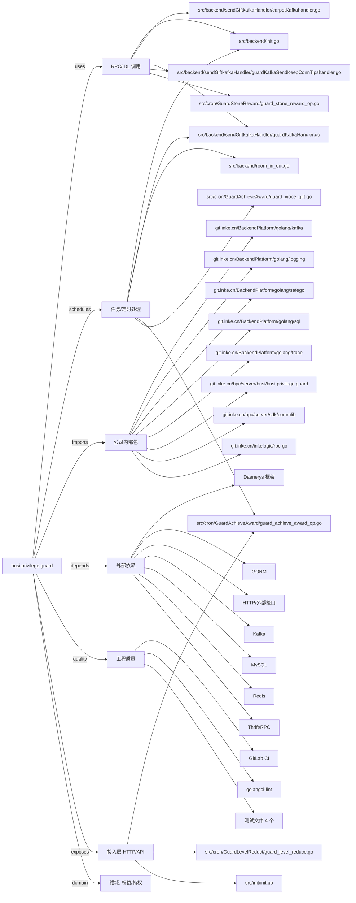

# busi.privilege.guard 技术图谱

## 一图技术图谱


## 项目定位
- 源码路径：`/Users/dds/go/src/git.inke.cn/bpc/server/busi/busi.privilege.guard`
- 领域判断：权益/特权
- README 摘要：[](https://code.inke.cn/bpc/server/busi/busi.privilege.guard/commits/master)
[](https://code.inke.cn/bpc/server/busi/busi.privilege.guard/commits/master)
守护重构新服务
产品文档 ：http://wiki.inkept.cn/pages/viewpage.action?pageId=22957338
接口文档 ：http://wiki.inkept.cn/pages/viewpage.action?pageId=16457590
```

## 静态结构画像
- 文本/代码文件数：185
- Go 文件数：178
- 文件类型分布：.go(178), .yml(2), .toml(2), .md(1), .json(1), .proto(1)
- 顶层目录分布：src(180), etc(2)

## 关键目录
- `src`: 180 个文本/代码文件
- `etc`: 2 个文本/代码文件

## 代码分层
- 接入层文件：3 个
- 服务层文件：0 个
- 数据访问文件：0 个
- 模型文件：0 个
- 任务/定时相关文件：20 个
- RPC/IDL 相关文件：20 个

## API/路由线索
- `=`

## 核心类型与方法线索
- 导出结构体：GuardBirthdayReq, GuardBirthdayItemReq, GuardSkinReissueReq, GuardFansReissueReq, ApiGuardFansReissueHandler, ApiGuardVoiceGiftIdsHandler, ApiGuardPublisherListHandler, ApiGuardPublisherHandler, ApiCarpetInfoHandler, UserInfo, GiftInfo, SvgaResInfo, CarpetData, ApiResetCustomMedalHandler, ResetCustomMedalReq, ApiGuardManageHandler, ApiGuardStoneTextHandler, GuardStoneTextDataRes, GuardStoneIndexDataRes, GuardStoneIndexData, IndexListUserInfo, ApiGuardStoneIndexHandler, ApiGuardStoneMySignHandler, GuardStonePublisherList, ApiMyGuardStoneListHandler, GuardStoneSignReq, ApiGuardStoneSignHandler, ApiGuardStoneSignUpdateHandler, ApiGuardStoneSignDelHandler, ApiGuardStoneRewardListHandler
- 导出函数/方法：PreProcess, Process, PostProcess, PreProcess, Process, PostProcess, Process, PostProcess, PreProcess, Process, PostProcess, Serve, ParseParam, Check, Serve, PreProcess, Process, PostProcess, Serve, Serve, Serve, Serve, ParseParam, CheckParam, Serve, Serve, Serve, Serve, RubbishCheckV2, PreProcess

## 外部依赖线索
- HTTP/外部接口: 85 处信号
- Redis: 39 处信号
- Kafka: 23 处信号
- GORM: 16 处信号
- Daenerys 框架: 10 处信号
- Thrift/RPC: 9 处信号
- MySQL: 6 处信号

## 内部依赖线索
- `git.inke.cn/bpc/server/busi/busi.privilege.guard`: 321
- `git.inke.cn/BackendPlatform/golang/logging`: 139
- `git.inke.cn/inkelogic/rpc-go`: 32
- `git.inke.cn/bpc/server/sdk/commlib`: 23
- `git.inke.cn/BackendPlatform/golang/trace`: 20
- `git.inke.cn/BackendPlatform/golang/safego`: 16
- `git.inke.cn/BackendPlatform/golang/sql`: 15
- `git.inke.cn/BackendPlatform/golang/kafka`: 13
- `git.inke.cn/BackendPlatform/go-tools/cast`: 9
- `git.inke.cn/bpc/server/sdk/room.action.base`: 9
- `git.inke.cn/bpc/server/sdk/room.live.base`: 9
- `git.inke.cn/BackendPlatform/golang/ecode`: 7

## 第三方 import 概览
- github.com(30), bytes(18), io(17), go.uber.org(17), busi.privilege.guard(11), runtime(6), golang.org(4), testing(4), database(3), reflect(3)

## IDL/协议文件
- `src/protocol/push.proto`

## 工程质量与交付
- GitLab CI：有
- golangci-lint：有
- 测试文件：
- `src/handler/guard_skin_reissue_test.go`
- `src/handler/guard_page_test.go`
- `src/handler/add_guard_voice_gift_test.go`
- `src/handler/guard_star_test.go`

## 阅读建议
- 先读 README 和 `server/http`、`handler`、`service` 目录，确认入口 API 与核心业务流程。
- 再沿服务层方法进入 DAO/Repo/Model，确认数据表、缓存 Key、RPC 调用和异步任务。
- 若图中只出现少量节点，通常表示该项目是配置型/胶水型服务，需结合上层共享工程和部署配置继续确认。
