# busi.privilege.guard_backend 技术图谱

## 一图技术图谱

```mermaid
flowchart LR
  naa1df2ef["Daenerys 框架"]
  n8f718eeb["GORM"]
  na05476e7["GitLab CI"]
  n7c735559["HTTP/外部接口"]
  n51be25b0["Kafka"]
  n62a004b9["MySQL"]
  n8aa21d2e["RPC/IDL 调用"]
  ne1114467["Redis"]
  n4e96cf40["Thrift/RPC"]
  nd3cffdee["app/main.go"]
  n7a224e78["backend/init.go"]
  ne11e6fb2["backend/kafka_consume.go"]
  nb733eace["backend/live_consume.go"]
  n6cfbac91["backend/room_noble_seat_ticker.go"]
  nb62e6828["billservice/Bill-consts.go"]
  n04ee4a86["billservice/Bill.go"]
  n4983a102["billservice/GoUnusedProtection__.go"]
  n2fd9e0e6["busi.privilege.guard_backend"]
  nee825e8b["client/utils.go"]
  nb9b1545a["dao/dao.go"]
  n86f071c7["dao/guard_record_mysql.go"]
  n7e3244aa["dao/kafka/kafka.go"]
  n6fb2cac9["dao/mysql/guard_blindbox_exchange_record_mysql.go"]
  n8ce3b14a["dao/mysql/guard_blindbox_get_record_mysql.go"]
  n625a7357["dao/mysql/guard_blindbox_open_record_mysql.go"]
  nc468cd99["dao/mysql/guard_blindbox_props_record_mysql.go"]
  n7d7ea8b2["git.inke.cn/BackendPlatform/golang/logging"]
  n14b7f193["git.inke.cn/BackendPlatform/golang/safego"]
  n09b0b0d9["git.inke.cn/bpc/server/busi/busi.privilege.guard_backend"]
  n780a94b0["git.inke.cn/bpc/server/sdk/commconst"]
  n7de617ec["git.inke.cn/bpc/server/sdk/commlib"]
  n58d5ea77["git.inke.cn/bpc/server/sdk/shanyin.server.serviceinfo"]
  nc0132d30["git.inke.cn/bpc/server/sdk/user.account.common_config"]
  n7bacf918["git.inke.cn/inkelogic/daenerys/http/server"]
  ne7b37ee1["golangci-lint"]
  n2c1fcf77["handler/guard_skin_buy.go"]
  n8663d381["handler/guard_task_home_page.go"]
  n1cd839b1["handler/utils.go"]
  n20a313f2["model/const.go"]
  n8039464b["model/error_code.go"]
  n6e8fb1b2["model/guard_blindbox.go"]
  ne295ea17["model/guard_blindbox_exchange_record.go"]
  na15f2101["model/guard_blindbox_get_record.go"]
  n2261561d["server/http/guard_blindbox.go"]
  nf03d9c77["server/http/http.go"]
  n4d17bdcb["service/guard_blindbox_exchange_record.go"]
  n0d1f5f98["service/guard_blindbox_get_record.go"]
  n83d2c64e["service/guard_blindbox_h5.go"]
  n454c6b7d["service/guard_blindbox_h5_prize.go"]
  n98d68ced["service/guard_blindbox_h5_send_prize.go"]
  n1efd7c42["service/guard_blindbox_open.go"]
  n4e726dcb["service/guard_blindbox_open_record.go"]
  n888b7733["业务服务层"]
  n8d81b440["任务/定时处理"]
  n7cc1b88f["公司内部包"]
  nb682654e["外部依赖"]
  nadeed157["工程质量"]
  n8de19b79["接入层 HTTP/API"]
  n9bfbba5f["数据访问层"]
  ne9fe3e59["模型/DTO"]
  nfb754e86["领域: 权益/特权"]
  nc1d8f75a["领域: 权限/管理后台"]
  n8aa21d2e --> nd3cffdee
  n8aa21d2e --> nb62e6828
  n8aa21d2e --> n04ee4a86
  n8aa21d2e --> n4983a102
  n8aa21d2e --> nee825e8b
  n2fd9e0e6 -- "uses" --> n8aa21d2e
  n2fd9e0e6 -- "core" --> n888b7733
  n2fd9e0e6 -- "schedules" --> n8d81b440
  n2fd9e0e6 -- "imports" --> n7cc1b88f
  n2fd9e0e6 -- "depends" --> nb682654e
  n2fd9e0e6 -- "quality" --> nadeed157
  n2fd9e0e6 -- "exposes" --> n8de19b79
  n2fd9e0e6 -- "persists" --> n9bfbba5f
  n2fd9e0e6 -- "defines" --> ne9fe3e59
  n2fd9e0e6 -- "domain" --> nfb754e86
  n2fd9e0e6 -- "domain" --> nc1d8f75a
  n888b7733 --> n4d17bdcb
  n888b7733 --> n0d1f5f98
  n888b7733 --> n83d2c64e
  n888b7733 --> n454c6b7d
  n888b7733 --> n98d68ced
  n888b7733 --> n1efd7c42
  n888b7733 --> n4e726dcb
  n8d81b440 --> nd3cffdee
  n8d81b440 --> n7a224e78
  n8d81b440 --> ne11e6fb2
  n8d81b440 --> nb733eace
  n8d81b440 --> n6cfbac91
  n7cc1b88f --> n7d7ea8b2
  n7cc1b88f --> n14b7f193
  n7cc1b88f --> n09b0b0d9
  n7cc1b88f --> n780a94b0
  n7cc1b88f --> n7de617ec
  n7cc1b88f --> n58d5ea77
  n7cc1b88f --> nc0132d30
  n7cc1b88f --> n7bacf918
  nb682654e --> naa1df2ef
  nb682654e --> n8f718eeb
  nb682654e --> n7c735559
  nb682654e --> n51be25b0
  nb682654e --> n62a004b9
  nb682654e --> ne1114467
  nb682654e --> n4e96cf40
  nadeed157 --> na05476e7
  nadeed157 --> ne7b37ee1
  n8de19b79 --> n2c1fcf77
  n8de19b79 --> n8663d381
  n8de19b79 --> n1cd839b1
  n8de19b79 --> n2261561d
  n8de19b79 --> nf03d9c77
  n9bfbba5f --> nb9b1545a
  n9bfbba5f --> n86f071c7
  n9bfbba5f --> n7e3244aa
  n9bfbba5f --> n6fb2cac9
  n9bfbba5f --> n8ce3b14a
  n9bfbba5f --> n625a7357
  n9bfbba5f --> nc468cd99
  ne9fe3e59 --> n20a313f2
  ne9fe3e59 --> n8039464b
  ne9fe3e59 --> n6e8fb1b2
  ne9fe3e59 --> ne295ea17
  ne9fe3e59 --> na15f2101
```


## 项目定位
- 源码路径：`/Users/dds/go/src/git.inke.cn/bpc/server/busi/busi.privilege.guard_backend`
- 领域判断：权益/特权, 权限/管理后台
- README 摘要：busi.privilege.guard_backend

```text
# busi.privilege.guard_backend
守护backend, 比如周守任务
```

## 静态结构画像
- 文本/代码文件数：72
- Go 文件数：64
- 文件类型分布：.go(64), .yml(2), .toml(2), .md(1), .json(1), .thrift(1), .proto(1)
- 顶层目录分布：dao(14), service(13), model(12), backend(6), handler(4), app(4), billservice(4), server(3), client(3), api(2)

## 关键目录
- `dao`: 14 个文本/代码文件
- `service`: 13 个文本/代码文件
- `model`: 12 个文本/代码文件
- `backend`: 6 个文本/代码文件
- `handler`: 4 个文本/代码文件
- `app`: 4 个文本/代码文件
- `billservice`: 4 个文本/代码文件
- `server`: 3 个文本/代码文件
- `client`: 3 个文本/代码文件
- `api`: 2 个文本/代码文件
- `globals`: 1 个文本/代码文件
- `thrift`: 1 个文本/代码文件

## 代码分层
- 接入层文件：6 个
- 服务层文件：13 个
- 数据访问文件：14 个
- 模型文件：11 个
- 任务/定时相关文件：19 个
- RPC/IDL 相关文件：11 个

## API/路由线索
- 静态扫描未提取到显式路由字符串，需结合框架注册/网关配置确认

## 核心类型与方法线索
- 导出结构体：Redis, Kafka, TaskRecord, EpochRecord, EpochStatus, Mysql, GiftThrift, Manager, BillThriftException, BillContent, GiftContent, SilverContent, SeqResult_, BillResult_, BalanceContent, BalanceResult_, BillParam, BillDetailParam, GuardBlindboxExchangeRecordModel, GuardBlindboxExchangeRecordAddReq, GuardBlindboxExchangeRecordDetailReq, GuardBlindboxExchangeRecordListReq, GuardBlindboxExchangeRecordModelList, GuardBlindboxExchangeRecordListResp, GuardBlindboxExchangeRecordDetailResp, GuardBlindboxExchangeAwardInfo, GuardBlindboxThemePropsModel, PropsValidConfigItem, GuardBlindboxThemePropsAddReq, GuardBlindboxThemePropsDetailReq
- 导出函数/方法：GetGuardTaskHomePage, Bind, GuardRepaireData, GuardSkinBuy, UpdateGold, Init, GetGuardRecordTableName, FindGuardRecordByCondition, UpdateGuardRecordByCondition, FindGuardRecordByPage, GetGuardRecordTotalCount, Init, GetSendGiftKafka, GetRoomPublishKafka, GetGuardDb, GetGuardRedis, GetGuardBlindboxInfoKey, GetUserFirstJoinRoomKey, GetUserHasThemeKey, GetGuardBlindBoxPopupKey, AddCacheCacheExpired, GetCache, GetCacheInt, GetNowTime, SetNowTime, IncryByCacheExpired, NewRedis, AddToNobleSeatDelayQueue, DelFromNobleSeatDelayQueue, GetFromNobleSeatDelayQueue

## 外部依赖线索
- MySQL: 20 处信号
- Redis: 17 处信号
- GORM: 16 处信号
- HTTP/外部接口: 15 处信号
- Daenerys 框架: 14 处信号
- Kafka: 9 处信号
- Thrift/RPC: 8 处信号

## 内部依赖线索
- `git.inke.cn/bpc/server/busi/busi.privilege.guard_backend`: 79
- `git.inke.cn/BackendPlatform/golang/logging`: 39
- `git.inke.cn/bpc/server/sdk/commlib`: 15
- `git.inke.cn/inkelogic/daenerys/http/server`: 6
- `git.inke.cn/BackendPlatform/golang/safego`: 6
- `git.inke.cn/bpc/server/sdk/user.account.common_config`: 6
- `git.inke.cn/bpc/server/sdk/shanyin.server.serviceinfo`: 5
- `git.inke.cn/bpc/server/sdk/commconst`: 5
- `git.inke.cn/BackendPlatform/golang/trace`: 4
- `git.inke.cn/inkelogic/daenerys`: 4
- `git.inke.cn/bpc/server/sdk/ka`: 4
- `git.inke.cn/bpc/server/sdk/finance.bill.service`: 3

## 第三方 import 概览
- github.com(19), runtime(3), bytes(3), os(2), golang.org(2), git.apache.org(2), flag(1), log(1), syscall(1), code.inke.cn(1)

## IDL/协议文件
- `billservice/BillService.thrift`
- `model/pb/push.proto`

## 工程质量与交付
- GitLab CI：有
- golangci-lint：有
- 测试文件：
- 未发现 `_test.go`

## 阅读建议
- 先读 README 和 `server/http`、`handler`、`service` 目录，确认入口 API 与核心业务流程。
- 再沿服务层方法进入 DAO/Repo/Model，确认数据表、缓存 Key、RPC 调用和异步任务。
- 若图中只出现少量节点，通常表示该项目是配置型/胶水型服务，需结合上层共享工程和部署配置继续确认。
