# busi.privilege.new_shopping 技术图谱

## 一图技术图谱

```mermaid
flowchart LR
  naa1df2ef["Daenerys 框架"]
  n8f718eeb["GORM"]
  na05476e7["GitLab CI"]
  n7c735559["HTTP/外部接口"]
  n51be25b0["Kafka"]
  n62a004b9["MySQL"]
  n8aa21d2e["RPC/IDL 调用"]
  ne1114467["Redis"]
  n4e96cf40["Thrift/RPC"]
  nd3cffdee["app/main.go"]
  n286b8ae1["backend/backendTask.go"]
  ne8099d8a["busi.privilege.new_shopping"]
  nbc0c8eb0["conf/config.go"]
  nf0c39162["dao/crm.go"]
  nb9b1545a["dao/dao.go"]
  n281f890a["dao/dress_shop.go"]
  n891e42a9["dao/dress_sidebar_dao.go"]
  n88dae59e["dao/goods.go"]
  nb8255d82["dao/goods_discount.go"]
  nc0578c98["dao/goods_order.go"]
  n63e74849["git.inke.cn/BackendPlatform/golang/ecode"]
  n7d7ea8b2["git.inke.cn/BackendPlatform/golang/logging"]
  n14b7f193["git.inke.cn/BackendPlatform/golang/safego"]
  ne2260199["git.inke.cn/BackendPlatform/golang/trace"]
  n81e23f61["git.inke.cn/bpc/server/busi/busi.privilege.new_shopping"]
  n7bacf918["git.inke.cn/inkelogic/daenerys/http/server"]
  n8501d0ab["git.inke.cn/inkelogic/daenerys/proxy"]
  n961ac33a["git.inke.cn/inkelogic/rpc-go"]
  ne7b37ee1["golangci-lint"]
  n2b9865ff["manager/billservice/Bill-consts.go"]
  n8989f978["manager/billservice/Bill.go"]
  na4f68c15["manager/billservice/GoUnusedProtection__.go"]
  n8077df92["manager/manager.go"]
  n253e5cac["manager/room_sidebar_manager.go"]
  n20a313f2["model/const.go"]
  n6a00ba84["model/delivery.go"]
  n64d9f47f["model/do.go"]
  n78def9d5["model/dto.go"]
  nf5feea26["model/ecode.go"]
  n33103421["model/model_room_sidebar.go"]
  n809ad4a0["server/http/arguments_room_sidebar.go"]
  nfb8077f5["server/http/gift_collection.go"]
  n654eba4f["server/http/goods.go"]
  nf03d9c77["server/http/http.go"]
  ne8862f15["server/http/middleware.go"]
  nccb53ae7["service/animation.go"]
  n84cf41c2["service/bill_service.go"]
  n7f97aeb6["service/black_card.go"]
  n0d130a27["service/common.go"]
  nd0b3572b["service/delivery.go"]
  n957b3769["service/dress_delivery.go"]
  nf91eb2c1["service/dress_shop.go"]
  n888b7733["业务服务层"]
  n8d81b440["任务/定时处理"]
  n7cc1b88f["公司内部包"]
  nb682654e["外部依赖"]
  nadeed157["工程质量"]
  n8de19b79["接入层 HTTP/API"]
  n9bfbba5f["数据访问层"]
  ne9fe3e59["模型/DTO"]
  nfb754e86["领域: 权益/特权"]
  n8aa21d2e --> nbc0c8eb0
  n8aa21d2e --> n2b9865ff
  n8aa21d2e --> n8989f978
  n8aa21d2e --> na4f68c15
  n8aa21d2e --> n8077df92
  ne8099d8a -- "uses" --> n8aa21d2e
  ne8099d8a -- "core" --> n888b7733
  ne8099d8a -- "schedules" --> n8d81b440
  ne8099d8a -- "imports" --> n7cc1b88f
  ne8099d8a -- "depends" --> nb682654e
  ne8099d8a -- "quality" --> nadeed157
  ne8099d8a -- "exposes" --> n8de19b79
  ne8099d8a -- "persists" --> n9bfbba5f
  ne8099d8a -- "defines" --> ne9fe3e59
  ne8099d8a -- "domain" --> nfb754e86
  n888b7733 --> nccb53ae7
  n888b7733 --> n84cf41c2
  n888b7733 --> n7f97aeb6
  n888b7733 --> n0d130a27
  n888b7733 --> nd0b3572b
  n888b7733 --> n957b3769
  n888b7733 --> nf91eb2c1
  n8d81b440 --> nd3cffdee
  n8d81b440 --> n286b8ae1
  n8d81b440 --> n253e5cac
  n8d81b440 --> n33103421
  n8d81b440 --> n0d130a27
  n7cc1b88f --> n63e74849
  n7cc1b88f --> n7d7ea8b2
  n7cc1b88f --> n14b7f193
  n7cc1b88f --> ne2260199
  n7cc1b88f --> n81e23f61
  n7cc1b88f --> n7bacf918
  n7cc1b88f --> n8501d0ab
  n7cc1b88f --> n961ac33a
  nb682654e --> naa1df2ef
  nb682654e --> n8f718eeb
  nb682654e --> n7c735559
  nb682654e --> n51be25b0
  nb682654e --> n62a004b9
  nb682654e --> ne1114467
  nb682654e --> n4e96cf40
  nadeed157 --> na05476e7
  nadeed157 --> ne7b37ee1
  n8de19b79 --> n809ad4a0
  n8de19b79 --> nfb8077f5
  n8de19b79 --> n654eba4f
  n8de19b79 --> nf03d9c77
  n8de19b79 --> ne8862f15
  n9bfbba5f --> nf0c39162
  n9bfbba5f --> nb9b1545a
  n9bfbba5f --> n281f890a
  n9bfbba5f --> n891e42a9
  n9bfbba5f --> n88dae59e
  n9bfbba5f --> nb8255d82
  n9bfbba5f --> nc0578c98
  ne9fe3e59 --> n20a313f2
  ne9fe3e59 --> n6a00ba84
  ne9fe3e59 --> n64d9f47f
  ne9fe3e59 --> n78def9d5
  ne9fe3e59 --> nf5feea26
```


## 项目定位
- 源码路径：`/Users/dds/go/src/git.inke.cn/bpc/server/busi/busi.privilege.new_shopping`
- 领域判断：权益/特权
- README 摘要：busi.privilege.new_shopping

```text
# busi.privilege.new_shopping
[](https://code.inke.cn/bpc/server/busi/busi.privilege.new_shopping/commits/master)
[](https://code.inke.cn/bpc/server/busi/busi.privilege.new_shopping/commits/master)
## 项目简介
商城服务WIKI： https://wiki.inkept.cn/pages/viewpage.action?pageId=80245769
- 数据库表见当前目录：shopping_store.sql
- 接口postman当前目录：postman.json
## 配置说明
## CHANGELOG
## 测试
旧版商城接口示例已下线并清理
# pool
```

## 静态结构画像
- 文本/代码文件数：110
- Go 文件数：100
- 文件类型分布：.go(100), .md(3), .yml(2), .toml(2), .sql(1), .json(1), .thrift(1)
- 顶层目录分布：service(33), manager(25), dao(16), server(9), model(9), datalog(4), app(4), api(2), utils(1), backend(1)

## 关键目录
- `service`: 33 个文本/代码文件
- `manager`: 25 个文本/代码文件
- `dao`: 16 个文本/代码文件
- `server`: 9 个文本/代码文件
- `model`: 9 个文本/代码文件
- `datalog`: 4 个文本/代码文件
- `app`: 4 个文本/代码文件
- `api`: 2 个文本/代码文件
- `utils`: 1 个文本/代码文件
- `backend`: 1 个文本/代码文件
- `sdk`: 1 个文本/代码文件
- `conf`: 1 个文本/代码文件

## 代码分层
- 接入层文件：8 个
- 服务层文件：20 个
- 数据访问文件：16 个
- 模型文件：9 个
- 任务/定时相关文件：9 个
- RPC/IDL 相关文件：15 个

## API/路由线索
- 静态扫描未提取到显式路由字符串，需结合框架注册/网关配置确认

## 核心类型与方法线索
- 导出结构体：Event_dress_gift_log_info, Bddress_gift_log, Event_pk_coin_shopping_order_info, Bdpk_coin_shopping_order, CrmUser, Dao, RedisPrefixProxy, Atom, ResData, ResAccount, BlackGoldLevelReq, BlackGoldLevelResp, BlackGoldLevel, AddRelationFrameReq, AddLiveBackgroundReq, GiftThrift, AddMicrophoneReq, Manager, AddSpeechReq, BillThriftException, BillContent, GiftContent, SilverContent, SeqResult_, BillResult_, BalanceContent, BalanceResult_, BillParam, BillDetailParam, Config
- 导出函数/方法：PkCoinShoppingOrder, DressGiftLog, DataLog, DataLog, Module, AppType, DataKey, DataKeyWithParam, Product, MetricServerEID, LoggingServerEID, DataLog, Module, AppType, DataKey, DataKeyWithParam, Product, MetricServerEID, LoggingServerEID, InitKafkaConsumer, GetShelvesGoods, GetOnlineShelvesGoods, AddGoodsOrder, UpdateGoodsOrder, GetGoodsOrderByStatus, GetShelvesType, GetGoodLimit, Lock, Unlock, GetGoods

## 外部依赖线索
- HTTP/外部接口: 29 处信号
- Daenerys 框架: 18 处信号
- Thrift/RPC: 9 处信号
- Kafka: 8 处信号
- GORM: 7 处信号
- Redis: 6 处信号
- MySQL: 1 处信号

## 内部依赖线索
- `git.inke.cn/bpc/server/busi/busi.privilege.new_shopping`: 97
- `git.inke.cn/BackendPlatform/golang/logging`: 63
- `git.inke.cn/BackendPlatform/golang/ecode`: 35
- `git.inke.cn/inkelogic/daenerys/http/server`: 8
- `git.inke.cn/BackendPlatform/golang/trace`: 6
- `git.inke.cn/inkelogic/rpc-go`: 5
- `git.inke.cn/BackendPlatform/golang/safego`: 5
- `git.inke.cn/inkelogic/daenerys/proxy`: 4
- `git.inke.cn/inkelogic/daenerys`: 3
- `git.inke.cn/bpc/server/sdk/commlib`: 3
- `git.inke.cn/BackendPlatform/go-tools/cast`: 3
- `git.inke.cn/inkelogic/daenerys/http/client`: 3

## 第三方 import 概览
- github.com(21), go.uber.org(6), bytes(6), crypto(3), reflect(2), os(2), unsafe(2), flag(1), log(1), syscall(1)

## IDL/协议文件
- `manager/billservice/BillService.thrift`

## 工程质量与交付
- GitLab CI：有
- golangci-lint：有
- 测试文件：
- 未发现 `_test.go`

## 阅读建议
- 先读 README 和 `server/http`、`handler`、`service` 目录，确认入口 API 与核心业务流程。
- 再沿服务层方法进入 DAO/Repo/Model，确认数据表、缓存 Key、RPC 调用和异步任务。
- 若图中只出现少量节点，通常表示该项目是配置型/胶水型服务，需结合上层共享工程和部署配置继续确认。
