# busi.privilege.new_userbag 技术图谱

## 一图技术图谱

```mermaid
flowchart LR
  naa1df2ef["Daenerys 框架"]
  n8f718eeb["GORM"]
  na05476e7["GitLab CI"]
  n7c735559["HTTP/外部接口"]
  n51be25b0["Kafka"]
  n62a004b9["MySQL"]
  n8aa21d2e["RPC/IDL 调用"]
  ne1114467["Redis"]
  nd3cffdee["app/main.go"]
  ne12c8207["backend/black_msg.go"]
  n1a2d03f9["backend/timer.go"]
  nc55dbd3f["busi.privilege.new_userbag"]
  nd37c6710["dao/add_lock.go"]
  n4cd7abaf["dao/cache.go"]
  n09d2a27f["dao/cache_key.go"]
  n830b104e["dao/cache_style.go"]
  nb9b1545a["dao/dao.go"]
  ndae3481f["dao/guard_redis.go"]
  ndc72baa0["dao/microphone_dynamic_effect_purchased.go"]
  n4d668def["dao/timeout.go"]
  nbfa5311d["git.inke.cn/BackendPlatform/go-tools/cast"]
  n63e74849["git.inke.cn/BackendPlatform/golang/ecode"]
  n7d7ea8b2["git.inke.cn/BackendPlatform/golang/logging"]
  nc6de6f65["git.inke.cn/bpc/server/busi/busi.privilege.new_userbag"]
  n780a94b0["git.inke.cn/bpc/server/sdk/commconst"]
  n7de617ec["git.inke.cn/bpc/server/sdk/commlib"]
  nc0132d30["git.inke.cn/bpc/server/sdk/user.account.common_config"]
  n0cea5f4d["git.inke.cn/inkelogic/daenerys/http/client"]
  ne7b37ee1["golangci-lint"]
  n8077df92["manager/manager.go"]
  n60f7f5db["manager/privilige_info.go"]
  n8e8735e0["manager/util.go"]
  n8e49631b["model/action_rules.go"]
  nd437982b["model/activity.go"]
  n4c455b19["model/base.go"]
  nca40ecd6["model/check.go"]
  n20a313f2["model/const.go"]
  n31c9e1d4["model/request.go"]
  n454ee1ae["server/http/goods_share.go"]
  nfa1b8922["server/http/handler.go"]
  nf03d9c77["server/http/http.go"]
  n6dfa5257["server/http/router.go"]
  nf2c62ab5["server/middleware/middleware.go"]
  n694756f6["service/constants.go"]
  n546d4cde["service/consume_link.go"]
  n4294bd34["service/consume_room_join_leave.go"]
  n4ba8225b["service/consume_sendgift.go"]
  nb102cf39["service/goods_room_share.go"]
  n90a79a95["service/goods_room_share_head_portrait.go"]
  n09c4db48["service/goods_room_share_microphone.go"]
  n888b7733["业务服务层"]
  n8d81b440["任务/定时处理"]
  n7cc1b88f["公司内部包"]
  nb682654e["外部依赖"]
  nadeed157["工程质量"]
  n8de19b79["接入层 HTTP/API"]
  n9bfbba5f["数据访问层"]
  ne9fe3e59["模型/DTO"]
  nfb754e86["领域: 权益/特权"]
  nfc56e941["领域: 礼物/打赏"]
  n8aa21d2e --> n1a2d03f9
  n8aa21d2e --> n8077df92
  n8aa21d2e --> n60f7f5db
  n8aa21d2e --> n8e8735e0
  n8aa21d2e --> nf03d9c77
  nc55dbd3f -- "uses" --> n8aa21d2e
  nc55dbd3f -- "core" --> n888b7733
  nc55dbd3f -- "schedules" --> n8d81b440
  nc55dbd3f -- "imports" --> n7cc1b88f
  nc55dbd3f -- "depends" --> nb682654e
  nc55dbd3f -- "quality" --> nadeed157
  nc55dbd3f -- "exposes" --> n8de19b79
  nc55dbd3f -- "persists" --> n9bfbba5f
  nc55dbd3f -- "defines" --> ne9fe3e59
  nc55dbd3f -- "domain" --> nfb754e86
  nc55dbd3f -- "domain" --> nfc56e941
  n888b7733 --> n694756f6
  n888b7733 --> n546d4cde
  n888b7733 --> n4294bd34
  n888b7733 --> n4ba8225b
  n888b7733 --> nb102cf39
  n888b7733 --> n90a79a95
  n888b7733 --> n09c4db48
  n8d81b440 --> nd3cffdee
  n8d81b440 --> ne12c8207
  n8d81b440 --> n1a2d03f9
  n8d81b440 --> n4d668def
  n8d81b440 --> n31c9e1d4
  n7cc1b88f --> nbfa5311d
  n7cc1b88f --> n63e74849
  n7cc1b88f --> n7d7ea8b2
  n7cc1b88f --> nc6de6f65
  n7cc1b88f --> n780a94b0
  n7cc1b88f --> n7de617ec
  n7cc1b88f --> nc0132d30
  n7cc1b88f --> n0cea5f4d
  nb682654e --> naa1df2ef
  nb682654e --> n8f718eeb
  nb682654e --> n7c735559
  nb682654e --> n51be25b0
  nb682654e --> n62a004b9
  nb682654e --> ne1114467
  nadeed157 --> na05476e7
  nadeed157 --> ne7b37ee1
  n8de19b79 --> n454ee1ae
  n8de19b79 --> nfa1b8922
  n8de19b79 --> nf03d9c77
  n8de19b79 --> n6dfa5257
  n8de19b79 --> nf2c62ab5
  n9bfbba5f --> nd37c6710
  n9bfbba5f --> n4cd7abaf
  n9bfbba5f --> n09d2a27f
  n9bfbba5f --> n830b104e
  n9bfbba5f --> nb9b1545a
  n9bfbba5f --> ndae3481f
  n9bfbba5f --> ndc72baa0
  ne9fe3e59 --> n8e49631b
  ne9fe3e59 --> nd437982b
  ne9fe3e59 --> n4c455b19
  ne9fe3e59 --> nca40ecd6
  ne9fe3e59 --> n20a313f2
```


## 项目定位
- 源码路径：`/Users/dds/go/src/git.inke.cn/bpc/server/busi/busi.privilege.new_userbag`
- 领域判断：礼物/打赏, 权益/特权
- README 摘要：busi.privilege.new_userbag

```text
# busi.privilege.new_userbag
## 项目简介
## 配置说明
## CHANGELOG
```

## 静态结构画像
- 文本/代码文件数：182
- Go 文件数：174
- 文件类型分布：.go(174), .yml(2), .md(2), .toml(2), .sql(1), .json(1)
- 顶层目录分布：service(77), model(41), manager(25), dao(16), server(7), app(4), backend(2), api(2), globals(1), util(1)

## 关键目录
- `service`: 77 个文本/代码文件
- `model`: 41 个文本/代码文件
- `manager`: 25 个文本/代码文件
- `dao`: 16 个文本/代码文件
- `server`: 7 个文本/代码文件
- `app`: 4 个文本/代码文件
- `backend`: 2 个文本/代码文件
- `api`: 2 个文本/代码文件
- `globals`: 1 个文本/代码文件
- `util`: 1 个文本/代码文件
- `conf`: 1 个文本/代码文件
- `consts`: 1 个文本/代码文件

## 代码分层
- 接入层文件：5 个
- 服务层文件：20 个
- 数据访问文件：16 个
- 模型文件：20 个
- 任务/定时相关文件：10 个
- RPC/IDL 相关文件：7 个

## API/路由线索
- 静态扫描未提取到显式路由字符串，需结合框架注册/网关配置确认

## 核心类型与方法线索
- 导出结构体：Dao, RedisPrefixProxy, SendPrivateMessageReq, SendPrivateMessageContent, SendPrivateMessageCardContent, SendPrivateMessageTextContent, Res, BaseRes, Manager, ConsumeUserPropByGiftResp, GiftPropInfo, JRGoldenLightModel, JROperateDress, GoodsTemplateResponse, GoodsTemplate, GoodsLimit, TimeoutGoods, FloatingCacheModel, UserBagCheckRequest, UserBagCheckResponse, GetSocialPropsResp, SocialProp, UserBagGoodsShareLogAddReq, UserBagGoodsShareLogUpdateReq, UserBagGoodsShareLogDetailReq, UserBagGoodsShareLogListReq, UserBagGoodsShareLogItem, UserBagGoodsShareLogListResp, UserBagGoodsShareLogDetailResp, NobilityQueryBagResp
- 导出函数/方法：CheckClientVersion, ArrayChunk, GetStylesCache, SingleGetStyleCache, SetStyleCache, GetShareDecorateLockKey, GetShareDecorateActionLockKey, GetGiftSendRecordKey, GetShareRoomActionLockKey, GetShareRoomActionCacheKey, GetUserBagGoodsShareLogTableName, DeleteUserBagGoodsShareLogById, GetUserBagGoodsShareLogById, FindUserBagGoodsShareLogByCondition, UpdateUserBagGoodsShareLogByCondition, AddUserBagGoodsShareLog, FindUserBagGoodsShareLogByPage, GetTimeoutNotifyLock, ReleaseTimeoutNotifyLock, GetTimeoutGoods, DelGoodsTimeoutNotify, AddGoodsTimeoutNotify, GetBagCache, GetBagCacheWithoutAnchorId, MGetSpeCache, SetSpeCache, SetBagCache, IdempotentCheck, DeleteCache, CheckCache

## 外部依赖线索
- HTTP/外部接口: 49 处信号
- Daenerys 框架: 34 处信号
- GORM: 16 处信号
- Redis: 11 处信号
- MySQL: 9 处信号
- Kafka: 4 处信号

## 内部依赖线索
- `git.inke.cn/bpc/server/busi/busi.privilege.new_userbag`: 249
- `git.inke.cn/BackendPlatform/golang/logging`: 103
- `git.inke.cn/bpc/server/sdk/commlib`: 31
- `git.inke.cn/inkelogic/daenerys/http/client`: 22
- `git.inke.cn/BackendPlatform/go-tools/cast`: 16
- `git.inke.cn/BackendPlatform/golang/ecode`: 12
- `git.inke.cn/bpc/server/sdk/commconst`: 8
- `git.inke.cn/bpc/server/sdk/user.account.common_config`: 7
- `git.inke.cn/bpc/server/sdk/shanyin.server.serviceinfo`: 6
- `git.inke.cn/bpc/server/sdk/busi.privilege.new_shopping`: 5
- `git.inke.cn/inkelogic/daenerys/proxy`: 5
- `git.inke.cn/inkelogic/daenerys/http/server`: 5

## 第三方 import 概览
- github.com(36), go.uber.org(11), golang.org(3), os(2), regexp(2), bytes(2), flag(1), log(1), syscall(1), reflect(1)

## IDL/协议文件
- 未发现 proto/thrift 文件

## 工程质量与交付
- GitLab CI：有
- golangci-lint：有
- 测试文件：
- 未发现 `_test.go`

## 阅读建议
- 先读 README 和 `server/http`、`handler`、`service` 目录，确认入口 API 与核心业务流程。
- 再沿服务层方法进入 DAO/Repo/Model，确认数据表、缓存 Key、RPC 调用和异步任务。
- 若图中只出现少量节点，通常表示该项目是配置型/胶水型服务，需结合上层共享工程和部署配置继续确认。
