# busi.privilege.relation 技术图谱

## 一图技术图谱

```mermaid
flowchart LR
  naa1df2ef["Daenerys 框架"]
  n8f718eeb["GORM"]
  na05476e7["GitLab CI"]
  n7c735559["HTTP/外部接口"]
  n51be25b0["Kafka"]
  n62a004b9["MySQL"]
  n8aa21d2e["RPC/IDL 调用"]
  ne1114467["Redis"]
  ncb98a9cf["backend/fans_relation.go"]
  n3f872bb4["busi.privilege.relation"]
  n4cd7abaf["dao/cache.go"]
  nb9b1545a["dao/dao.go"]
  n61ce51ad["dao/mysql_fans_accompany.go"]
  n5685e817["dao/mysql_fans_relation.go"]
  n060a45c4["dao/redis_accompany.go"]
  nd7632f5c["dao/redis_fans_accompany.go"]
  nfb6adab9["dao/redis_fans_relation.go"]
  n7d7ea8b2["git.inke.cn/BackendPlatform/golang/logging"]
  ne2260199["git.inke.cn/BackendPlatform/golang/trace"]
  n9add1331["git.inke.cn/bpc/server/busi/busi.privilege.relation"]
  n7b29fa88["git.inke.cn/bpc/server/sdk/busi.privilege.fans_relation"]
  n7de617ec["git.inke.cn/bpc/server/sdk/commlib"]
  n0d851172["git.inke.cn/inkelogic/daenerys"]
  n7bacf918["git.inke.cn/inkelogic/daenerys/http/server"]
  n961ac33a["git.inke.cn/inkelogic/rpc-go"]
  n8077df92["manager/manager.go"]
  n40ca2dcd["model/FansRelation.go"]
  nd5cc3477["model/accompany.go"]
  n2912182e["model/constants.go"]
  nc31b8654["model/model.go"]
  nbf352e64["model/tb/FansAccompanyRecord.go"]
  nfa1b8922["server/http/handler.go"]
  nf03d9c77["server/http/http.go"]
  n6dfa5257["server/http/router.go"]
  nb42eac74["service/err_content.go"]
  n22462d6c["service/fans_relation.go"]
  n47f18697["service/message.go"]
  n935d430f["service/repaire.go"]
  neeade751["service/service.go"]
  nb66e0368["util/http.go"]
  n888b7733["业务服务层"]
  n8d81b440["任务/定时处理"]
  n7cc1b88f["公司内部包"]
  nb682654e["外部依赖"]
  nadeed157["工程质量"]
  n8de19b79["接入层 HTTP/API"]
  n9bfbba5f["数据访问层"]
  ne9fe3e59["模型/DTO"]
  nfb754e86["领域: 权益/特权"]
  n8aa21d2e --> n8077df92
  n8aa21d2e --> nf03d9c77
  n8aa21d2e --> nb66e0368
  n3f872bb4 -- "uses" --> n8aa21d2e
  n3f872bb4 -- "core" --> n888b7733
  n3f872bb4 -- "schedules" --> n8d81b440
  n3f872bb4 -- "imports" --> n7cc1b88f
  n3f872bb4 -- "depends" --> nb682654e
  n3f872bb4 -- "quality" --> nadeed157
  n3f872bb4 -- "exposes" --> n8de19b79
  n3f872bb4 -- "persists" --> n9bfbba5f
  n3f872bb4 -- "defines" --> ne9fe3e59
  n3f872bb4 -- "domain" --> nfb754e86
  n888b7733 --> nb42eac74
  n888b7733 --> n22462d6c
  n888b7733 --> n47f18697
  n888b7733 --> n935d430f
  n888b7733 --> neeade751
  n8d81b440 --> ncb98a9cf
  n8d81b440 --> n40ca2dcd
  n8d81b440 --> nfa1b8922
  n8d81b440 --> n22462d6c
  n7cc1b88f --> n7d7ea8b2
  n7cc1b88f --> ne2260199
  n7cc1b88f --> n9add1331
  n7cc1b88f --> n7b29fa88
  n7cc1b88f --> n7de617ec
  n7cc1b88f --> n0d851172
  n7cc1b88f --> n7bacf918
  n7cc1b88f --> n961ac33a
  nb682654e --> naa1df2ef
  nb682654e --> n8f718eeb
  nb682654e --> n7c735559
  nb682654e --> n51be25b0
  nb682654e --> n62a004b9
  nb682654e --> ne1114467
  nadeed157 --> na05476e7
  n8de19b79 --> nfa1b8922
  n8de19b79 --> nf03d9c77
  n8de19b79 --> n6dfa5257
  n9bfbba5f --> n4cd7abaf
  n9bfbba5f --> nb9b1545a
  n9bfbba5f --> n61ce51ad
  n9bfbba5f --> n5685e817
  n9bfbba5f --> n060a45c4
  n9bfbba5f --> nd7632f5c
  n9bfbba5f --> nfb6adab9
  ne9fe3e59 --> n40ca2dcd
  ne9fe3e59 --> nd5cc3477
  ne9fe3e59 --> n2912182e
  ne9fe3e59 --> nc31b8654
  ne9fe3e59 --> nbf352e64
```


## 项目定位
- 源码路径：`/Users/dds/go/src/git.inke.cn/bpc/server/busi/busi.privilege.relation`
- 领域判断：权益/特权
- README 摘要：无标题

```text
未发现 README 或 README 内容为空
```

## 静态结构画像
- 文本/代码文件数：40
- Go 文件数：32
- 文件类型分布：.go(32), .toml(3), .md(2), .json(2), .yml(1)
- 顶层目录分布：model(9), dao(7), app(5), service(5), server(3), util(2), backend(2), api(2), Godeps(1), manager(1)

## 关键目录
- `model`: 9 个文本/代码文件
- `dao`: 7 个文本/代码文件
- `app`: 5 个文本/代码文件
- `service`: 5 个文本/代码文件
- `server`: 3 个文本/代码文件
- `util`: 2 个文本/代码文件
- `backend`: 2 个文本/代码文件
- `api`: 2 个文本/代码文件
- `Godeps`: 1 个文本/代码文件
- `manager`: 1 个文本/代码文件
- `conf`: 1 个文本/代码文件

## 代码分层
- 接入层文件：3 个
- 服务层文件：5 个
- 数据访问文件：7 个
- 模型文件：9 个
- 任务/定时相关文件：4 个
- RPC/IDL 相关文件：3 个

## API/路由线索
- 静态扫描未提取到显式路由字符串，需结合框架注册/网关配置确认

## 核心类型与方法线索
- 导出结构体：AnyErr, Dao, Manager, Model, FansMonthAccompany, AnyErr, FansRelation, FansAccompany, FansAccompanyRecord, FansRelationRecord, Service, Config
- 导出函数/方法：DoPost, BytesToInt, IntToBytes, GetFansRelationFromRedis, GetAllFansRelationFromRedis, GetUidAndAnchorsRelationFromRedis, SetFansRelationToRedis, SetAccompanyToRedis, GetConcernListFromRedis, AddAccompanyWithExpireAt, QueryCurrentAccompany, QueryCurrentAccompanyBackup, UpdateFansAccompanyFromDb, AddAccompany, QueryAccompany, GetFansAccompanyFromDbByID, GetMonthAccompany, GetFansAccompanyUpdateFromDb, GetUserAnchorRelation, GetCurrentAccompanyKey, GetExpireKey, GetFansRelationCacheKey, GetFansNumCacheKey, GetFansRelationFromCache, MgetFansRelationFromCache, SetFansRelationToCache, GetFansNumFromCache, SetFanNumToCache, DeleteFansNumCache, DeleteFansRelationCache

## 外部依赖线索
- Daenerys 框架: 7 处信号
- HTTP/外部接口: 6 处信号
- Redis: 6 处信号
- GORM: 6 处信号
- MySQL: 2 处信号
- Kafka: 1 处信号

## 内部依赖线索
- `git.inke.cn/bpc/server/busi/busi.privilege.relation`: 34
- `git.inke.cn/BackendPlatform/golang/logging`: 11
- `git.inke.cn/inkelogic/daenerys`: 4
- `git.inke.cn/inkelogic/daenerys/http/server`: 3
- `git.inke.cn/bpc/server/sdk/commlib`: 3
- `git.inke.cn/BackendPlatform/golang/trace`: 2
- `git.inke.cn/bpc/server/sdk/busi.privilege.fans_relation`: 2
- `git.inke.cn/inkelogic/rpc-go`: 1
- `git.inke.cn/BackendPlatform/golang/redis`: 1
- `git.inke.cn/BackendPlatform/golang/sql`: 1
- `git.inke.cn/BackendPlatform/golang/ecode`: 1
- `git.inke.cn/BackendPlatform/go-tools/cast`: 1

## 第三方 import 概览
- github.com(5), os(2), bytes(2), flag(1), log(1), syscall(1)

## IDL/协议文件
- 未发现 proto/thrift 文件

## 工程质量与交付
- GitLab CI：有
- golangci-lint：未发现
- 测试文件：
- 未发现 `_test.go`

## 阅读建议
- 先读 README 和 `server/http`、`handler`、`service` 目录，确认入口 API 与核心业务流程。
- 再沿服务层方法进入 DAO/Repo/Model，确认数据表、缓存 Key、RPC 调用和异步任务。
- 若图中只出现少量节点，通常表示该项目是配置型/胶水型服务，需结合上层共享工程和部署配置继续确认。
