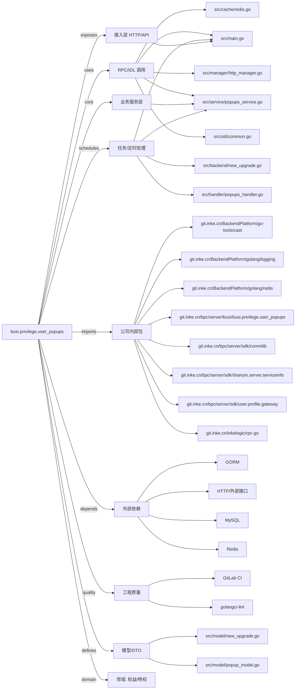

# busi.privilege.user_popups 技术图谱

## 一图技术图谱


## 项目定位
- 源码路径：`/Users/dds/go/src/git.inke.cn/bpc/server/busi/busi.privilege.user_popups`
- 领域判断：权益/特权
- README 摘要：无标题

```text
未发现 README 或 README 内容为空
```

## 静态结构画像
- 文本/代码文件数：19
- Go 文件数：13
- 文件类型分布：.go(13), .yml(2), .toml(2), .md(1), .json(1)
- 顶层目录分布：src(16)

## 关键目录
- `src`: 16 个文本/代码文件

## 代码分层
- 接入层文件：1 个
- 服务层文件：1 个
- 数据访问文件：0 个
- 模型文件：2 个
- 任务/定时相关文件：4 个
- RPC/IDL 相关文件：5 个

## API/路由线索
- 静态扫描未提取到显式路由字符串，需结合框架注册/网关配置确认

## 核心类型与方法线索
- 导出结构体：Config, GetPopList, ClickPop, AddPopContent, SendUser, SendGlobalJson, SendGlobal, GetPopStat, DelPop, GetBetaPopType, IosBetaApp, UpdateBetaConf, Json, VersionUpdateTipsWhite, RespPushMsg, VersionUpdateTip, VersionUpdateTip, VersionUpdateTipsWhite, VersionUpdateTipResp, PopContent, ReqPushMsg, PlatformMsg, ReqBetaPopType, RespBetaPopType, IosBetaPopResp, ReqBetaConf, SessionResponse, SendUserJson
- 导出函数/方法：Serve, Serve, Serve, Serve, Serve, Serve, Serve, Serve, Serve, Serve, GetPopContentKey, GetPushBoxKey, GetGlobalBoxKey, GetPullBoxKey, GetMarkPopByDayKey, GetTodayPopTimesKey, GetPopkeyShowTimesKey, GetPopkeyClickTimesKey, RedisInit, GetRedis, AddPopContent, GetPopContent, AddPushPop, DelPushPopByPopKey, BatchDelPushPopByPopKey, GetPushPop, DelPushPop, GetAllPushPop, AddGlobalPop, DelGlobalPop

## 外部依赖线索
- HTTP/外部接口: 5 处信号
- Redis: 2 处信号
- MySQL: 1 处信号
- GORM: 1 处信号

## 内部依赖线索
- `git.inke.cn/bpc/server/busi/busi.privilege.user_popups`: 21
- `git.inke.cn/BackendPlatform/golang/logging`: 10
- `git.inke.cn/inkelogic/rpc-go`: 5
- `git.inke.cn/bpc/server/sdk/commlib`: 5
- `git.inke.cn/bpc/server/sdk/shanyin.server.serviceinfo`: 3
- `git.inke.cn/BackendPlatform/go-tools/cast`: 3
- `git.inke.cn/bpc/server/sdk/user.profile.gateway`: 1
- `git.inke.cn/BackendPlatform/golang/redis`: 1
- `git.inke.cn/BackendPlatform/golang/sql`: 1
- `git.inke.cn/BackendPlatform/golang/trace`: 1
- `git.inke.cn/BackendPlatform/golang/safego`: 1

## 第三方 import 概览
- golang.org(4), flag(1), io(1), regexp(1), runtime(1), bytes(1), github.com(1)

## IDL/协议文件
- 未发现 proto/thrift 文件

## 工程质量与交付
- GitLab CI：有
- golangci-lint：有
- 测试文件：
- 未发现 `_test.go`

## 阅读建议
- 先读 README 和 `server/http`、`handler`、`service` 目录，确认入口 API 与核心业务流程。
- 再沿服务层方法进入 DAO/Repo/Model，确认数据表、缓存 Key、RPC 调用和异步任务。
- 若图中只出现少量节点，通常表示该项目是配置型/胶水型服务，需结合上层共享工程和部署配置继续确认。
