# busi.sendgift.core 技术图谱

## 一图技术图谱

```mermaid
flowchart LR
  naa1df2ef["Daenerys 框架"]
  n8f718eeb["GORM"]
  na05476e7["GitLab CI"]
  n7c735559["HTTP/外部接口"]
  n51be25b0["Kafka"]
  n62a004b9["MySQL"]
  n8aa21d2e["RPC/IDL 调用"]
  ne1114467["Redis"]
  n4e96cf40["Thrift/RPC"]
  n76a4a540["busi.sendgift.core"]
  nbfa5311d["git.inke.cn/BackendPlatform/go-tools/cast"]
  n7d7ea8b2["git.inke.cn/BackendPlatform/golang/logging"]
  n14b7f193["git.inke.cn/BackendPlatform/golang/safego"]
  ne2260199["git.inke.cn/BackendPlatform/golang/trace"]
  n2cf4c4cb["git.inke.cn/bpc/server/busi/busi.sendgift.core"]
  n780a94b0["git.inke.cn/bpc/server/sdk/commconst"]
  n7de617ec["git.inke.cn/bpc/server/sdk/commlib"]
  n961ac33a["git.inke.cn/inkelogic/rpc-go"]
  ne7b37ee1["golangci-lint"]
  n53618cae["main_test.go"]
  n5a98bbbb["src/backend/compensate_bill.go"]
  n8b69e1b6["src/backend/cron.go"]
  nd440d6c6["src/backend/init.go"]
  nc8cdb426["src/backend/init_giftwall_failback.go"]
  n152cdcbc["src/backend/pk_special_gift.go"]
  nfa83182f["src/common/consts.go"]
  n026776b7["src/common/defines.go"]
  n25792dbe["src/dao/face_effect.go"]
  nb4d1e1bf["src/dao/local_cache.go"]
  nc850e34c["src/dao/mysql.go"]
  n3d8f1b0c["src/dao/redis.go"]
  n1c8bed1e["src/dao/tb.go"]
  ne2faa0bd["src/handler/init.go"]
  na84135f6["src/model/custom_firework.go"]
  n75d9c6c2["src/model/doudizhu.go"]
  n15cf5714["src/model/file.go"]
  n6933a139["src/model/http.go"]
  nf1e71428["src/model/kafka.go"]
  n8d81b440["任务/定时处理"]
  n7cc1b88f["公司内部包"]
  nb682654e["外部依赖"]
  nadeed157["工程质量"]
  n8de19b79["接入层 HTTP/API"]
  n9bfbba5f["数据访问层"]
  ne9fe3e59["模型/DTO"]
  n71498de5["测试文件 8 个"]
  nfc56e941["领域: 礼物/打赏"]
  n8aa21d2e --> n53618cae
  n8aa21d2e --> n5a98bbbb
  n8aa21d2e --> n8b69e1b6
  n8aa21d2e --> nd440d6c6
  n8aa21d2e --> nc8cdb426
  n76a4a540 -- "uses" --> n8aa21d2e
  n76a4a540 -- "schedules" --> n8d81b440
  n76a4a540 -- "imports" --> n7cc1b88f
  n76a4a540 -- "depends" --> nb682654e
  n76a4a540 -- "quality" --> nadeed157
  n76a4a540 -- "exposes" --> n8de19b79
  n76a4a540 -- "persists" --> n9bfbba5f
  n76a4a540 -- "defines" --> ne9fe3e59
  n76a4a540 -- "domain" --> nfc56e941
  n8d81b440 --> n8b69e1b6
  n8d81b440 --> nd440d6c6
  n8d81b440 --> nc8cdb426
  n8d81b440 --> n152cdcbc
  n8d81b440 --> n026776b7
  n7cc1b88f --> nbfa5311d
  n7cc1b88f --> n7d7ea8b2
  n7cc1b88f --> n14b7f193
  n7cc1b88f --> ne2260199
  n7cc1b88f --> n2cf4c4cb
  n7cc1b88f --> n780a94b0
  n7cc1b88f --> n7de617ec
  n7cc1b88f --> n961ac33a
  nb682654e --> naa1df2ef
  nb682654e --> n8f718eeb
  nb682654e --> n7c735559
  nb682654e --> n51be25b0
  nb682654e --> n62a004b9
  nb682654e --> ne1114467
  nb682654e --> n4e96cf40
  nadeed157 --> na05476e7
  nadeed157 --> ne7b37ee1
  nadeed157 --> n71498de5
  n8de19b79 --> n53618cae
  n8de19b79 --> nfa83182f
  n8de19b79 --> ne2faa0bd
  n8de19b79 --> n6933a139
  n9bfbba5f --> n25792dbe
  n9bfbba5f --> nb4d1e1bf
  n9bfbba5f --> nc850e34c
  n9bfbba5f --> n3d8f1b0c
  n9bfbba5f --> n1c8bed1e
  ne9fe3e59 --> na84135f6
  ne9fe3e59 --> n75d9c6c2
  ne9fe3e59 --> n15cf5714
  ne9fe3e59 --> n6933a139
  ne9fe3e59 --> nf1e71428
```


## 项目定位
- 源码路径：`/Users/dds/go/src/git.inke.cn/bpc/server/busi/busi.sendgift.core`
- 领域判断：礼物/打赏
- README 摘要：接口协议

```text
## 接口协议
## 第三方依赖
## REF
```

## 静态结构画像
- 文本/代码文件数：128
- Go 文件数：98
- 文件类型分布：.go(98), .md(16), .yaml(5), .json(3), .yml(2), .toml(2), .proto(1), .thrift(1)
- 顶层目录分布：src(101), doc(13), tests(6), conf(4)

## 关键目录
- `src`: 101 个文本/代码文件
- `doc`: 13 个文本/代码文件
- `tests`: 6 个文本/代码文件
- `conf`: 4 个文本/代码文件

## 代码分层
- 接入层文件：4 个
- 服务层文件：0 个
- 数据访问文件：5 个
- 模型文件：10 个
- 任务/定时相关文件：11 个
- RPC/IDL 相关文件：20 个

## API/路由线索
- 静态扫描未提取到显式路由字符串，需结合框架注册/网关配置确认

## 核心类型与方法线索
- 导出结构体：RoomEffectHandler, GiftCmsgHandler, BusinessHandler, DefinedExtraInfo, SameUser, VoiceMatchSendGiftReq, VoiceMatchHandler, LiveSendGiftHandler, CommonSendGiftReq, CommonSendGiftHandler, PrivateLetterHandler, InternalSendkafka, RobotSendResp, RobotSendReq, RobotSendHandler, GiftOrderTb, CashGiftOrderTb, CashGiftReqTb, PkBatchCommonGiftLog, RdsManager, Mysql, BackGroundResp, WhiteList, FacialEffectsList, SourceTypeInfo, PKBatchRecordManager, FailedRecordProcessor, DelayRecordProcessor, UserCardResp, UserCard
- 导出函数/方法：TestMain, TestDoudizhuFullLifecycle, Serve, Serve, GiftCmsgForSingle, GiftCmsgForBatch, Serve, GiftForSingle, GiftForBatch, GiftForBatchPreRequire, GiftForSendAllThemeGift, GiftForSendAllThemeGiftPreRequire, GiftForSendAllThemeGiftSendSystemMsg, GiftForSendAllThemeGiftSendPersonMsg, BusinessParse, BusinessProcess, Serve, IsSameUser, GetGiftID, GetCv, GetSmid, GetSender, GetRecver, GetBuzID, GetBuzDesc, GetBzType, Serve, VoiceMatchSendGiftParse, VoiceMatchSendGiftProcess, Serve

## 外部依赖线索
- HTTP/外部接口: 50 处信号
- Kafka: 42 处信号
- Redis: 33 处信号
- Thrift/RPC: 12 处信号
- Daenerys 框架: 7 处信号
- MySQL: 4 处信号
- GORM: 3 处信号

## 内部依赖线索
- `git.inke.cn/bpc/server/busi/busi.sendgift.core`: 159
- `git.inke.cn/BackendPlatform/golang/logging`: 63
- `git.inke.cn/bpc/server/sdk/commlib`: 26
- `git.inke.cn/BackendPlatform/golang/trace`: 19
- `git.inke.cn/inkelogic/rpc-go`: 15
- `git.inke.cn/BackendPlatform/go-tools/cast`: 15
- `git.inke.cn/BackendPlatform/golang/safego`: 15
- `git.inke.cn/bpc/server/sdk/commconst`: 15
- `git.inke.cn/bpc/server/sdk/room.msg.base`: 9
- `git.inke.cn/bpc/server/sdk/shanyin.server.serviceinfo`: 5
- `git.inke.cn/bpc/server/sdk/dq`: 4
- `git.inke.cn/bpc/server/sdk/room.merge.server`: 4

## 第三方 import 概览
- github.com(48), golang.org(32), go.uber.org(17), io(11), testing(8), code.inke.cn(6), os(5), crypto(4), bytes(4), runtime(3)

## IDL/协议文件
- `src/protocol/push.proto`
- `src/billservice/BillService.thrift`

## 工程质量与交付
- GitLab CI：有
- golangci-lint：有
- 测试文件：
- `main_test.go`
- `tests/core_test.go`
- `src/manager/doudizhu_metrics_test.go`
- `src/manager/pk_mood_gift_test.go`
- `src/manager/doudizhu_test.go`
- `src/common/pk_gift_mutex_test.go`
- `src/common/pk_mood_gift_resources_test.go`
- `src/common/doudizhu_resources_test.go`

## 阅读建议
- 先读 README 和 `server/http`、`handler`、`service` 目录，确认入口 API 与核心业务流程。
- 再沿服务层方法进入 DAO/Repo/Model，确认数据表、缓存 Key、RPC 调用和异步任务。
- 若图中只出现少量节点，通常表示该项目是配置型/胶水型服务，需结合上层共享工程和部署配置继续确认。
