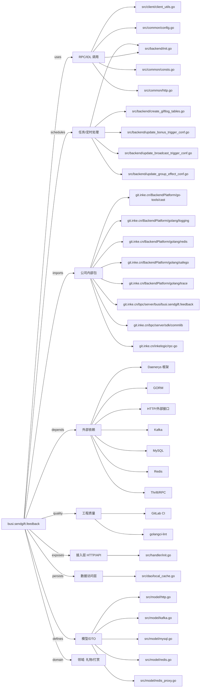

# busi.sendgift.feedback 技术图谱

## 一图技术图谱


## 项目定位
- 源码路径：`/Users/dds/go/src/git.inke.cn/bpc/server/busi/busi.sendgift.feedback`
- 领域判断：礼物/打赏
- README 摘要：无标题

```text
未发现 README 或 README 内容为空
```

## 静态结构画像
- 文本/代码文件数：66
- Go 文件数：54
- 文件类型分布：.go(54), .toml(5), .json(4), .yml(2), .proto(1)
- 顶层目录分布：src(56), conf(6), etc(2)

## 关键目录
- `src`: 56 个文本/代码文件
- `conf`: 6 个文本/代码文件
- `etc`: 2 个文本/代码文件

## 代码分层
- 接入层文件：1 个
- 服务层文件：0 个
- 数据访问文件：1 个
- 模型文件：7 个
- 任务/定时相关文件：8 个
- RPC/IDL 相关文件：20 个

## API/路由线索
- 静态扫描未提取到显式路由字符串，需结合框架注册/网关配置确认

## 核心类型与方法线索
- 导出结构体：TestController, TestRequest, GiftLog, Event_super_gun_v2_slots_info, Bdsuper_gun_v2_slots, PushRequest, PushResponse, PushRequest, PushResponse, GiftInfo, Atom, CacheBillboardAgoInfo, Content, CardContent, SendMessageIn, SendMessageOut, MysteryIn, MysteryOut, BaseRes, GuardStarOut, Whitelist, GuardScoreFeedbackMgr, GuardRelation, GuardStar, FeedbackMgr, Config, AppConf, WhiteListControlConf, GiftTriggerBonusConf, GiftTriggerBroadcastConf
- 导出函数/方法：Serve, InitServer, SuperGunMaxSlotsEvent, Module, AppType, DataKey, DataKeyWithParam, Product, MetricServerEID, LoggingServerEID, Init, SetJSON, SetByte, GetJSON, FlowKeyDataDeal, InitBackend, Close, Enum, String, UnmarshalJSON, EnumDescriptor, Enum, String, UnmarshalJSON, EnumDescriptor, Enum, String, UnmarshalJSON, EnumDescriptor, Reset

## 外部依赖线索
- HTTP/外部接口: 26 处信号
- Kafka: 22 处信号
- Redis: 20 处信号
- Thrift/RPC: 8 处信号
- MySQL: 5 处信号
- Daenerys 框架: 4 处信号
- GORM: 2 处信号

## 内部依赖线索
- `git.inke.cn/bpc/server/busi/busi.sendgift.feedback`: 66
- `git.inke.cn/BackendPlatform/golang/logging`: 32
- `git.inke.cn/inkelogic/rpc-go`: 10
- `git.inke.cn/BackendPlatform/golang/trace`: 9
- `git.inke.cn/bpc/server/sdk/commlib`: 4
- `git.inke.cn/BackendPlatform/golang/safego`: 3
- `git.inke.cn/BackendPlatform/go-tools/cast`: 3
- `git.inke.cn/BackendPlatform/golang/redis`: 3
- `git.inke.cn/bpc/server/sdk/shanyin.server.serviceinfo`: 2
- `git.inke.cn/bpc/server/sdk/busi.gift.billboard_base`: 2
- `git.inke.cn/inkelogic/rpc-go/desc`: 2
- `git.inke.cn/tpc/inf/go-tls`: 2

## 第三方 import 概览
- golang.org(17), github.com(16), bytes(8), git.apache.org(5), runtime(3), go.uber.org(3), io(3), os(2), crypto(2), reflect(2)

## IDL/协议文件
- `src/link_msg/push.proto`

## 工程质量与交付
- GitLab CI：有
- golangci-lint：有
- 测试文件：
- 未发现 `_test.go`

## 阅读建议
- 先读 README 和 `server/http`、`handler`、`service` 目录，确认入口 API 与核心业务流程。
- 再沿服务层方法进入 DAO/Repo/Model，确认数据表、缓存 Key、RPC 调用和异步任务。
- 若图中只出现少量节点，通常表示该项目是配置型/胶水型服务，需结合上层共享工程和部署配置继续确认。
