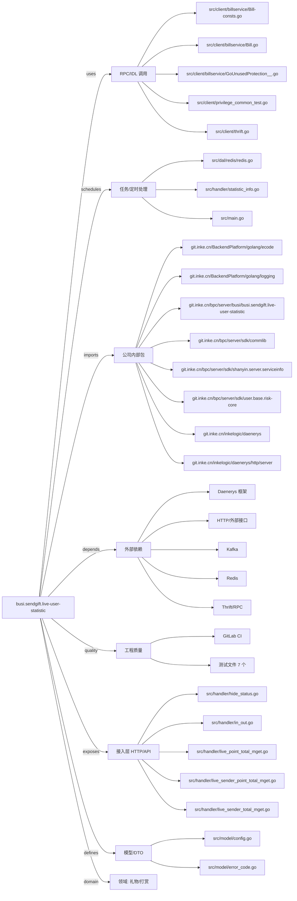

# busi.sendgift.live-user-statistic 技术图谱

## 一图技术图谱


## 项目定位
- 源码路径：`/Users/dds/go/src/git.inke.cn/bpc/server/busi/busi.sendgift.live-user-statistic`
- 领域判断：礼物/打赏
- README 摘要：busi.sendgift.live-user-statistic

```text
# busi.sendgift.live-user-statistic
## 包括一些用户的信息
## todo ：迁移到用户组
统计服务
```

## 静态结构画像
- 文本/代码文件数：47
- Go 文件数：39
- 文件类型分布：.go(39), .toml(4), .md(1), .yml(1), .json(1), .thrift(1)
- 顶层目录分布：src(41), conf(4)

## 关键目录
- `src`: 41 个文本/代码文件
- `conf`: 4 个文本/代码文件

## 代码分层
- 接入层文件：14 个
- 服务层文件：0 个
- 数据访问文件：0 个
- 模型文件：2 个
- 任务/定时相关文件：3 个
- RPC/IDL 相关文件：13 个

## API/路由线索
- 静态扫描未提取到显式路由字符串，需结合框架注册/网关配置确认

## 核心类型与方法线索
- 导出结构体：Account, Description, Popups, LiveSenderTotalMGetReq, LiveSenderTotalMGetResp, InoutReq, InoutResp, Inout, LiveSenderPointTotalMGetReq, LiveSenderPointTotalMGetResp, LivePointTotalMGetReq, LivePointTotalMGetResp, GetRankInfoReq, GetRankInfoResp, SetBillboardInnerHideReq, InnerHideResp, SetBillboardHideReq, SetBillboardHideResp, SendGiftKafkaMsg, Config, RdsDao, HideStatusResult, CtrlConfDefault, BaseRes, GameCoinAccountResp, RespUserAccountData, UserRank, UserRankResp, UserRankInout, BalanceInputData
- 导出函数/方法：GetStatisticInfo, GetUserStatistic, LiveSenderTotalMGet, Check, GetInout, LiveSenderPointTotalMGet, LivePointTotalMGet, Check, GetRankInfo, TestGetUserStatistic, Check, SetBillboardInnerHide, GetHideStatus, GetStatisticInfoInner, RankShow, Check, SetBillboardHide, Init, Init, Shutdown, Init, Shutdown, InitConfig, Init, GetRds, NewRdsDao, SetBillboardHide, SetBillboardHideForScore, SetBillboardHideForScoreGlobal, BatchGetHideStatus

## 外部依赖线索
- HTTP/外部接口: 23 处信号
- Daenerys 框架: 20 处信号
- Thrift/RPC: 10 处信号
- Redis: 5 处信号
- Kafka: 1 处信号

## 内部依赖线索
- `git.inke.cn/bpc/server/busi/busi.sendgift.live-user-statistic`: 37
- `git.inke.cn/BackendPlatform/golang/logging`: 24
- `git.inke.cn/inkelogic/daenerys/http/server`: 14
- `git.inke.cn/inkelogic/daenerys`: 6
- `git.inke.cn/bpc/server/sdk/shanyin.server.serviceinfo`: 2
- `git.inke.cn/BackendPlatform/golang/ecode`: 2
- `git.inke.cn/bpc/server/sdk/commlib`: 1
- `git.inke.cn/bpc/server/sdk/user.base.risk-core`: 1
- `git.inke.cn/bpc/server/sdk/busi.gift.billboard_base`: 1
- `git.inke.cn/inkelogic/daenerys/config/encoder`: 1
- `git.inke.cn/bpc/server/sdk/busi.privilege.experiencecard`: 1
- `git.inke.cn/bpc/server/sdk/ik`: 1

## 第三方 import 概览
- github.com(9), testing(6), bytes(4), os(3), io(2), git.apache.org(2), flag(1), syscall(1), go.uber.org(1), runtime(1)

## IDL/协议文件
- `src/client/billservice/BillService.thrift`

## 工程质量与交付
- GitLab CI：有
- golangci-lint：未发现
- 测试文件：
- `src/handler/privilege_common_test.go`
- `src/handler/statistic_info_test.go`
- `src/client/thrift_test.go`
- `src/client/user_rank_logic_test.go`
- `src/client/privilege_common_test.go`
- `src/client/red_packet_test.go`
- `src/client/user_session_test.go`

## 阅读建议
- 先读 README 和 `server/http`、`handler`、`service` 目录，确认入口 API 与核心业务流程。
- 再沿服务层方法进入 DAO/Repo/Model，确认数据表、缓存 Key、RPC 调用和异步任务。
- 若图中只出现少量节点，通常表示该项目是配置型/胶水型服务，需结合上层共享工程和部署配置继续确认。
