# busi.sendgift.play 技术图谱

## 一图技术图谱

```mermaid
flowchart LR
  naa1df2ef["Daenerys 框架"]
  n8f718eeb["GORM"]
  na05476e7["GitLab CI"]
  n7c735559["HTTP/外部接口"]
  n51be25b0["Kafka"]
  n62a004b9["MySQL"]
  n8aa21d2e["RPC/IDL 调用"]
  ne1114467["Redis"]
  n4e96cf40["Thrift/RPC"]
  nd3cffdee["app/main.go"]
  n33548c98["backend/gift_collection.go"]
  n763091eb["backend/gift_exhibition_hall.go"]
  n4aae401d["backend/hi_coin_lucky_bag.go"]
  n7a224e78["backend/init.go"]
  n04fee5dc["backend/little_flower_flower.go"]
  nf31f55d3["backend/room_pub_msg_event.go"]
  n2546d132["busi.sendgift.play"]
  n26701f97["client/anchor_info/anchor_info.go"]
  n934ce22a["dao/Init.go"]
  n63696167["dao/cache/cache.go"]
  n83fafd7c["dao/db/cf_get_egg_recored_mysql.go"]
  nc0c7de36["dao/db/daily_advanced_gift_db.go"]
  nf4036072["dao/db/db.go"]
  n6781d451["dao/db/feed_gift.go"]
  n8b32854b["dao/db/gift_collection.go"]
  nbfa5311d["git.inke.cn/BackendPlatform/go-tools/cast"]
  n7d7ea8b2["git.inke.cn/BackendPlatform/golang/logging"]
  n51ff41b4["git.inke.cn/bpc/server/busi/busi.sendgift.play"]
  n438af9bf["git.inke.cn/bpc/server/sdk/busi.gift.wall"]
  n780a94b0["git.inke.cn/bpc/server/sdk/commconst"]
  n7de617ec["git.inke.cn/bpc/server/sdk/commlib"]
  n56f964c3["git.inke.cn/bpc/server/sdk/user.profile.gateway"]
  n7bacf918["git.inke.cn/inkelogic/daenerys/http/server"]
  n28c2b7e2["model/activity_model.go"]
  n7403b1d7["model/cf_get_egg_recored.go"]
  n2500e56d["model/code.go"]
  n7f893b07["model/common.go"]
  n20a313f2["model/const.go"]
  n0653ce8e["server/consume_reminder.go"]
  na0f69095["server/custom_fireworks.go"]
  n4025139f["server/daily_advanced_gift.go"]
  nc070eaf9["server/defined_gift_list.go"]
  nf2f81423["server/doudizhu.go"]
  n8d81b440["任务/定时处理"]
  n7cc1b88f["公司内部包"]
  nb682654e["外部依赖"]
  nadeed157["工程质量"]
  n8de19b79["接入层 HTTP/API"]
  n9bfbba5f["数据访问层"]
  ne9fe3e59["模型/DTO"]
  nda4751ff["测试文件 7 个"]
  n015f7fd2["领域: 增长/玩法"]
  nfc56e941["领域: 礼物/打赏"]
  n8aa21d2e --> nd3cffdee
  n8aa21d2e --> n7a224e78
  n8aa21d2e --> n04fee5dc
  n8aa21d2e --> nf31f55d3
  n8aa21d2e --> n26701f97
  n2546d132 -- "uses" --> n8aa21d2e
  n2546d132 -- "schedules" --> n8d81b440
  n2546d132 -- "imports" --> n7cc1b88f
  n2546d132 -- "depends" --> nb682654e
  n2546d132 -- "quality" --> nadeed157
  n2546d132 -- "exposes" --> n8de19b79
  n2546d132 -- "persists" --> n9bfbba5f
  n2546d132 -- "defines" --> ne9fe3e59
  n2546d132 -- "domain" --> n015f7fd2
  n2546d132 -- "domain" --> nfc56e941
  n8d81b440 --> nd3cffdee
  n8d81b440 --> n33548c98
  n8d81b440 --> n763091eb
  n8d81b440 --> n4aae401d
  n8d81b440 --> n7a224e78
  n7cc1b88f --> nbfa5311d
  n7cc1b88f --> n7d7ea8b2
  n7cc1b88f --> n51ff41b4
  n7cc1b88f --> n438af9bf
  n7cc1b88f --> n780a94b0
  n7cc1b88f --> n7de617ec
  n7cc1b88f --> n56f964c3
  n7cc1b88f --> n7bacf918
  nb682654e --> naa1df2ef
  nb682654e --> n8f718eeb
  nb682654e --> n7c735559
  nb682654e --> n51be25b0
  nb682654e --> n62a004b9
  nb682654e --> ne1114467
  nb682654e --> n4e96cf40
  nadeed157 --> na05476e7
  nadeed157 --> nda4751ff
  n8de19b79 --> n0653ce8e
  n8de19b79 --> na0f69095
  n8de19b79 --> n4025139f
  n8de19b79 --> nc070eaf9
  n8de19b79 --> nf2f81423
  n9bfbba5f --> n934ce22a
  n9bfbba5f --> n63696167
  n9bfbba5f --> n83fafd7c
  n9bfbba5f --> nc0c7de36
  n9bfbba5f --> nf4036072
  n9bfbba5f --> n6781d451
  n9bfbba5f --> n8b32854b
  ne9fe3e59 --> n28c2b7e2
  ne9fe3e59 --> n7403b1d7
  ne9fe3e59 --> n2500e56d
  ne9fe3e59 --> n7f893b07
  ne9fe3e59 --> n20a313f2
```


## 项目定位
- 源码路径：`/Users/dds/go/src/git.inke.cn/bpc/server/busi/busi.sendgift.play`
- 领域判断：礼物/打赏, 增长/玩法
- README 摘要：busi.sendgift.play

```text
# busi.sendgift.play
送礼玩法，用于一些玩法或活动之类的，适用于短平快
```

## 静态结构画像
- 文本/代码文件数：218
- Go 文件数：210
- 文件类型分布：.go(210), .toml(2), .md(1), .yml(1), .json(1), .sql(1), .yaml(1), .thrift(1)
- 顶层目录分布：manager(64), dao(35), server(32), model(24), client(16), backend(15), tschema(12), common(6), app(4), utils(4)

## 关键目录
- `manager`: 64 个文本/代码文件
- `dao`: 35 个文本/代码文件
- `server`: 32 个文本/代码文件
- `model`: 24 个文本/代码文件
- `client`: 16 个文本/代码文件
- `backend`: 15 个文本/代码文件
- `tschema`: 12 个文本/代码文件
- `common`: 6 个文本/代码文件
- `app`: 4 个文本/代码文件
- `utils`: 4 个文本/代码文件
- `tests`: 1 个文本/代码文件
- `conf`: 1 个文本/代码文件

## 代码分层
- 接入层文件：20 个
- 服务层文件：0 个
- 数据访问文件：20 个
- 模型文件：20 个
- 任务/定时相关文件：20 个
- RPC/IDL 相关文件：20 个

## API/路由线索
- 静态扫描未提取到显式路由字符串，需结合框架注册/网关配置确认

## 核心类型与方法线索
- 导出结构体：RdsDao, ConsumeReminderConfig, RadishKnifeGiftUpgrade, GiftExhibitionHallTimeConfig, GiftExhibitionHallGiftConfig, GiftExhibitionHallTitleConfig, EffectConfig, UserDefinedGiftRecordModel, GetUserDefinedGiftRecordModel, UserCustomGiftRecordModel, FeedGift, FeedGiftButton, FeedGiftRule, HeartMusicRoomGiftRecord, HeartMusicUserGiftRecord, UpgradeGiftConfig, UpgradeGiftUserSendLimit, UpgradeGiftUserSendProcess, UpgradeGiftUserSendProcessRes, GiftCollectionLibrary, GiftCollectionRecord, GiftBagRecord, HiCoinLuckyBag, GoodFortuneFromHeavenRecord, NewAnchorGiftTarget, TestReq, StoreGiftImgReq, GetDefinedGiftListReq, HeartMusicUserGiftResp, HeartMusicUserGiftRespData
- 导出函数/方法：TestMain, Init, GetRds, GetMySQL, Init, GetLiveInfo, SetLiveInfo, GetUpgradeGiftConf, SetUpgradeGiftConf, GetGiftInfo, SetGiftInfo, SetGiftExhibitionHallConfig, GetGiftExhibitionHallConfig, LockEffectiveDebut, UnLockEffectiveDebut, GetFirstDebutTime, SetFirstDebutTime, ZAddEffectiveSet, DelEffectiveSet, GetEffectiveSet, SAddEffectiveDay, SRemEffectiveDay, SCardEffectiveDay, ZRemEffectiveDay, SetNewAnchorGiftTarget, SetNewAnchorGiftTargetValue, GetNewAnchorGiftTarget, DelNewAnchorGiftTarget, MGetNewAnchorGiftTarget, MSetNewAnchorGiftTarget

## 外部依赖线索
- HTTP/外部接口: 87 处信号
- Daenerys 框架: 53 处信号
- Redis: 52 处信号
- Kafka: 37 处信号
- GORM: 17 处信号
- MySQL: 16 处信号
- Thrift/RPC: 7 处信号

## 内部依赖线索
- `git.inke.cn/bpc/server/busi/busi.sendgift.play`: 400
- `git.inke.cn/BackendPlatform/golang/logging`: 125
- `git.inke.cn/bpc/server/sdk/commlib`: 50
- `git.inke.cn/BackendPlatform/go-tools/cast`: 50
- `git.inke.cn/inkelogic/daenerys/http/server`: 33
- `git.inke.cn/bpc/server/sdk/user.profile.gateway`: 25
- `git.inke.cn/bpc/server/sdk/commconst`: 22
- `git.inke.cn/bpc/server/sdk/busi.gift.wall`: 22
- `git.inke.cn/BackendPlatform/golang/safego`: 19
- `git.inke.cn/bpc/server/sdk/room.msg.base`: 17
- `git.inke.cn/BackendPlatform/golang/trace`: 16
- `git.inke.cn/bpc/server/sdk/room.action.base`: 16

## 第三方 import 概览
- github.com(53), go.uber.org(41), bytes(10), golang.org(9), testing(7), os(6), code.inke.cn(6), cmp(3), slices(3), git.apache.org(3)

## IDL/协议文件
- `client/billservice/BillService.thrift`

## 工程质量与交付
- GitLab CI：有
- golangci-lint：未发现
- 测试文件：
- `main_test.go`
- `dao/redis/doudizhu_test.go`
- `manager/pk_mood_gift/panel_test.go`
- `manager/lottery_card/lottery_card_test.go`
- `manager/doudizhu/reverse_test.go`
- `manager/gift_exhibition_hall/gift_handle_bufa_test.go`
- `common/utils_test.go`

## 阅读建议
- 先读 README 和 `server/http`、`handler`、`service` 目录，确认入口 API 与核心业务流程。
- 再沿服务层方法进入 DAO/Repo/Model，确认数据表、缓存 Key、RPC 调用和异步任务。
- 若图中只出现少量节点，通常表示该项目是配置型/胶水型服务，需结合上层共享工程和部署配置继续确认。
