# growth.base.play 技术图谱

## 一图技术图谱

```mermaid
flowchart LR
  naa1df2ef["Daenerys 框架"]
  n8f718eeb["GORM"]
  na05476e7["GitLab CI"]
  n7c735559["HTTP/外部接口"]
  n51be25b0["Kafka"]
  n62a004b9["MySQL"]
  n8aa21d2e["RPC/IDL 调用"]
  ne1114467["Redis"]
  n4e96cf40["Thrift/RPC"]
  nbfa5311d["git.inke.cn/BackendPlatform/go-tools/cast"]
  n7d7ea8b2["git.inke.cn/BackendPlatform/golang/logging"]
  ne2260199["git.inke.cn/BackendPlatform/golang/trace"]
  nd5ec6b9d["git.inke.cn/bpc/server/busi/growth.base.play"]
  n780a94b0["git.inke.cn/bpc/server/sdk/commconst"]
  n7de617ec["git.inke.cn/bpc/server/sdk/commlib"]
  n58d5ea77["git.inke.cn/bpc/server/sdk/shanyin.server.serviceinfo"]
  n961ac33a["git.inke.cn/inkelogic/rpc-go"]
  ne7b37ee1["golangci-lint"]
  n4db4d549["growth.base.play"]
  n8b69e1b6["src/backend/cron.go"]
  n070cca4a["src/backend/dispatcher/dispatcher.go"]
  n43edc414["src/backend/free_gift/send_rank_gift.go"]
  nd440d6c6["src/backend/init.go"]
  n1797c672["src/backend/luckybag/auto_send_prize_lucky_bag.go"]
  n3cd1cadc["src/backend/quickticket/notify_daemon.go"]
  n104ceb7d["src/client/billservice/Bill-consts.go"]
  n1dcb2bd9["src/client/billservice/Bill.go"]
  n3b4bdbdd["src/client/billservice/GoUnusedProtection__.go"]
  ncf17c963["src/client/busi.privilege.fans_club.go"]
  ne2faa0bd["src/handler/init.go"]
  nd56bcf52["src/service/common.go"]
  nfec9a43b["src/service/daily_fortune/claim_reward.go"]
  n5cf16691["src/service/daily_fortune/close_popup.go"]
  n8303f288["src/service/daily_fortune/draw.go"]
  n9d2e87ba["src/service/daily_fortune/history.go"]
  n6df97b0c["src/service/daily_fortune/index.go"]
  n57f92e59["src/service/daily_fortune/message_entry.go"]
  n888b7733["业务服务层"]
  n8d81b440["任务/定时处理"]
  n7cc1b88f["公司内部包"]
  nb682654e["外部依赖"]
  nadeed157["工程质量"]
  n8de19b79["接入层 HTTP/API"]
  n4018b9d2["测试文件 6 个"]
  n015f7fd2["领域: 增长/玩法"]
  n8aa21d2e --> n070cca4a
  n8aa21d2e --> n104ceb7d
  n8aa21d2e --> n1dcb2bd9
  n8aa21d2e --> n3b4bdbdd
  n8aa21d2e --> ncf17c963
  n4db4d549 -- "uses" --> n8aa21d2e
  n4db4d549 -- "core" --> n888b7733
  n4db4d549 -- "schedules" --> n8d81b440
  n4db4d549 -- "imports" --> n7cc1b88f
  n4db4d549 -- "depends" --> nb682654e
  n4db4d549 -- "quality" --> nadeed157
  n4db4d549 -- "exposes" --> n8de19b79
  n4db4d549 -- "domain" --> n015f7fd2
  n888b7733 --> nd56bcf52
  n888b7733 --> nfec9a43b
  n888b7733 --> n5cf16691
  n888b7733 --> n8303f288
  n888b7733 --> n9d2e87ba
  n888b7733 --> n6df97b0c
  n888b7733 --> n57f92e59
  n8d81b440 --> n8b69e1b6
  n8d81b440 --> n43edc414
  n8d81b440 --> nd440d6c6
  n8d81b440 --> n1797c672
  n8d81b440 --> n3cd1cadc
  n7cc1b88f --> nbfa5311d
  n7cc1b88f --> n7d7ea8b2
  n7cc1b88f --> ne2260199
  n7cc1b88f --> nd5ec6b9d
  n7cc1b88f --> n780a94b0
  n7cc1b88f --> n7de617ec
  n7cc1b88f --> n58d5ea77
  n7cc1b88f --> n961ac33a
  nb682654e --> naa1df2ef
  nb682654e --> n8f718eeb
  nb682654e --> n7c735559
  nb682654e --> n51be25b0
  nb682654e --> n62a004b9
  nb682654e --> ne1114467
  nb682654e --> n4e96cf40
  nadeed157 --> na05476e7
  nadeed157 --> ne7b37ee1
  nadeed157 --> n4018b9d2
  n8de19b79 --> ne2faa0bd
```


## 项目定位
- 源码路径：`/Users/dds/go/src/git.inke.cn/bpc/server/busi/growth.base.play`
- 领域判断：增长/玩法
- README 摘要：id      name

```text
id      name
1       贵族气质头像框
2       贵族气质勋章
3       钻石礼包
4       么么哒
5       恋爱烟花
6       告白气球
7       迷宫寻宝认证
8       钻石礼包
9       竹蜻蜓
10      梦幻小马
11      海澜梦境头像框
```

## 静态结构画像
- 文本/代码文件数：253
- Go 文件数：178
- 文件类型分布：.go(178), .json(59), .md(11), .yml(2), .toml(2), .proto(1)
- 顶层目录分布：src(180), conf(60), showdoc(8)

## 关键目录
- `src`: 180 个文本/代码文件
- `conf`: 60 个文本/代码文件
- `showdoc`: 8 个文本/代码文件

## 代码分层
- 接入层文件：1 个
- 服务层文件：20 个
- 数据访问文件：0 个
- 模型文件：0 个
- 任务/定时相关文件：20 个
- RPC/IDL 相关文件：20 个

## API/路由线索
- 静态扫描未提取到显式路由字符串，需结合框架注册/网关配置确认

## 核心类型与方法线索
- 导出结构体：AppHandler, Route, BaseRes, BackColorLevel, ColorCom, FreeGiftConfig, SendRecommendCardRecord, Atom, LiveInfo, QuickTicketExtendData, KafkaDispatcher, KafkaMessageHandler, PropsGcmKafkaModel, SendPropsKafkaModel, UserRechargeKafkaModel, ExtendData, RoomPublishKafkaModel, FollowKafkaModel, SendGiftKafkaModel, LiveJoinAndLeaveModel, StrategyEventKafka, Atom, StayDurationKafka, Treasure, Price, Reward, RewardParams, ItemInfo, ItemInfoParams, ViewInfo
- 导出函数/方法：Serve, Get, Post, PostOnly, Validate, Handler, Wrapper, InitServer, UUID, LogID, PrettySerialize, LogRequestFmt, LogResponseFmt, LogReq, LogResp, TestFilter, Now, GetCurrentSundayDate, SendSystemMessageDo, SendGuardGiftMsg, GetChatBackColor, GetUserLivingInfo, GetGiftInfo, SendGiftInner, TestGetCurrentSundayDate, Contains, Apply, Filter, ConvertMapToObject, HTTPPost

## 外部依赖线索
- HTTP/外部接口: 56 处信号
- Redis: 30 处信号
- Kafka: 23 处信号
- GORM: 13 处信号
- MySQL: 9 处信号
- Daenerys 框架: 7 处信号
- Thrift/RPC: 5 处信号

## 内部依赖线索
- `git.inke.cn/bpc/server/busi/growth.base.play`: 310
- `git.inke.cn/BackendPlatform/golang/logging`: 143
- `git.inke.cn/BackendPlatform/golang/trace`: 21
- `git.inke.cn/inkelogic/rpc-go`: 18
- `git.inke.cn/bpc/server/sdk/commlib`: 16
- `git.inke.cn/bpc/server/sdk/commconst`: 9
- `git.inke.cn/bpc/server/sdk/shanyin.server.serviceinfo`: 7
- `git.inke.cn/BackendPlatform/go-tools/cast`: 6
- `git.inke.cn/BackendPlatform/golang/kafka`: 5
- `git.inke.cn/bpc/server/sdk/ka`: 4
- `git.inke.cn/BackendPlatform/golang/redis`: 4
- `git.inke.cn/bpc/server/sdk/busi.sendgift.core`: 3

## 第三方 import 概览
- github.com(76), bytes(9), testing(6), os(5), golang.org(5), reflect(4), crypto(3), io(3), runtime(3), go.uber.org(3)

## IDL/协议文件
- `src/client/linkroommsg/linkroommsg.proto`

## 工程质量与交付
- GitLab CI：有
- golangci-lint：有
- 测试文件：
- `src/utils/collections_test.go`
- `src/utils/datetimes_test.go`
- `src/storage/dao_test.go`
- `src/service/free_gift/get_gift_info_test.go`
- `src/service/luckybag/splitdiamond_test.go`
- `src/service/daily_fortune/model_test.go`

## 阅读建议
- 先读 README 和 `server/http`、`handler`、`service` 目录，确认入口 API 与核心业务流程。
- 再沿服务层方法进入 DAO/Repo/Model，确认数据表、缓存 Key、RPC 调用和异步任务。
- 若图中只出现少量节点，通常表示该项目是配置型/胶水型服务，需结合上层共享工程和部署配置继续确认。
