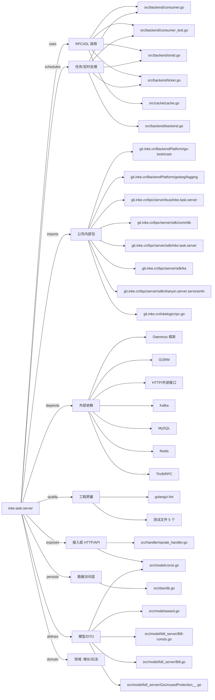

# inke.task.server 技术图谱

## 一图技术图谱


## 项目定位
- 源码路径：`/Users/dds/go/src/git.inke.cn/bpc/server/busi/inke.task.server`
- 领域判断：增长/玩法
- README 摘要：无标题

```text
未发现 README 或 README 内容为空
```

## 静态结构画像
- 文本/代码文件数：192
- Go 文件数：185
- 文件类型分布：.go(185), .sql(2), .toml(2), .yml(1), .json(1), .proto(1)
- 顶层目录分布：src(187), conf(4)

## 关键目录
- `src`: 187 个文本/代码文件
- `conf`: 4 个文本/代码文件

## 代码分层
- 接入层文件：2 个
- 服务层文件：0 个
- 数据访问文件：1 个
- 模型文件：13 个
- 任务/定时相关文件：20 个
- RPC/IDL 相关文件：20 个

## API/路由线索
- `int`
- `int`
- `int`
- `int`
- `int`
- `int`
- `int`
- `int`
- `int`
- `int`
- `int`
- `int`
- `int`
- `int`
- `int`
- `int`
- `int`
- `int`
- `int`
- `int`

## 核心类型与方法线索
- 导出结构体：TaskCenterRiskControlHandler, RiskControlResponse, TaskTypeHandler, TargetListHandler, AwardListHandler, ItemListHandler, AwardDescHandler, AwardDescription, AwardDescriptionResponse, Item, ItemListResponse, TaskTypeResponse, TargetListResponse, AwardListResponse, DataDispatchCallbackHandler, DataDispatchCallbackResponse, DataDispatchCallbackBody, UnfreezeSMIDCountHandler, UnfreezeSMIDCountResp, ShareLiveTaskStatusHandler, ShareLiveTaskStatusResponse, TaskData_, AssociateDeviceHandler, AssociateDeviceResponse, AssociateDeviceReq, TaskCompleteNumHandler, TaskCompleteNumResponse, TaskListHandler, TaskListItem, TaskTypeListItem
- 导出函数/方法：Serve, Serve, Serve, Serve, Serve, Serve, InitServer, InitConfig, TestFocusRewardSendHandler_MissingParams, TestFocusRewardSendHandler_NotDoubleNew, TestFocusRewardSendHandler_TaskNotRewarded, TestFocusRewardSendHandler_NotInLiveRoom, TestFocusRewardSendHandler_Normal, Serve, Serve, Serve, Serve, Serve, Len, Swap, Less, GetInkeCoin, Serve, ConsumerLoginEvent, GetHeaders, IsContain, Serve, Serve, Serve, Serve

## 外部依赖线索
- Kafka: 80 处信号
- HTTP/外部接口: 49 处信号
- Redis: 12 处信号
- Thrift/RPC: 8 处信号
- Daenerys 框架: 6 处信号
- GORM: 4 处信号
- MySQL: 3 处信号

## 内部依赖线索
- `git.inke.cn/bpc/server/busi/inke.task.server`: 350
- `git.inke.cn/BackendPlatform/golang/logging`: 173
- `git.inke.cn/BackendPlatform/go-tools/cast`: 30
- `git.inke.cn/inkelogic/rpc-go`: 27
- `git.inke.cn/bpc/server/sdk/commlib`: 18
- `git.inke.cn/bpc/server/sdk/shanyin.server.serviceinfo`: 17
- `git.inke.cn/bpc/server/sdk/ka`: 6
- `git.inke.cn/bpc/server/sdk/inke.task.server`: 6
- `git.inke.cn/bpc/server/sdk/commconst`: 6
- `git.inke.cn/bpc/server/sdk/user.profile.logic`: 5
- `git.inke.cn/bpc/server/sdk/room.live.base`: 4
- `git.inke.cn/bpc/server/sdk/busi.privilege.new_shopping`: 4

## 第三方 import 概览
- golang.org(104), github.com(46), bytes(11), io(7), testing(5), os(4), runtime(3), git.apache.org(3), flag(2), reflect(2)

## IDL/协议文件
- `src/common/linkroommsg/linkroommsg.proto`

## 工程质量与交付
- GitLab CI：未发现
- golangci-lint：有
- 测试文件：
- `src/handler/focus_reward_send_handler_test.go`
- `src/handler/focus_reward_award_handler_test.go`
- `src/cache/inke_coin_test.go`
- `src/backend/consumer_test.go`
- `src/policy/watch_three_minutes_policy_test.go`

## 阅读建议
- 先读 README 和 `server/http`、`handler`、`service` 目录，确认入口 API 与核心业务流程。
- 再沿服务层方法进入 DAO/Repo/Model，确认数据表、缓存 Key、RPC 调用和异步任务。
- 若图中只出现少量节点，通常表示该项目是配置型/胶水型服务，需结合上层共享工程和部署配置继续确认。
