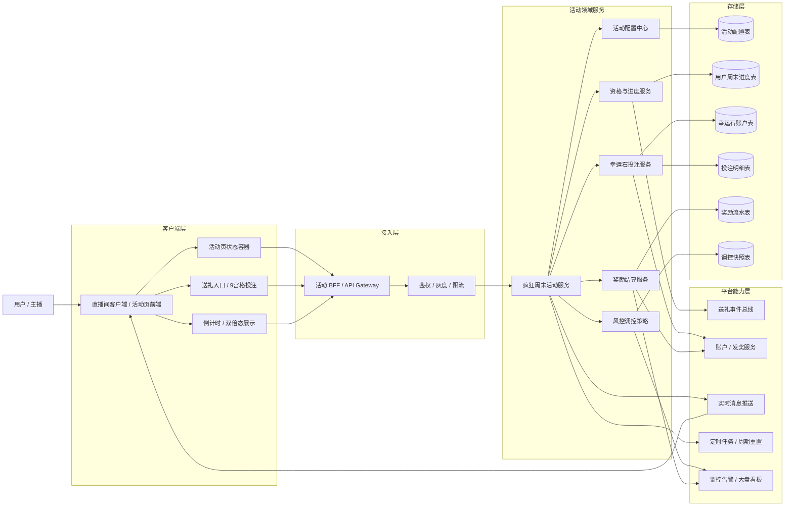
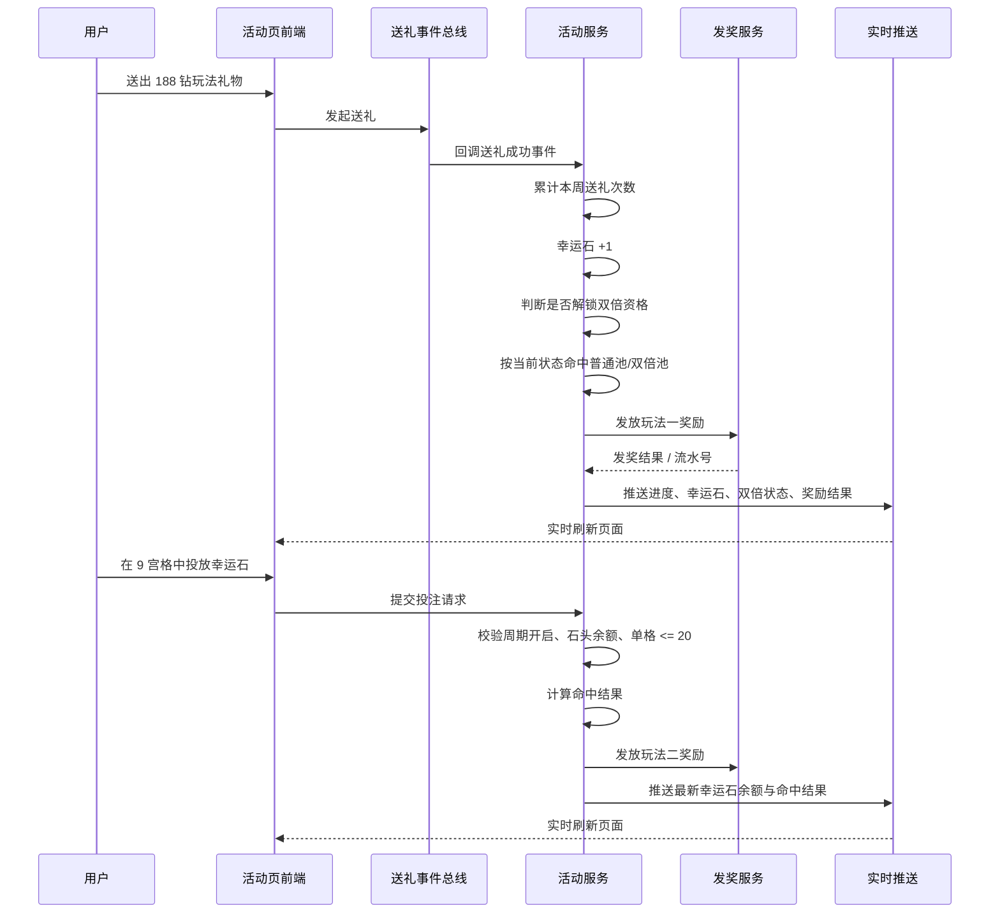
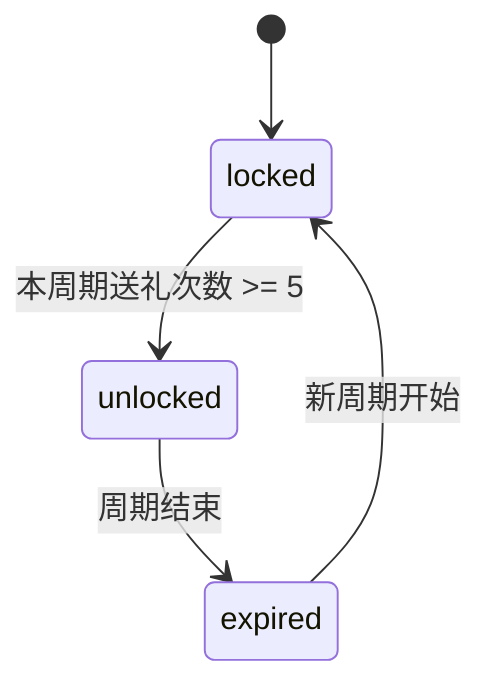
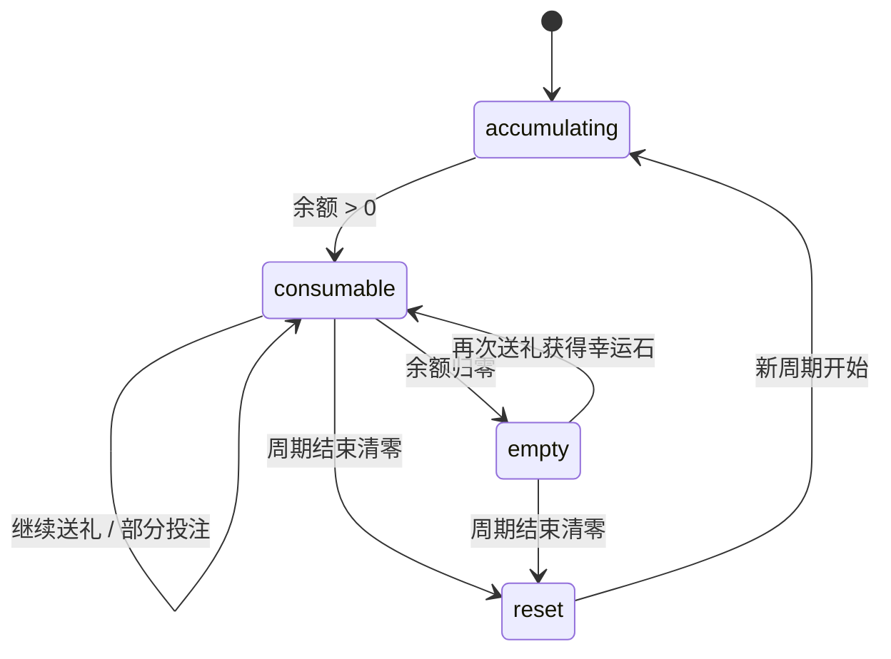

# 疯狂周末 - 架构图与实现分层

本文基于已整理的需求结论与现有静态页面稿，给出一版面向评审的系统架构图。目标不是直接约束实现细节，而是先对齐模块边界、数据流和高风险决策点。

## 1. 系统分层架构图



## 2. 核心业务流



## 3. 推荐模块职责

- `活动页前端`：只负责展示与交互编排，不承担资格、概率、倒计时真值计算。
- `活动 BFF / API Gateway`：聚合活动首页数据、投注提交、开奖记录查询，屏蔽后端拆分。
- `疯狂周末活动服务`：作为玩法编排核心，统一控制周期判断、资格切换、奖励链路和页面态。
- `资格与进度服务`：维护用户周末送礼次数、双倍解锁状态、跨房间累计口径。
- `幸运石投注服务`：维护幸运石余额、9 宫格投注明细、限额校验和命中算法。
- `奖励结算服务`：对接平台发奖能力，保证幂等、补偿、流水可追踪。
- `活动配置中心`：管理活动时间、普通池/双倍池权重、9 宫格奖项、指定双倍礼物标记。
- `风控调控策略`：根据整体消耗/产出看板动态调整后续开奖策略，但不能回写已开奖结果。

## 4. 关键数据对象

- `活动配置表`：活动时间、周末窗口、奖池权重、9 宫格配置、双倍指定礼物标记。
- `用户周末进度表`：用户维度的本周送礼次数、双倍资格状态、最近重置时间。
- `幸运石账户表`：当前可用幸运石、累计获得数、累计消耗数、周末周期标识。
- `投注明细表`：每次投注的奖品选择、投入数量、请求幂等号、开奖结果。
- `奖励流水表`：玩法一/玩法二发奖记录、用户/主播对象、发奖状态、补偿状态。
- `调控快照表`：每个统计窗口的消耗、产出、策略版本、策略生效时间。

## 5. 实时同步点

- 送礼成功后，页面上的 `送礼进度`、`幸运石数量`、`双倍状态` 需要立即同步。
- 玩法一开奖后，奖励结果需要通过实时消息或轮询兜底回到前端。
- 玩法二投注成功后，9 宫格选择态、余额、命中结果必须原子刷新，避免重复提交。
- 周日 `23:59:59` 周期重置时，需要同时清理进度、双倍资格、幸运石，并触发页面状态切换。

## 6. 当前高风险点

- `大盘调控策略` 口径不清：建议限定为“只影响后续开奖权重，不影响已开奖结果”，否则会破坏可审计性。
- `双倍奖励范围` 未明确：需要确认双倍表是否全量双发，还是只有带标记奖项双发。
- `幸运石命中算法` 未明确：建议尽快固定为“单次投注生成一次结果”还是“每个奖格独立判定”。
- `成本口径` 存在冲突：188 钻礼物里主播先得 1 钻、剩余 182 钻入池，但分析里出现 177 / 187 的投入口径，必须统一。
- `实时链路幂等` 需要明确：送礼回调重复、发奖超时、推送失败都要有补偿机制。

## 7. 建议的实现切分

1. 第一期只做固定配置玩法，不做在线动态调控，先把普通池、双倍池、幸运石链路跑通。
2. 第二期再接入大盘监控和调控策略，但策略仅允许影响未来开奖，不允许追溯改写历史。
3. 前端与服务端先对齐三个统一口径：周末周期、双倍解锁条件、幸运石命中规则。

## 8. 接口清单草案

### 8.1 活动首页

`GET /activity/crazy-weekend/home`

用途：
- 返回活动页首屏渲染所需全部聚合数据。

建议返回：

```json
{
  "activityId": "crazy_weekend_20260523",
  "serverTime": "2026-05-23T20:15:01+08:00",
  "activityStatus": "running",
  "weekCycle": {
    "cycleId": "2026W21",
    "startTime": "2026-05-23T00:00:00+08:00",
    "endTime": "2026-05-25T23:59:59+08:00",
    "countdownSeconds": 100799
  },
  "userProgress": {
    "giftCount": 3,
    "unlockThreshold": 5,
    "doubleStatus": "locked",
    "luckyStoneBalance": 10
  },
  "rewardPool": {
    "mode": "normal",
    "items": []
  },
  "bettingBoard": {
    "limitPerItem": 20,
    "awards": []
  }
}
```

### 8.2 玩法一结果查询

`GET /activity/crazy-weekend/draw-records?cursor=xxx`

用途：
- 拉取用户最近的玩法一开奖记录，给前端做结果流和兜底补拉。

### 8.3 幸运石投注提交

`POST /activity/crazy-weekend/bets`

请求建议：

```json
{
  "requestId": "uuid",
  "cycleId": "2026W21",
  "selections": [
    { "awardId": "gift_52", "stoneCount": 3 },
    { "awardId": "gift_388", "stoneCount": 7 }
  ]
}
```

返回建议：

```json
{
  "requestId": "uuid",
  "result": {
    "hitAwardId": "gift_388",
    "rewardCount": 7,
    "rewardValue": 300
  },
  "account": {
    "luckyStoneBalance": 0
  }
}
```

### 8.4 用户活动资产快照

`GET /activity/crazy-weekend/assets`

用途：
- 仅返回用户进度、幸运石、双倍资格，用于前端局部刷新或页面恢复。

### 8.5 配置下发

`GET /activity/crazy-weekend/config`

用途：
- 给前端下发不敏感展示配置，例如文案、奖池展示项、倒计时说明、双倍标记样式。
- 概率权重本身建议只保存在服务端，不直接暴露给客户端。

## 9. 关键数据表草案

### 9.1 活动配置表 `cw_activity_config`

| 字段 | 类型 | 说明 |
| --- | --- | --- |
| `id` | bigint | 主键 |
| `activity_id` | varchar | 活动标识 |
| `activity_name` | varchar | 活动名称 |
| `activity_start_time` | datetime | 总活动开始时间 |
| `activity_end_time` | datetime | 总活动结束时间 |
| `week_cycle_rule` | json | 周末周期规则 |
| `unlock_threshold` | int | 双倍解锁次数，默认 5 |
| `bet_limit_per_item` | int | 单奖品单次最大投入，默认 20 |
| `status` | tinyint | 配置状态 |
| `ext_json` | json | 扩展展示配置 |

### 9.2 奖池配置表 `cw_reward_pool_item`

| 字段 | 类型 | 说明 |
| --- | --- | --- |
| `id` | bigint | 主键 |
| `activity_id` | varchar | 活动标识 |
| `pool_type` | varchar | `normal` / `double` / `betting` |
| `award_id` | varchar | 奖品标识 |
| `award_value` | int | 礼物价值 |
| `weight` | int | 权重 |
| `reward_output` | int | 产出值 |
| `is_double_marked` | tinyint | 是否双倍指定礼物 |
| `sort_order` | int | 展示顺序 |

### 9.3 用户周末进度表 `cw_user_cycle_progress`

| 字段 | 类型 | 说明 |
| --- | --- | --- |
| `id` | bigint | 主键 |
| `activity_id` | varchar | 活动标识 |
| `cycle_id` | varchar | 周期标识 |
| `uid` | bigint | 用户 ID |
| `gift_count` | int | 本周期送礼次数 |
| `double_status` | varchar | `locked` / `unlocked` / `expired` |
| `unlocked_at` | datetime | 解锁时间 |
| `last_gift_at` | datetime | 最近送礼时间 |
| `version` | int | 乐观锁版本 |

### 9.4 幸运石账户表 `cw_lucky_stone_account`

| 字段 | 类型 | 说明 |
| --- | --- | --- |
| `id` | bigint | 主键 |
| `activity_id` | varchar | 活动标识 |
| `cycle_id` | varchar | 周期标识 |
| `uid` | bigint | 用户 ID |
| `balance` | int | 当前可用幸运石 |
| `total_acquired` | int | 累计获得 |
| `total_consumed` | int | 累计消耗 |
| `version` | int | 乐观锁版本 |
| `updated_at` | datetime | 更新时间 |

### 9.5 幸运石投注明细表 `cw_bet_order`

| 字段 | 类型 | 说明 |
| --- | --- | --- |
| `id` | bigint | 主键 |
| `request_id` | varchar | 幂等请求号 |
| `activity_id` | varchar | 活动标识 |
| `cycle_id` | varchar | 周期标识 |
| `uid` | bigint | 用户 ID |
| `selections_json` | json | 投注明细 |
| `total_stone_count` | int | 总投入幸运石 |
| `hit_award_id` | varchar | 命中奖品 |
| `reward_count` | int | 发奖份数 |
| `status` | varchar | `init` / `success` / `failed` |
| `created_at` | datetime | 创建时间 |

### 9.6 奖励流水表 `cw_reward_record`

| 字段 | 类型 | 说明 |
| --- | --- | --- |
| `id` | bigint | 主键 |
| `biz_type` | varchar | `draw` / `bet` |
| `biz_order_id` | varchar | 业务单号 |
| `activity_id` | varchar | 活动标识 |
| `cycle_id` | varchar | 周期标识 |
| `uid` | bigint | 用户 ID |
| `anchor_uid` | bigint | 主播 ID |
| `award_id` | varchar | 奖品 ID |
| `reward_count` | int | 发奖数量 |
| `reward_target` | varchar | `user` / `anchor` / `both` |
| `grant_status` | varchar | `init` / `success` / `retrying` / `failed` |
| `grant_trace_id` | varchar | 发奖链路号 |

## 10. 关键状态流转

### 10.1 双倍资格状态



### 10.2 幸运石账户状态



## 11. 服务端落地建议

- 送礼回调处理建议走事件消费，避免把玩法逻辑耦合进主送礼链路。
- `gift_count` 和 `lucky_stone_balance` 更新建议放在同一事务内，避免进度和资产错位。
- 投注接口必须强制 `requestId` 幂等，防止用户重复点击导致重复扣石和重复发奖。
- 周期重置建议用“逻辑周期号 + 惰性结转”实现，不依赖单点全量扫描清表。
- 所有开奖结果都应落奖励流水和原始入参快照，保证后续审计和申诉可追踪。

## 12. 下一步可继续拆解

1. 前端页面接口字段对照表。
2. 后端异常码与边界场景清单。
3. 玩法一 / 玩法二测试用例矩阵。
