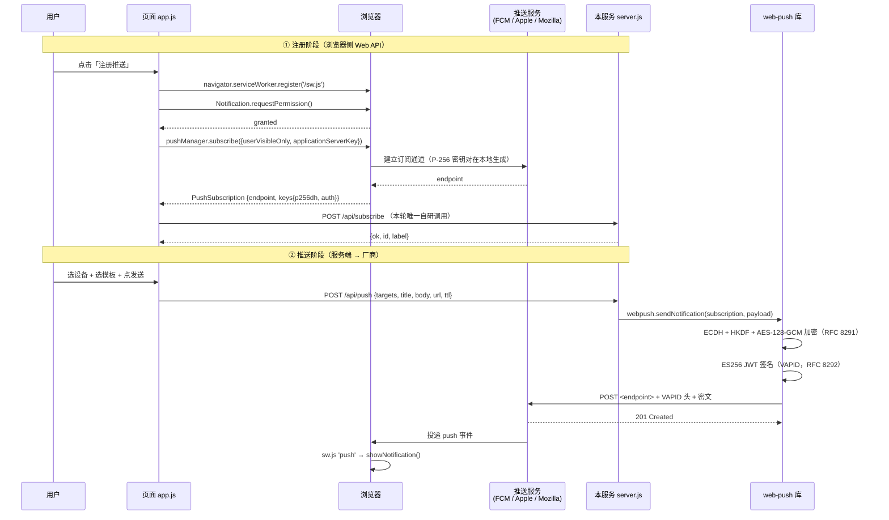

# Web Push 全链路 API 分析

> 基于本仓库源码（`server.js` / `public/app.js` / `public/sw.js` / `node_modules/web-push`）逐行梳理：
> **注册推送**和**发送推送**到底调了哪些 API。
> 所有行号均可在当前代码中 grep 到，push 服务的响应码标注来自真实实测（HTTP 201）。

## 0. 一句话结论

- **注册** = 浏览器 Web API（Service Worker + Notifications + Push API）+ 一次本服务上报（`POST /api/subscribe`）。
- **推送** = 本服务 → `web-push`（加密 + 签名）→ `POST <subscription.endpoint>` → 厂商推送服务 → 浏览器 SW 的 `push` 事件 → `showNotification`。
- **不存在统一的「推送 API」**：那个 `endpoint` 本身就是 API 地址，主机名取决于浏览器厂商（FCM / Apple / Mozilla）。

## 1. 全局架构



## 2. 注册链路（浏览器端，7 个 Web API）

代码位置：`public/app.js` 的 `subscribe()`（app.js:185 起）。

| # | 调用 | 源码位置 | 所属标准 |
| --- | --- | --- | --- |
| 1 | `navigator.serviceWorker.register('/sw.js', { scope: '/' })` | app.js:221、668 | Service Workers |
| 2 | `await navigator.serviceWorker.ready` | app.js:222、669 | Service Workers |
| 3 | `Notification.permission` | app.js:175、229 | Notifications |
| 4 | `Notification.requestPermission()` | app.js:233 | Notifications |
| 5 | `reg.pushManager.getSubscription()` | app.js:258、304、670 | Push API |
| 6 | `reg.pushManager.subscribe({ userVisibleOnly: true, applicationServerKey })` | **app.js:263** | Push API（核心） |
| 7 | `sub.toJSON()` / `sub.getKey('p256dh')` / `sub.getKey('auth')` | app.js:195、203、204 | Push API |
| 8 | `atob()`：base64url → `Uint8Array`（作为 `applicationServerKey`） | app.js:53 | Web API |

### 2.1 `subscribe()` 背后浏览器做了什么（源码看不到但真实发生）

1. 在**本地**生成一对 P-256 密钥（私钥永远不离开浏览器，只把公钥 `p256dh` 给你）。
2. 携带 `applicationServerKey`（你的 VAPID 公钥）向**厂商推送服务**建立该 origin 的订阅通道。
3. 返回 `endpoint`（该设备在该推送服务上的唯一投递地址）+ `auth` 共享密钥（16 字节）。

```js
// app.js:263 附近
const sub = await reg.pushManager.subscribe({
  userVisibleOnly: true,                                    // 浏览器强制：收到 push 必须展示通知
  applicationServerKey: urlBase64ToUint8Array(publicKey),   // VAPID 公钥
});
```

### 2.2 注册相关的其余自研调用

| 用途 | 调用 | 位置 |
| --- | --- | --- |
| 上报订阅 | `POST /api/subscribe`（body 带 `label`，如 `macOS · Chrome`） | app.js:277 |
| 取消订阅 | `sub.unsubscribe()` + `DELETE /api/subscriptions`（传 endpoint） | app.js:304–315 |
| 本地通知自检 | `reg.showNotification()`（不经过服务端） | app.js:329 |
| SW 换订阅时重注册 | `'pushsubscriptionchange'` → 页面收到 `subscription-change` 后自动重订阅 | sw.js:50、app.js:675 |

## 3. 推送链路（服务端）

### 3.1 调用栈

```
app.js:547              fetch('/api/push', POST)              ← 页面 → 本服务
  └─ server.js:245      路由 /api/push
       └─ server.js:283 webpush.sendNotification(sub, payload, {TTL})
            ├─ encryption-helper.js   ECDH P-256 → HKDF-SHA256 → AES-128-GCM（RFC 8291）
            ├─ vapid-helper.js:226    jws.sign(...) 生成 ES256 JWT
            └─ web-push-lib.js:369    https.request(POST <endpoint>)   ← 真正发出的 HTTP
```

初始化：`server.js:38 webpush.setVapidDetails(subject, publicKey, privateKey)`。

### 3.2 `web-push` 组装出的真实 HTTP 请求

（`web-push-lib.js:232` 组装，可用 `webpush.generateRequestDetails()` 打印，本仓库实测输出如下）

```http
POST https://web.push.apple.com/QLKzFR0Zq5NQGGnWiY2lKFdTNPydUSUlKOPQLNltxBkC92nRKR5f0RZbkRysP7zL6HHON6fBstG5VthR_V6DfeBwJMMYge0bBQr7JU5CHwR-FvSgRXOzPHHnRJBYP6GFQfMlmY-TbqfoDqviVQ21h1LxzGFvTaSK7x306J6D5G4
TTL: 3600                                     ← :234
Content-Type: application/octet-stream        ← :247
Content-Encoding: aes128gcm                   ← :250
Content-Length: 169                           ← :246
Authorization: vapid t=<ES256 JWT>, k=<VAPID 公钥>   ← :286
Urgency: normal                               ← :300
Topic: <可选，用于覆盖同 topic 的旧通知>        ← :303

<169 字节密文（不是明文 JSON）>
```

- `Authorization` 的 JWT 内容为 `{ aud: <推送服务 origin>, exp, sub: mailto:xxx }`，用 VAPID 私钥做 ES256 签名（`vapid-helper.js:226` 的 `jws.sign`）。
- **有 payload** 必须用 RFC 8291 加密（密钥来自订阅的 `p256dh` / `auth`），所以纯 curl 写不出来。
- **无 payload** 可以纯 curl（见 §5）。

### 3.3 各个浏览器的推送服务端点

| 浏览器 | 被 POST 的 API | 实测响应 |
| --- | --- | --- |
| Chrome / Edge | `https://fcm.googleapis.com/fcm/send/<token>` | `201 Created` |
| Safari（iOS 16.4+ / macOS） | `https://web.push.apple.com/<token>` | `201 Created` |
| Firefox | `https://updates.push.services.mozilla.com/wpush/v2/<token>` | `201 Created` |

响应码语义（`server.js` 的 `/api/push` 分支里使用）：

| 状态码 | 含义 | 本项目处理 |
| --- | --- | --- |
| 201 | 已接收投递 | 计入 `sent` |
| 400/413 | 请求/payload 非法 | 返回错误原因 |
| 401/403 | VAPID 鉴权失败（密钥不匹配） | 返回错误原因 |
| 404/410 | 订阅已失效（卸载 PWA / 清数据） | **自动从 `subscriptions.json` 删除** |
| 429 | 触发限流 | 返回错误原因 |
| 5xx | 推送服务自身故障 | 返回错误原因，保留订阅 |

### 3.4 依赖链

```
web-push@3.6.7
├── http_ece             → RFC 8291 加密（ECDH / HKDF / AES-128-GCM）
├── jws                  → VAPID 的 ES256 JWT 签名
├── asn1.js              → 密钥 DER 编解码
├── https-proxy-agent    → 可选代理
└── minimist             → CLI 参数解析
```

## 4. 接收链路（Service Worker）

代码位置：`public/sw.js`

| 事件 / 调用 | 位置 | 作用 |
| --- | --- | --- |
| `self.addEventListener('push', …)` | sw.js:10 | 收到服务端投递的推送 |
| `event.data.json()` / `event.data.text()` | sw.js:13、15 | 解析 payload |
| `self.registration.showNotification(title, options)` | sw.js:28 | **必须调**，否则 `userVisibleOnly` 下 Chrome 会报错 |
| `clients.matchAll()` + `client.postMessage()` | sw.js:38、59 | 把 payload 转发给已打开的页面（app.js:671 接收） |
| `notification.close()` + `clients.openWindow()` | sw.js:35、45 | 点通知后聚焦或新开页面 |
| `'pushsubscriptionchange'` | sw.js:50 | 订阅被浏览器更新时告知页面 |
| `skipWaiting()` / `clients.claim()` | sw.js:3、7 | SW 立即生效并接管页面 |

## 5. 三层 API 边界汇总

**A. 浏览器 Web API（W3C 标准，页面与 SW 使用）**

`ServiceWorkerContainer.register` · `ServiceWorkerRegistration.pushManager` · `PushManager.subscribe` · `PushManager.getSubscription` · `PushSubscription.unsubscribe` · `PushSubscription.toJSON` · `PushSubscription.getKey` · `Notification.requestPermission` · `Notification.close` · `ServiceWorkerRegistration.showNotification` · `Clients.matchAll` · `Clients.openWindow` · `Client.postMessage`

**B. 本地密码学算法（不是远程 API，但决定了请求形态）**

ECDH P-256 · HKDF-SHA256 · AES-128-GCM（RFC 8291）· ES256 JWT（RFC 8292 / VAPID）

**C. 厂商推送服务 HTTP API（唯一的「真·远程推送 API」）**

```
POST <subscription.endpoint>
Authorization: vapid t=<JWT>, k=<公钥>
TTL / Content-Encoding / Content-Length / Urgency / Topic
body = RFC8291 密文（或空）
```

**D. 本项目自研 HTTP 接口（`server.js`）**

| 方法 | 路径 | 位置 | 说明 |
| --- | --- | --- | --- |
| POST | `/api/subscribe` | server.js:171 | 浏览器上报订阅，按 endpoint 去重 |
| GET | `/api/subscriptions` | server.js:206 | 设备列表 |
| DELETE | `/api/subscriptions` | server.js:212 | `{id}` 删一台 / `{endpoint}` 删指定 / `{all:true}` 清空 |
| PATCH | `/api/subscriptions` | server.js:229 | 重命名设备 |
| POST | `/api/push` | server.js:245 | 推送入口，`targets` 支持 `'all'` 或 id 数组 |
| GET | `/api/vapid-public-key` | server.js:325 | 当前公钥（页面启动时用来同步默认值） |
| GET | `/api/health` | server.js:329 | 状态、设备数、依赖可用性 |
| — | `server.listen(PORT, HOST)` | server.js:373 | 默认 `0.0.0.0:25259` |

## 6. `npx web-push` CLI 手动操作

### 6.1 怎么运行

`web-push` 包自带一个 CLI（`node_modules/web-push/src/cli.js`），**只有两个子命令**：

```
web-push generate-vapid-keys [--json]
web-push send-notification --endpoint=<url> [--key=<browser key>] [--auth=<auth secret>]
                            [--payload=<message>] [--ttl=<seconds>] [--encoding=<encoding type>]
                            [--vapid-subject=<vapid subject>] [--vapid-pubkey=<public key>]
                            [--vapid-pvtkey=<private key>] [--proxy=<http proxy uri>]
                            [--gcm-api-key=<api key>]
```

三种调用方式，效果完全一样：

```bash
cd /Users/dds/data/ai/work/web-push
npx web-push ...                 # 用项目内 node_modules 里的版本（本项目推荐）
./node_modules/.bin/web-push ... # 直接执行 bin
npm i -g web-push && web-push ...# 全局安装后随处可用
```

### 6.2 生成 VAPID 公私钥

```bash
npx web-push generate-vapid-keys
```

输出（本项目正在用的这一组）：

```
=======================================

Public Key:
BPnvp8p4QdnOh4vO6-oAhxFGouHJTqY68C_4-goxBh1sphBEb1blz2FgqyEVg5JoFMBdSJKu2tDR-VLkdUNIHrQ

Private Key:
UArGsIjinVV7Lk0g3zOdkMctvWIoTzUT8jV2vayiOyQ

=======================================
```

加 `--json` 得到一行 JSON，方便喂给脚本 / 写进 env：

```bash
npx web-push generate-vapid-keys --json
# {"publicKey":"BBGuMg0uPWzBEUnmorcRqDmKAn_af0gb9bmWnzdpTTyq3En3RFePIf1SluxLufhE8sSntjfDg_S_Ov0Ay_Cjn8s","privateKey":"x1A87rhoNu39BtQNgNYtjjs1k3Wh_1dIqWsZR8J5VxQ"}
```

**两个密钥的用途完全不同**：

| 密钥 | 放哪里 | 用途 |
| --- | --- | --- |
| Public Key | 前端（页面输入框、`applicationServerKey`） | 订阅时告诉推送服务「谁在订阅」 |
| Private Key | **仅服务端**（`server.js` 顶部或环境变量） | 推送时对 VAPID JWT 做 ES256 签名 |

本项目里的配置位置（`server.js` 顶部，可用环境变量覆盖）：

```bash
export VAPID_PUBLIC_KEY='BPnvp8p4...'
export VAPID_PRIVATE_KEY='UArGsIjin...'
export VAPID_SUBJECT='mailto:duzhenxun@126.com'
```

> ⚠️ **换密钥 = 所有旧订阅作废**。推送服务会返回 403 `UnauthorizedRegistration`，因为订阅时绑定的就是旧公钥；必须让每台设备重新点「注册推送」。

### 6.3 手动发一条推送（`send-notification`）

这是一个**实测通过**的完整命令（输出 `Push message sent.`）：

```bash
cd /Users/dds/data/ai/work/web-push

npx web-push send-notification \
  --endpoint='https://web.push.apple.com/QE1ggrGe5hdwXfUeaq_JyLM0jQvXVY4ylK-4bfZCeiVI6yHZadUN84tCVlh2KL_HJeVvqLe9ZtfA7yPRCfJgnJ-f8uPdN3N8NHqcu7VuXOtNp-JQTaKGLUHS9o4Ka8Gkq60DheVA7_Ycc04itPtnqlzVPmg43nxtExAM8HEln6U' \
  --key='BCmpSAsQObxxgCqmGg-HcQpKJQK8iJLtjrnmJD8b3G3Hlcf6IrKuOXBbn7XMiKWzSm1yspYIgxLzZFDWWkCBVGY' \
  --auth='vzF2CxbJdYEhAIOu6GhkqA' \
  --payload='{"title":"测试通知","body":"iOS PWA推送成功！","url":"/"}' \
  --ttl=3600 \
  --vapid-subject='mailto:duzhenxun@126.com' \
  --vapid-pubkey='BPnvp8p4QdnOh4vO6-oAhxFGouHJTqY68C_4-goxBh1sphBEb1blz2FgqyEVg5JoFMBdSJKu2tDR-VLkdUNIHrQ' \
  --vapid-pvtkey='UArGsIjinVV7Lk0g3zOdkMctvWIoTzUT8jV2vayiOyQ'

# → Push message sent.        （失败时会打印推送服务返回的错误，如 410 / 403）
```

参数对照表（注意**不是**把整个 subscription JSON 丢进去，要拆成三个参数）：

| CLI 参数 | 取值来源 | 对应源码里的什么 |
| --- | --- | --- |
| `--endpoint` | `subscription.endpoint` | POST 的目标 URL（必须去掉首尾空格） |
| `--key` | `subscription.keys.p256dh` | 浏览器公钥，用于 RFC8291 加密 |
| `--auth` | `subscription.keys.auth` | 认证密钥（16 字节 base64url） |
| `--payload` | 任意字符串（通常是 JSON） | 加密后放进 body，SW 里 `event.data.json()` 解析 |
| `--ttl` | 秒，默认 4 周 | 离线保留时长，对应 `TTL` 请求头 |
| `--encoding` | `aes128gcm`（默认）/ `aesgcm` | 即 `Content-Encoding` 头 |
| `--vapid-subject` | `mailto:xxx` 或 `https://xxx` | VAPID JWT 的 `sub` 字段 |
| `--vapid-pubkey` / `--vapid-pvtkey` | §6.2 生成的两个 key | VAPID JWT 签名与 `k=` 参数 |
| `--proxy` | `http://host:port` | 走代理发出请求 |
| `--gcm-api-key` | 老版 FCM key | 已废弃，现代浏览器不需要 |

> CLI 的 `send-notification` 等价于在代码里调 `webpush.sendNotification(subscription, payload, { TTL })` —— 见 §3.1 的调用栈。

### 6.4 常见报错对照

| 现象 | 原因 | 解决 |
| --- | --- | --- |
| 只打印 `Usage:` 一大段，什么都没发 | 子命令写成了 `web-push send`（不存在），CLI 只认 `send-notification` / `generate-vapid-keys` | 改成 `send-notification` |
| `--subscription` 被忽略 / 报未知参数 | CLI 不支持传整个 subscription JSON | 拆成 `--endpoint` / `--key` / `--auth` |
| 报缺少 key 或 `p256dh value should be 65 bytes long` | 没给 `--key` / `--auth`，或公钥被截断、复制时漏字符 | 从页面重新复制 `keys`，或调 `/api/subscriptions` 取 |
| 只给 `--vapid-pvtkey` 不生效 | VAPID 必须同时给公钥和私钥 | 补上 `--vapid-pubkey` |
| `URI malformed` / URL 非法 | endpoint 结尾多了空格，或被 Markdown 包成 `[https://…](https://…)` | 去掉空格与方括号，只留纯净 URL |
| `401` / `403 UnauthorizedRegistration` | VAPID 密钥与生成该订阅时的公钥不一致 | 用回原密钥，或让设备重新注册 |
| `404` / `410` | 订阅已失效（卸载 PWA、清数据、换浏览器） | 该设备重新点「注册推送」 |
| `413` | payload 过大 | 缩短内容（各推送服务限制约 4KB） |

## 7. 附录

### 7.1 纯 curl 推送（无 payload 模式，不需要加密）

```bash
node scripts/raw-request.js          # 只打印请求头 + 等价 curl
node scripts/raw-request.js --send   # 真的发出（实测 201 Created）
```

脚本自己算 ES256 JWT、手工拼 VAPID 头，证明**推送协议本身不依赖任何库**，只有那 169 字节密文需要 `http_ece`。

### 7.2 三种推送方式速查（详情见 §6.3）

```bash
# ① web-push CLI（子命令 send-notification，参数拆开，完整示例见 §6.3）
npx web-push send-notification \
  --endpoint='<endpoint>' --key='<p256dh>' --auth='<auth>' \
  --payload='{"title":"标题","body":"内容"}' --ttl=3600 \
  --vapid-subject='mailto:you@example.com' \
  --vapid-pubkey='<VAPID 公钥>' --vapid-pvtkey='<VAPID 私钥>'

# ② 本项目脚本（自动读 subscriptions.json，逐个发并清理失效订阅）
npm run send -- "标题" "内容"

# ③ 本项目 API（页面用的就是这条；顺便加密由服务端代劳）
curl -X POST http://localhost:25259/api/push -H 'Content-Type: application/json' \
  -d '{"targets":"all","title":"标题","body":"内容","url":"/","ttl":3600}'
```

### 7.3 安全提醒

- VAPID **私钥只在服务端**（`server.js` 顶部 / 环境变量），一旦泄漏，任何人可冒充你推送。
- 本项目 API 默认**无鉴权**，公网暴露等于公开「给所有设备推任意内容 + 读取/清空订阅列表」的能力，建议加 `PUSH_TOKEN`。
- 推送权限按 **origin** 隔离：`localhost:25259`、`push.example.com` 是两个独立订阅源。
